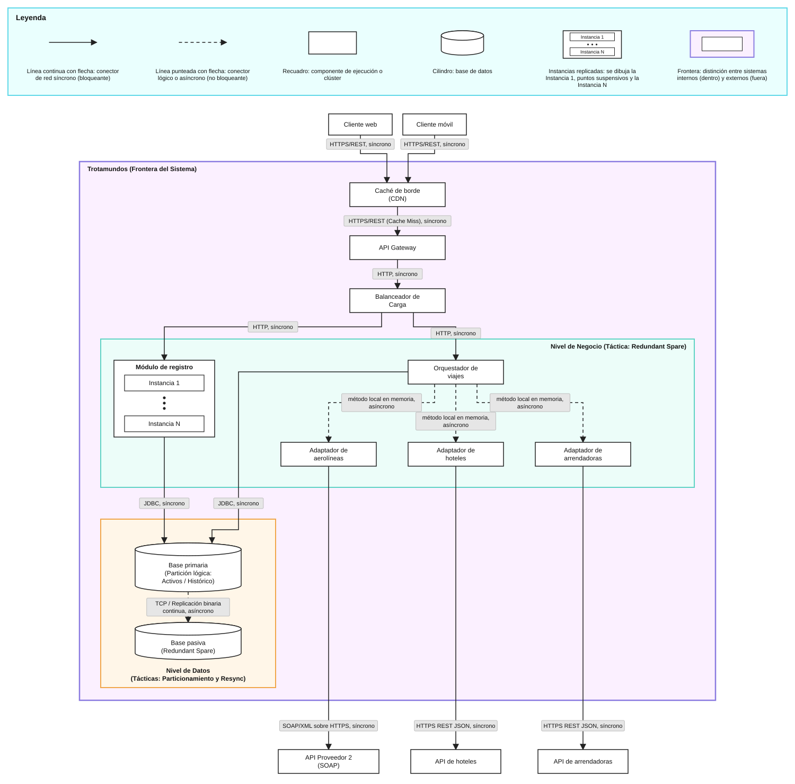

# Trotamundos — iteración 1

| Campo                       | Valor                                                                                                  |
| --------------------------- | ------------------------------------------------------------------------------------------------------ |
| **Ronda**                   | 1                                                                                                      |
| **Arranque**                | Greenfield. Se refina el sistema mediante la descomposición que fija la topología del Core.            |
| **Qué toma esta iteración** | La topología del Core para la consulta del viajero, con la escala y los tiempos de respuesta del goal. |

El paso 1 de la ronda está en [README.md](README.md).

## Paso 2. Establecer el goal

| Id           | En el goal o afuera                                                                                         |
| ------------ | ----------------------------------------------------------------------------------------------------------- |
| `REF-01`     | En el goal. Las reservas se agrupan por viaje y, al completarse, se archivan o salen de la vista principal. |
| `QA-PER-02`  | En el goal. Nueva cotización desde la web, en 800 ms.                                                       |
| `QA-PER-03`  | En el goal. El usuario abre la aplicación móvil y el primer contenido aparece en menos de 1,4 s.            |
| `QA-ESC-01`  | En el goal. Registro masivo de 100.000 usuarios nuevos por día.                                             |
| `CON-01`     | En el goal. Las dos versiones son necesarias: web y móvil.                                                  |
| `CON-02`     | En el goal. La integración con aerolíneas, hoteles, arrendadoras y correo es por APIs.                      |
| `REF-02`     | Afuera. Sondear el correo y agregar al itinerario las reservas de los mensajes de viaje.                    |
| `REF-03`     | Afuera. Filtrar y armar whitelists de remitentes de correos de viaje.                                       |
| `REF-04`     | Afuera. Agregar, actualizar o eliminar una reserva a mano.                                                  |
| `REF-05`     | Afuera. Resolver un problema con la agencia de viajes preferida.                                            |
| `REF-06`     | Afuera. Consultas analíticas de tendencias, destinos y cancelaciones.                                       |
| `QA-PER-01`  | Afuera. Actualización de una API externa.                                                                   |
| `QA-INT-01`  | Afuera. Integrar la API propietaria de una cadena hotelera nueva.                                           |
| `QA-PER-04*` | Afuera. Consulta de tendencias, destinos y cancelaciones.                                                   |
| `QA-DIS-01`  | Afuera. Caída de un nodo de cotización.                                                                     |
| `QA-INT-02`  | Afuera. Incorporar Instagram como canal de propuestas e itinerarios.                                        |
| `QA-SEG-01`  | Afuera. Ráfaga de recuperación de contraseña.                                                               |
| `QA-SEG-02`  | Afuera. Registrar una actividad en el itinerario compartido.                                                |
| `QA-SEG-03*` | Afuera. El titular autoriza la lectura de su correo.                                                        |
| `QA-EVO-01`  | Afuera. Integrar un medio de transporte que el panel todavía no agrupa.                                     |
| `QA-USA-01`  | Afuera. El viajero consulta su viaje en el móvil, con una capacidad nativa como el GPS.                     |

**Goal.** El objetivo de esta iteración es definir la topología global del Core de la plataforma Trotamundos para que las reservas se agrupen por viaje y, al completarse, se archiven o salgan de la vista principal (`REF-01`). Las dos versiones son necesarias, web y móvil (`CON-01`). Una cotización nueva responde en 800 ms desde la web (`QA-PER-02`). Al abrir la aplicación móvil, el primer contenido aparece en menos de 1,4 s (`QA-PER-03`). El Core atiende el registro de `QA-ESC-01`: 100.000 usuarios nuevos por día, con confirmación en menos de 2 segundos. La integración con aerolíneas, hoteles, arrendadoras y correo es por APIs (`CON-02`).

## Paso 3. Elegir los elementos a refinar

| Elemento   | Por qué este                                                                                                                                                                                                            | Movimiento  |
| ---------- | ----------------------------------------------------------------------------------------------------------------------------------------------------------------------------------------------------------------------- | ----------- |
| El sistema | Reúne `REF-01` en la web y en el móvil (`CON-01`, `QA-PER-02`, `QA-PER-03`), el registro masivo de `QA-ESC-01` y las APIs de `CON-02`. La iteración establece la topología de ese Core como descomposición del sistema. | Descomponer |

El sistema se descompone para fijar la topología del Core: el punto en el que el viajero consulta sus reservas agrupadas por viaje, desde la web y desde el móvil.

## Paso 4. Elegir los conceptos de diseño

| Alternativa                                | Tipo                        | Beneficia                                                                                                         | Perjudica                                                                                                                                                            | Queda |
| ------------------------------------------ | --------------------------- | ----------------------------------------------------------------------------------------------------------------- | -------------------------------------------------------------------------------------------------------------------------------------------------------------------- | ----- |
| N-Tier (capas / three-tier)                | Estilo                      | Separa presentación, lógica de negocio y datos, sobre una base tradicional y probada (`QA-ESC-01`, `QA-INT-01`).  | Las capas se escalan juntas con menos granularidad que servicios independientes, se sacrifica Escalabilidad                                                          | Sí    |
| Microservicios                             | Estilo                      | Servicios independientes y cohesivos (ej. Usuarios, Cotizaciones).                                                | Suma complejidad operativa y de coordinación distribuida.                                                                                                            | No    |
| Micro-kernel (plugins)                     | Estilo                      | Kernel mínimo con funcionalidades acoplables; alta extensibilidad local.                                          | Menos apto para despliegues distribuidos de alta concurrencia (`QA-ESC-01`, `QA-PER-02`).                                                                            | No    |
| Redundant spare                            | Táctica (disponibilidad)    | Un componente duplicado toma el control si falla el primario (hot, warm o cold spare) (`QA-DIS-01`).              | Costo de mantener componentes duplicados. Se paga en latencia, siendo que la comunicacion entre ellos es sincrona                                                    | Sí    |
| State resynchronization                    | Táctica (disponibilidad)    | Mantiene sincronizado el estado entre el componente activo y el de respaldo (ej. checksum o hash).                | Tráfico y lógica extra para sincronizar.                                                                                                                             | Sí    |
| Heartbeat                                  | Táctica (disponibilidad)    | El componente vigilado emite mensajes periódicos a un monitor.                                                    | Agrega mensajería de monitoreo.                                                                                                                                      | No    |
| Ping/Echo                                  | Táctica (disponibilidad)    | El adaptador envía un ping a la API de su productor y el eco indica que esa API responde (`QA-PER-02`, `CON-02`). | Agrega un pedido de alcance hacia cada API externa (Mayor trafico de red).                                                                                           | Sí    |
| Múltiples copias de datos (caché)          | Táctica (performance)       | Guarda cotizaciones previas y respuestas estáticas (`QA-PER-02`).                                                 | Podrian existir invalidaciones de cache, por datos desactualizados en estas memorias rapidas. Se perjudica a la Consistencia de los datos.                           | Sí    |
| Procesamiento concurrente (Scatter-Gather) | Táctica (performance)       | Paraleliza consultas a varios orígenes y evita sumar latencias en forma lineal (`QA-PER-02`).                     | Más complejidad de coordinación y manejo de respuestas parciales(Menor mantenibilidad). No necesariamente mejora Latencia en algunos casos debido a Race conditions. | Sí    |
| Priorización de recursos                   | Táctica (performance)       | Da más hilos a transacciones críticas (ej. cotizaciones web) frente a reportes analíticos.                        | Requiere políticas de asignación.                                                                                                                                    | No    |
| Capa Anti-Corrupción (ACL) / Adaptadores   | Táctica (interoperabilidad) | Aísla el modelo de dominio interno del contrato externo (`QA-INT-01`).                                            | Una capa extra de traducción. Se paga en Performance(Latencia)                                                                                                       | Sí    |
| API Gateway                                | Táctica (interoperabilidad) | Unifica el punto de entrada para clientes móviles y web.                                                          | (SPOF)Es un punto único que hay que dimensionar y hacer redundante. El costo podria asumirse en Seguridad y/o disponibilidad.                                        | Sí    |
| Service Discovery                          | Táctica (interoperabilidad) | Registro dinámico de endpoints internos, sin IPs fijas.                                                           | Componente adicional de infraestructura.                                                                                                                             | No    |

Tácticas que quedan: Redundant spare, State resynchronization, Ping/Echo, Múltiples copias de datos (caché), Procesamiento concurrente (Scatter-Gather), Capa Anti-Corrupción (ACL) / Adaptadores y API Gateway.

Prototipo throwaway: ninguno por ahora.

## Paso 5. Instanciar, asignar y definir interfaces

En esta iteración greenfield los elementos son los bloques de la macro-arquitectura. El N-Tier queda en tres tiers. El componente de integración vive dentro del tier de negocio: es el subsistema de adaptadores que habla con las APIs de `CON-02`.

Registro, orquestador y adaptadores se despliegan como la misma capa. El clúster agrega copias idénticas de esa capa, que es el costo que el paso 4 aceptó al quedarse con N-Tier.

### Tier 1. Presentación y borde

| Elemento                     | Responsabilidad                                                                                                                                                                                                                                                                                                                                                                                                                                          | Interfaz                                                                                                                                                                                                                                      |
| ---------------------------- | -------------------------------------------------------------------------------------------------------------------------------------------------------------------------------------------------------------------------------------------------------------------------------------------------------------------------------------------------------------------------------------------------------------------------------------------------------- | --------------------------------------------------------------------------------------------------------------------------------------------------------------------------------------------------------------------------------------------- |
| Cliente web                  | Pide la vista principal, la cotización y el alta. Renderiza la grilla de precios (`QA-PER-02`, `REF-01`, `CON-01`).                                                                                                                                                                                                                                                                                                                                      | Hacia el gateway, por HTTPS REST: vista principal del viajero; cotización con fecha, hospedaje y compañía; alta de cuenta. Desde el gateway: viajes de la vista principal, grilla de precios o confirmación de cuenta.                        |
| Cliente móvil                | Al abrirse muestra el login. Pide al borde los recursos estáticos de ese primer contenido (`QA-PER-03`). Después del login pide la vista principal y el alta (`CON-01`, `QA-ESC-01`).                                                                                                                                                                                                                                                                    | Hacia el gateway, por HTTPS REST: recursos estáticos del primer contenido y, luego, el mismo intercambio del cliente web para la vista principal y el alta.                                                                                   |
| API Gateway y caché de borde | Único punto de entrada público de la web y del móvil (`CON-01`). Valida la sesión con el módulo de registro y reparte el pedido. La caché de borde guarda recursos estáticos, respuestas frecuentes y la grilla ya consolidada de una fecha, un hospedaje y una compañía (`QA-PER-02`, `QA-PER-03`). Una escritura nueva de esos tres criterios reemplaza la copia. Una copia del gateway toma el punto de entrada cuando la primaria deja de responder. | Externa: HTTPS REST hacia internet, para los dos clientes. Interna: HTTP o gRPC hacia el balanceador del tier de negocio. La caché se consulta en el mismo borde. Hacia el cliente: el recurso estático, la grilla o la respuesta del módulo. |

### Tier 2. Lógica de negocio

El tier se instancia con redundant spare: un clúster de nodos idénticos detrás del balanceador. Cada pedido lo procesa un nodo. El clúster toma las cotizaciones concurrentes de `QA-PER-02` y las altas de `QA-ESC-01`. La táctica queda citada desde `QA-DIS-01`, que sigue afuera del goal.

| Elemento                             | Responsabilidad                                                                                                                                                                                                                                                                                       | Interfaz                                                                                                                                                                                                                                                                                                                                                                                                                                                                                                             |
| ------------------------------------ | ----------------------------------------------------------------------------------------------------------------------------------------------------------------------------------------------------------------------------------------------------------------------------------------------------- | -------------------------------------------------------------------------------------------------------------------------------------------------------------------------------------------------------------------------------------------------------------------------------------------------------------------------------------------------------------------------------------------------------------------------------------------------------------------------------------------------------------------- |
| Balanceador                          | Entrega cada pedido a un nodo del clúster.                                                                                                                                                                                                                                                            | Desde el gateway: HTTP o gRPC, con el pedido ya encaminado a registro o al orquestador. Hacia un nodo: ese mismo pedido.                                                                                                                                                                                                                                                                                                                                                                                             |
| Módulo de registro                   | Procesa el alta, aprovisiona el perfil y habilita el inicio de sesión inmediato (`QA-ESC-01`). Valida la sesión cuando el gateway se lo pide.                                                                                                                                                         | `IRegistroUsuario`, consumida por el gateway a través del balanceador: alta de cuenta, o validación de sesión. Hacia la base primaria: cuenta, perfil y sesión. Hacia el gateway: confirmación de alta, o sesión válida.                                                                                                                                                                                                                                                                                             |
| Orquestador de viajes y cotizaciones | Core. Agrupa las reservas por viaje y, cuando el viaje se completa, lo archiva o lo saca de la vista principal (`REF-01`). En la cotización aplica scatter-gather: dispara en paralelo la consulta de precio a los adaptadores y consolida la grilla con los orígenes que respondieron (`QA-PER-02`). | Servicios internos, alcanzados por el balanceador. Desde el gateway: vista principal de un viajero, o fecha, hospedaje y compañía. Hacia la base primaria: viajes, reservas y la marca de archivado o de salida de la vista. Hacia los adaptadores: los contratos internos (`IProveedorInventario`, `ICotizadorHotel` y los equivalentes de aerolínea, arrendadora y correo). Hacia el gateway: viajes de la vista principal, o la grilla consolidada.                                                               |
| Adaptadores (ACL)                    | Un adaptador por contraparte de `CON-02`: aerolíneas, hoteles, arrendadoras y correo. Traduce el JSON o XML del proveedor al modelo interno de Trotamundos. Instancian la ACL del paso 4 (`QA-INT-01`). Cada uno emplea ping/echo contra la API de su productor.                                      | Interna: el adaptador implementa el contrato que el orquestador invoca, y es dueño del cliente HTTP hacia afuera. Externa: HTTP, REST o SOAP, hacia la API del proveedor: el ping de alcance y, con eco, el pedido de disponibilidad y precio. Desde la API: el eco, o el silencio pasado el umbral del adaptador. El contrato concreto lo fija el proveedor. El adaptador de correo queda con ese mismo par de interfaces para `CON-02`. El sondeo del correo es `REF-02` y esta iteración lo dejó afuera del goal. |

### Tier 3. Acceso a datos

| Elemento                                | Responsabilidad                                                                                                                                                                                                                                                                                                                  | Interfaz                                                                                                                                                                                                     |
| --------------------------------------- | -------------------------------------------------------------------------------------------------------------------------------------------------------------------------------------------------------------------------------------------------------------------------------------------------------------------------------- | ------------------------------------------------------------------------------------------------------------------------------------------------------------------------------------------------------------ |
| Base de datos principal (activo/pasivo) | El nodo primario persiste cuentas, perfiles, sesiones, viajes activos y el archivo de viajes completados (`REF-01`). Replica su estado transaccional al nodo pasivo. State resynchronization: los dos nodos comparan ese estado por checksum en una red privada. Cuando el primario deja de atender, el pasivo asume el tráfico. | Desde el registro y el orquestador: conexiones al nodo que atiende las escrituras, con un protocolo de base de datos (JDBC u ODBC). Entre primario y pasivo: la red privada de sincronización y el checksum. |

### Ping/echo

La táctica la emplean los adaptadores, y cada uno contra la API de su productor. El adaptador inicia el par: envía el ping y espera el eco. El eco indica que esa API responde y da el retardo de ida y vuelta. El umbral de espera es propiedad del adaptador; los drivers no lo fijan en milisegundos. Los tres adaptadores de la cotización envían el ping a la vez, así las esperas no se suman entre productores.

Con echo, el adaptador sigue por la misma interfaz externa y pide disponibilidad y precio. Sin eco dentro del umbral, devuelve al orquestador que ese origen no respondió, y el pedido de precio a esa API no sale. El orquestador arma la grilla con los orígenes que sí respondieron (`QA-PER-02`).

| Adaptador                 | API a la que hace ping | Eco                             | Efecto                                                                                                                                                      |
| ------------------------- | ---------------------- | ------------------------------- | ----------------------------------------------------------------------------------------------------------------------------------------------------------- |
| Adaptador de aerolíneas   | API de aerolíneas      | Respuesta de alcance de esa API | Con eco, traduce el precio al modelo interno. Sin eco, la aerolínea queda fuera de la grilla.                                                               |
| Adaptador de hoteles      | API de hoteles         | Respuesta de alcance de esa API | Con eco, traduce el precio. Sin eco, el hotel queda fuera de la grilla. El contrato interno de esta rama es `ICotizadorHotel`.                              |
| Adaptador de arrendadoras | API de arrendadoras    | Respuesta de alcance de esa API | Con eco, traduce el precio. Sin eco, la arrendadora queda fuera de la grilla.                                                                               |
| Adaptador de correo       | API de correo          | Respuesta de alcance de esa API | Misma verificación, porque `CON-02` incluye esa API. La cotización de esta iteración no lo llama. El sondeo del correo es `REF-02` y quedó afuera del goal. |

### Relaciones permitidas

- Cliente web y cliente móvil → API Gateway.
- API Gateway → caché de borde.
- API Gateway → balanceador → un nodo de registro o un nodo del orquestador.
- Módulo de registro → base primaria.
- Orquestador → base primaria.
- Orquestador → adaptadores de aerolíneas, hoteles y arrendadoras, en paralelo.
- Cada adaptador → la API de su productor: ping/echo y, con eco, el pedido de disponibilidad y precio.
- Base primaria → base pasiva.

### Secuencia

**Apertura del móvil** (`QA-PER-03`). El usuario abre la aplicación. El cliente pide al gateway los recursos estáticos del primer contenido. La caché de borde los sirve desde memoria y el cliente renderiza el formulario de login.

**Consulta del panel** (`REF-01`, `CON-01`). El cliente web, o el móvil después del login, pide la vista principal. El gateway valida la sesión con el módulo de registro, a través del balanceador, y entrega la consulta a un nodo del orquestador. El orquestador lee los viajes en la base primaria, los agrupa y devuelve los que siguen en la vista principal. El cliente muestra esa vista.

**Cotización desde la web** (`QA-PER-02`). El cliente web envía fecha, hospedaje y compañía por HTTPS. El gateway valida la sesión con registro. Si la caché de borde tiene la grilla de esos criterios, la devuelve. Si no la tiene, el balanceador entrega el pedido a un nodo del orquestador. Ese nodo pide a la vez a los adaptadores de aerolíneas, hoteles y arrendadoras. Cada adaptador envía el ping a la API de su productor. Con eco, pide el precio y lo traduce al modelo interno. Sin eco dentro de su umbral, devuelve ese origen como no respondido. El orquestador arma la grilla con los orígenes que respondieron. El gateway la guarda en la caché de borde, reemplaza la copia anterior de esos criterios y el cliente web la renderiza.

**Registro** (`QA-ESC-01`). El cliente envía el alta al gateway. El balanceador la entrega a un nodo del módulo de registro. Registro escribe la cuenta y el perfil en la base primaria, el primario replica el estado al pasivo y el cliente recibe la confirmación. El recorrido es gateway, balanceador, registro y base.

## Paso 6. Bosquejar y registrar la decisión

### Estructura

**Epígrafe.** Vista de componentes y conectores del Core de Trotamundos. Busca exponer las unidades de ejecución y la interacción entre ellas: el borde, el nivel de negocio y el de datos, los conectores síncronos y asíncronos, y la frontera del sistema frente a los clientes y a las APIs de los proveedores.

### Catálogo

Decisiones de diseño registradas en [ADRs/ITERACION_1](ADRs/ITERACION_1/).

| ID      | Decisión                                                                                   | Estado    |
| ------- | ------------------------------------------------------------------------------------------ | --------- |
| ADR-001 | [Estilo arquitectónico del Core: N-Tier](ADRs/ITERACION_1/ADR-001.md)                      | aceptado  |
| ADR-002 | [Disponibilidad: Redundant spare](ADRs/ITERACION_1/ADR-002.md)                             | aceptado  |
| ADR-003 | [Disponibilidad: State resynchronization](ADRs/ITERACION_1/ADR-003.md)                     | propuesto |
| ADR-004 | [Disponibilidad: Ping/Echo](ADRs/ITERACION_1/ADR-004.md)                                   | aceptado  |
| ADR-005 | [Performance: Múltiples copias de datos (caché)](ADRs/ITERACION_1/ADR-005.md)              | aceptado  |
| ADR-006 | [Performance: Procesamiento concurrente (Scatter-Gather)](ADRs/ITERACION_1/ADR-006.md)     | aceptado  |
| ADR-007 | [Interoperabilidad: Capa Anti-Corrupción (ACL) / Adaptadores](ADRs/ITERACION_1/ADR-007.md) | aceptado  |
| ADR-008 | [Interoperabilidad: API Gateway](ADRs/ITERACION_1/ADR-008.md)                              | aceptado  |
| ADR-009 | [Estilo arquitectónico: Microservicios](ADRs/ITERACION_1/ADR-009.md)                       | rechazado |
| ADR-010 | [Disponibilidad: Heartbeat](ADRs/ITERACION_1/ADR-010.md)                                   | rechazado |
| ADR-011 | [Estilo arquitectónico: Micro-kernel (plugins)](ADRs/ITERACION_1/ADR-011.md)               | rechazado |
| ADR-012 | [Performance: Priorización de recursos](ADRs/ITERACION_1/ADR-012.md)                       | rechazado |
| ADR-013 | [Interoperabilidad: Service Discovery](ADRs/ITERACION_1/ADR-013.md)                        | rechazado |

## Paso 7. Analizar y revisar el purpose

| Id del goal | Estado     | Una oración                                                                                                                                                                                                                                                                     |
| ----------- | ---------- | ------------------------------------------------------------------------------------------------------------------------------------------------------------------------------------------------------------------------------------------------------------------------------- |
| `REF-01`    | Completely | El orquestador agrupa las reservas por viaje y las archiva o saca de la vista principal, con su interfaz definida hacia la base.                                                                                                                                                |
| `CON-01`    | Completely | El API Gateway es el único punto de entrada de la web y del móvil ([ADR-008](ADRs/ITERACION_1/ADR-008.md)).                                                                                                                                                                     |
| `CON-02`    | Completely | Hay un adaptador ACL por contraparte ([ADR-007](ADRs/ITERACION_1/ADR-007.md)) y Ping/Echo verifica el alcance de cada API ([ADR-004](ADRs/ITERACION_1/ADR-004.md)).                                                                                                             |
| `QA-PER-02` | Partially  | Caché y Scatter-Gather ([ADR-005](ADRs/ITERACION_1/ADR-005.md), [ADR-006](ADRs/ITERACION_1/ADR-006.md)) atacan los 800 ms, pero el umbral de espera del ping no está fijado en ms, no se definió qué hace el sistema cuando una API no responde y la medida no está verificada. |
| `QA-PER-03` | Partially  | La caché de borde sirve el primer contenido, pero el FCP de 1,4 s en 3G no está verificado y la app móvil no tiene diseño interno.                                                                                                                                              |
| `QA-ESC-01` | Partially  | El clúster N-Tier absorbe el registro ([ADR-001](ADRs/ITERACION_1/ADR-001.md)), pero no hay decisión sobre la distribución entre continentes ni sobre el escalado de escrituras con una sola base primaria.                                                                     |
| `QA-DIS-01` | Partially  | Redundant spare está aceptado ([ADR-002](ADRs/ITERACION_1/ADR-002.md)), pero la sincronización de estado entre respaldo y principal es solo una propuesta ([ADR-003](ADRs/ITERACION_1/ADR-003.md)), así que no se asegura no perder peticiones en vuelo.                        |

| Pregunta                    | Respuesta                                                                                                                                                                                                                                                                                                                                                                                                                                                                                                                                                                                                                                                                                                                                                                                    |
| --------------------------- | -------------------------------------------------------------------------------------------------------------------------------------------------------------------------------------------------------------------------------------------------------------------------------------------------------------------------------------------------------------------------------------------------------------------------------------------------------------------------------------------------------------------------------------------------------------------------------------------------------------------------------------------------------------------------------------------------------------------------------------------------------------------------------------------- |
| ¿Se cumplió el goal?        | Parcialmente. La topología del Core quedó fijada y cubre `REF-01`, `CON-01` y `CON-02`. `QA-PER-02`, `QA-PER-03`, `QA-ESC-01` y `QA-DIS-01` quedan parciales por decisiones diferidas.                                                                                                                                                                                                                                                                                                                                                                                                                                                                                                                                                                                                       |
| Purpose de la ronda         | Arquitectura greenfield del panel de viajes en web y móvil, guiada por los escenarios de [LISTADO_DRIVERS.md](LISTADO_DRIVERS.md) ([README.md](README.md), paso 1).                                                                                                                                                                                                                                                                                                                                                                                                                                                                                                                                                                                                                          |
| ¿Hace falta otra iteración? | Sí.                                                                                                                                                                                                                                                                                                                                                                                                                                                                                                                                                                                                                                                                                                                                                                                          |
| Entra en la siguiente       | 1) Qué hace el sistema cuando Ping/Echo detecta una API caída: el orquestador ya arma la grilla con los orígenes que responden, pero falta decidir reintentos, degradación y aviso al usuario (`QA-PER-02`, `QA-DIS-01`). 2) Mecanismo de State resynchronization entre el componente de respaldo y el principal, por ejemplo checksum o hash ([ADR-003](ADRs/ITERACION_1/ADR-003.md), propuesto). 3) Umbral de espera del ping, en ms. 4) Escalado y distribución geográfica del registro y de la base (`QA-ESC-01`). 5) Diseño interno de la app móvil y verificación del FCP (`QA-PER-03`). 6) Los ids que quedaron afuera del goal siguen en `Not Yet`: `QA-PER-01`, `QA-PER-04*`, `QA-INT-01`, `QA-INT-02`, `QA-SEG-01` a `QA-SEG-03*`, `QA-EVO-01`, `QA-USA-01` y `REF-02` a `REF-06`. |

**NOTA**: FALTAN TARDE-OFFS EN LOS ADRs, mas analisis, una vista de asignacion de momento seria  apresurado, podria hacerse zoom sobre el orquestador y exponer una vista estatica(modulos)  