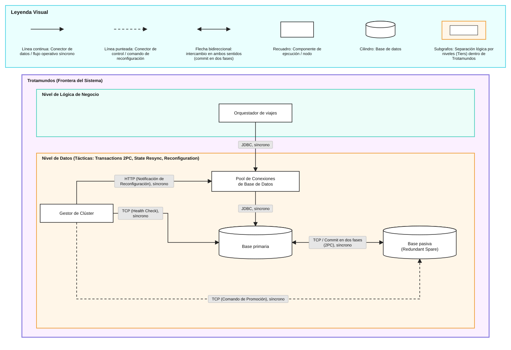
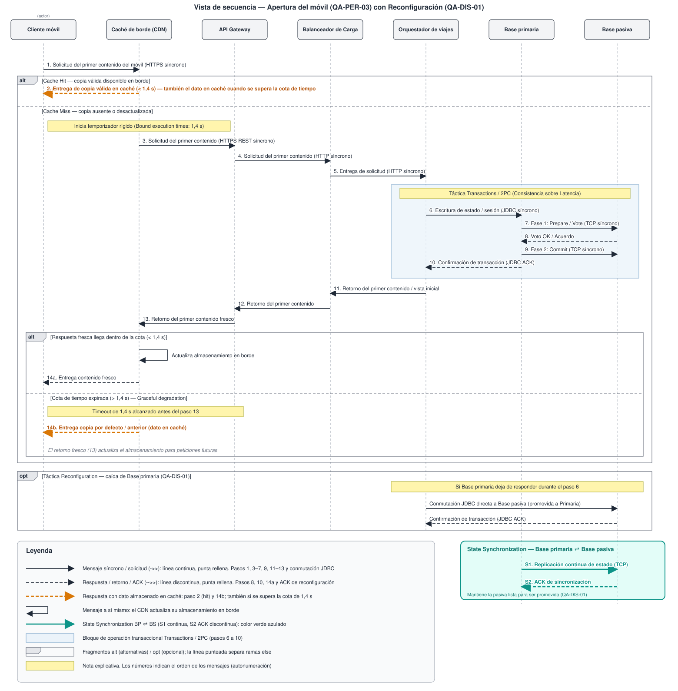
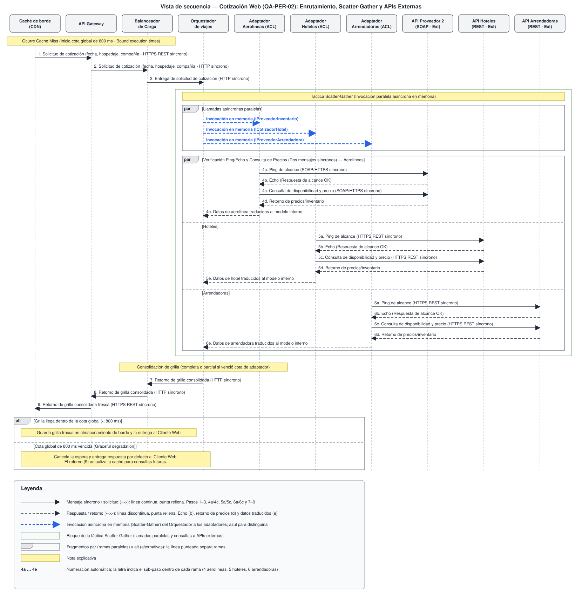

# Trotamundos — iteración 2

| Campo                       | Valor                                                                                                                               |
| --------------------------- | ----------------------------------------------------------------------------------------------------------------------------------- |
| **Ronda**                   | 1                                                                                                                                   |
| **Arranque**                | Refinamiento. Se retoma el Core de la iteración 1 en los drivers que quedaron parciales.                                            |
| **Qué toma esta iteración** | La especificación de la caché y de la interacción con las APIs, y la sincronización de las copias ante la caída del nodo principal. |

El paso 1 de la ronda está en [README.md](README.md). El cierre de la iteración anterior está en [ITERACION_1.md](ITERACION_1.md).

## Paso 2. Establecer el goal

| Id           | En el goal o afuera                                                                                                                                                                                                                                           |
| ------------ | ------------------------------------------------------------------------------------------------------------------------------------------------------------------------------------------------------------------------------------------------------------- |
| `QA-PER-02`  | En el goal. Nueva cotización desde la web, en 800 ms para el 90 % de las peticiones. Se especifica el uso de la caché y la interacción con las APIs: ante una cota de tiempo, la caché entrega una respuesta por defecto.                                     |
| `QA-PER-03`  | En el goal. El usuario abre la aplicación móvil y el primer contenido aparece en menos de 1,4 s en el 90 % de las sesiones. Esa misma caché entrega la respuesta por defecto ante la cota de tiempo.                                                          |
| `QA-ESC-01`  | Afuera. Sigue parcial y queda para otra iteración. Registro masivo de 100.000 usuarios nuevos por día.                                                                                                                                                        |
| `REF-02`     | Afuera. Sondear el correo y agregar al itinerario las reservas de los mensajes de viaje.                                                                                                                                                                      |
| `REF-03`     | Afuera. Filtrar y armar whitelists de remitentes de correos de viaje.                                                                                                                                                                                         |
| `REF-04`     | Afuera. Agregar, actualizar o eliminar una reserva a mano.                                                                                                                                                                                                    |
| `REF-05`     | Afuera. Resolver un problema con la agencia de viajes preferida.                                                                                                                                                                                              |
| `REF-06`     | Afuera. Consultas analíticas de tendencias, destinos y cancelaciones.                                                                                                                                                                                         |
| `QA-PER-01`  | Afuera. Actualización de una API externa.                                                                                                                                                                                                                     |
| `QA-INT-01`  | Afuera. Integrar la API propietaria de una cadena hotelera nueva.                                                                                                                                                                                             |
| `QA-PER-04*` | Afuera. Consulta de tendencias, destinos y cancelaciones.                                                                                                                                                                                                     |
| `QA-DIS-01`  | En el goal. Caída de un nodo de cotización. La sincronización de las copias prioriza la consistencia por sobre la performance en latencia. Si cae el nodo principal, la carga se delega con la táctica Reconfiguration para seguir atendiendo las peticiones. |
| `QA-INT-02`  | Afuera. Incorporar Instagram como canal de propuestas e itinerarios.                                                                                                                                                                                          |
| `QA-SEG-01`  | Afuera. Ráfaga de recuperación de contraseña.                                                                                                                                                                                                                 |
| `QA-SEG-02`  | Afuera. Registrar una actividad en el itinerario compartido.                                                                                                                                                                                                  |
| `QA-SEG-03*` | Afuera. El titular autoriza la lectura de su correo.                                                                                                                                                                                                          |
| `QA-EVO-01`  | Afuera. Integrar un medio de transporte que el panel todavía no agrupa.                                                                                                                                                                                       |
| `QA-USA-01`  | Afuera. El viajero consulta su viaje en el móvil, con una capacidad nativa como el GPS.                                                                                                                                                                       |

**Drivers ya resueltos:** `REF-01`, `CON-01`, `CON-02`.

**Goal.** El objetivo de esta iteración es especificar el uso de la caché y la interacción con las APIs para la cotización web (`QA-PER-02`) y para el primer contenido del móvil (`QA-PER-03`). Ante una cota de tiempo, la caché entrega una respuesta por defecto. Una cotización nueva responde en 800 ms para el 90 % de las peticiones. Al abrir la aplicación móvil, el primer contenido aparece en menos de 1,4 s en el 90 % de las sesiones. En la sincronización de las copias, que la iteración 1 dejó propuesta, el trade-off prioriza la consistencia por sobre la performance en latencia (`QA-DIS-01`). Si cae el nodo principal, la carga se delega aplicando la táctica Reconfiguration, de modo que el sistema siga atendiendo las peticiones y el servicio acumule menos de 5 minutos de inactividad al mes.

Los pasos siguen el orden del método: este paso fija el goal y el paso 3 elige el elemento a refinar.

## Paso 3. Elegir los elementos a refinar

| Elemento                                                                  | Por qué este                                                                                                                                                                                                                                                                                                | Movimiento |
| ------------------------------------------------------------------------- | ----------------------------------------------------------------------------------------------------------------------------------------------------------------------------------------------------------------------------------------------------------------------------------------------------------- | ---------- |
| Caché de borde (CDN)                                                      | Está en el camino de Cliente web y de Cliente móvil, antes del API Gateway. Ahí se especifica la respuesta por defecto cuando se alcanza la cota de tiempo: la grilla de la cotización (`QA-PER-02`) y el primer contenido del móvil (`QA-PER-03`). El conector hacia el API Gateway es el de cache miss.   | Refinar    |
| Orquestador de viajes                                                     | En el cache miss la cotización llega a este componente, que dispara en paralelo al Adaptador de aerolíneas, al Adaptador de hoteles y al Adaptador de arrendadoras. La interacción con las APIs de la cotización se coordina aquí, dentro de la cota de `QA-PER-02`.                                        | Refinar    |
| Adaptador de aerolíneas, Adaptador de hoteles y Adaptador de arrendadoras | Son el lado interno de la llamada síncrona a API Proveedor 2 (SOAP), API de hoteles y API de arrendadoras. La cota de espera de cada API se fija en estos adaptadores (`QA-PER-02`).                                                                                                                        | Refinar    |
| Base primaria y Base pasiva                                               | Son las copias del nivel de datos. El conector entre ellas es TCP / replicación binaria continua, asíncrono. Esta iteración fija ese intercambio priorizando la consistencia por sobre la performance en latencia y, si cae la primaria, la reconfiguración que delega la carga en la pasiva (`QA-DIS-01`). | Refinar    |
| Balanceador de Carga y nodos del Orquestador de viajes                    | `QA-DIS-01` habla de la caída de un nodo de procesamiento de cotización. El Balanceador reparte los pedidos entre los nodos del Orquestador (redundant spare de la iteración 1). Acá se fija cómo detecta la falla, cómo aísla el nodo caído y qué hace con las peticiones en vuelo.                        | Refinar    |

Se refinan esos componentes de [vistas/C&C_VIEW_IT1.svg](vistas/C&C_VIEW_IT1.svg). Cliente web y Cliente móvil originan los estímulos. API Gateway encamina. Módulo de registro queda para `QA-ESC-01`. API Proveedor 2 (SOAP), API de hoteles y API de arrendadoras están fuera de la frontera de Trotamundos.

## Paso 4. Elegir los conceptos de diseño

En esta iteración evaluamos las tácticas que quedaron abiertas de la Iteración 1 y los nuevos conceptos propuestos, enfocados en resolver los *drivers* específicos del *goal*: la cota de tiempo en la caché para la cotización y el móvil (`QA-PER-02`, `QA-PER-03`), la interacción con las APIs de terceros, y el mecanismo de sincronización priorizando la consistencia ante caídas (`QA-DIS-01`).

| Alternativa           | Tipo                     | Beneficia                                                                                                                                                                   | Perjudica                                                                                                                                                      | Queda |
| --------------------- | ------------------------ | --------------------------------------------------------------------------------------------------------------------------------------------------------------------------- | -------------------------------------------------------------------------------------------------------------------------------------------------------------- | ----- |
| Heartbeat             | Táctica (disponibilidad) | El componente vigilado emite mensajes periódicos a un monitor.                                                                                                              | El componente a vigilar (API del proveedor) es externo y no está a nuestro alcance modificarlo para emitir latidos. Se paga en Performance(Latencia).          | No    |
| Bound execution times | Táctica (performance)    | Pone un techo al tiempo de procesamiento. Al alcanzar esa cota, la caché entrega una respuesta por defecto asegurando cumplir los 800 ms y 1.4s (`QA-PER-02`, `QA-PER-03`). | Se sacrifica la exactitud del cómputo. La respuesta por defecto puede quedar desactualizada y se perjudica la Consistencia de los datos.                       | Sí    |
| Retry                 | Táctica (disponibilidad) | Si el silencio de una API es transitorio, repetir el pedido puede tener éxito, con un límite de reintentos.                                                                 | Un timeout largo se paga en Performance(Latencia). Uno corto saca de la grilla una API que aún podía responder y se perjudica la Disponibilidad de ese origen. | No    |
| Transactions          | Táctica (disponibilidad) | Agrupa las actualizaciones de las dos copias para que el intercambio sea atómico, consistente, aislado y durable (`QA-DIS-01`).                                             | El commit en dos fases retiene la escritura hasta que Base primaria y Base pasiva acuerdan. Se paga fuertemente en Performance(Latencia).                      | Sí    |
| Reconfiguration       | Táctica (disponibilidad) | Reasigna responsabilidades a los recursos que siguen funcionando. Si cae la Base primaria, la carga pasa a la Base pasiva y el sistema sigue atendiendo (`QA-DIS-01`).      | El traspaso de la carga no es inmediato: se paga en Performance(Latencia). La función que no puede reasignarse se sacrifica en Disponibilidad.                 | Sí    |
| Graceful degradation  | Táctica (disponibilidad) | Ante la falla de una API o de un nodo se sostienen las funciones críticas y se sueltan las que no lo son (`QA-PER-02`, `QA-DIS-01`).                                        | Se sacrifican las funciones no críticas. Se perjudica la completitud de la respuesta (`QA-PER-02`) a cambio de sostener la Disponibilidad.                     | Sí    |

**Tacticas incorporadas en la iteracion 1:**

- Redundant spare. Un componente duplicado toma el control si falla el primario (hot, warm o cold spare) (`QA-DIS-01`).
- State resynchronization. Mantiene sincronizado el estado entre el componente activo y el de respaldo (`QA-DIS-01`).
- Ping/Echo. El adaptador envía un ping a la API de su productor y el eco indica que esa API responde (`QA-PER-02`).
- Múltiples copias de datos (caché). Guarda cotizaciones previas y respuestas estáticas (`QA-PER-02`, `QA-PER-03`).
- Procesamiento concurrente (Scatter-Gather) con el Orquestador.
- Capa Anti-Corrupción (ACL) / Adaptadores (por API de proveedor).
- API Gateway.

**Justificación de la Selección:**

Para cumplir el *goal* de la iteración, se aceptan las tácticas de la Iteración 1 y se incorporan nuevas decisiones:

- **Bound execution times y Graceful degradation:** Se seleccionan conjuntamente para garantizar que la caché de borde devuelva una respuesta (la grilla por defecto) si el orquestador o las APIs exceden la cota de 800 ms o 1.4s (`QA-PER-02`, `QA-PER-03`). Se acepta la degradación de la respuesta (datos no actualizados en tiempo real) a cambio de cumplir estrictamente el atributo de Performance.
- **Transactions y Reconfiguration:** Para resolver el fallo del nodo principal (`QA-DIS-01`), el *goal* establece que se prioriza la consistencia sobre la latencia. Por ello, se elige *Transactions* (commit en dos fases) garantizando que la copia pasiva (*Redundant spare*) esté exactamente igual que la primaria (*State resynchronization*). Ante la caída, se dispara la táctica de *Reconfiguration* para mover la carga al nodo pasivo, logrando la recuperación en menos de 5 minutos.
- **Rechazo de Heartbeat:** Se descarta esta táctica debido a que el componente que se necesita vigilar (la API del proveedor) es externo al sistema y no está a nuestro alcance modificarlo para que emita latidos hacia nuestro monitor.
- **Rechazo de Retry:** Se descarta el *Retry* porque sumar intentos bloqueantes contra las APIs externas comprometería las estrictas cotas de latencia (800ms) de `QA-PER-02`. Es preferible degradar (*Graceful degradation*) y devolver lo que se tenga o la copia en caché.

Prototipo throwaway: ninguno por ahora.

## Paso 5. Instanciar, asignar y definir interfaces

Se instancian los elementos del paso 3. Cada uno recibe las tácticas que el paso 4 dejó en sí, más las de la iteración 1 que ese paso incorpora. Heartbeat y Retry no se asignan.

La cota de Bound execution times es la del goal: 800 ms en la cotización (`QA-PER-02`) y 1,4 s en el primer contenido del móvil (`QA-PER-03`). Los drivers no fijan en milisegundos la cota de espera de cada API; esa cota es de su adaptador.

### Caché de borde (CDN)

| Elemento             | Responsabilidad                                                                                                                                                                                                                                                                                                                                                                                                                                                                                                                                                                                                                                                                                                                                                                                                                                                  | Interfaz                                                                                                                                                                                                                                                                                                                                                                 |
| -------------------- | ---------------------------------------------------------------------------------------------------------------------------------------------------------------------------------------------------------------------------------------------------------------------------------------------------------------------------------------------------------------------------------------------------------------------------------------------------------------------------------------------------------------------------------------------------------------------------------------------------------------------------------------------------------------------------------------------------------------------------------------------------------------------------------------------------------------------------------------------------------------- | ------------------------------------------------------------------------------------------------------------------------------------------------------------------------------------------------------------------------------------------------------------------------------------------------------------------------------------------------------------------------ |
| Caché de borde (CDN) | Guarda copias de la grilla de una fecha, un hospedaje y una compañía, y del primer contenido del móvil (Múltiples copias de datos). Bound execution times pone la cota de 800 ms a la cotización y la de 1,4 s al primer contenido. Si la cota se alcanza antes de que llegue la respuesta fresca, Graceful degradation entrega la respuesta por defecto: la copia que ya tiene, aunque no esté actualizada (`QA-PER-02`, `QA-PER-03`). El cálculo fresco se sacrifica para cerrar dentro de la cota. Si la caché no tiene copia de esos criterios (primera consulta) y la cota vence, no hay nada que entregar: devuelve la grilla parcial que el Orquestador de viajes ya armó con los orígenes que respondieron y, si no hay ninguno, un aviso de "cotización en curso". El resultado fresco, cuando llega, se guarda para la próxima consulta (`QA-PER-02`). | Desde Cliente web, por HTTPS REST: fecha, hospedaje y compañía. Hacia Cliente web: la grilla, o la copia por defecto si venció la cota de 800 ms. Desde Cliente móvil, por HTTPS REST: el primer contenido. Hacia Cliente móvil: ese contenido, o su copia por defecto si venció la cota de 1,4 s. Hacia el API Gateway: el conector de cache miss, con el mismo pedido. |

### Orquestador de viajes

| Elemento              | Responsabilidad                                                                                                                                                                                                                                                                                                                                                                           | Interfaz                                                                                                                                                                                                                                                                                                                                                                  |
| --------------------- | ----------------------------------------------------------------------------------------------------------------------------------------------------------------------------------------------------------------------------------------------------------------------------------------------------------------------------------------------------------------------------------------- | ------------------------------------------------------------------------------------------------------------------------------------------------------------------------------------------------------------------------------------------------------------------------------------------------------------------------------------------------------------------------- |
| Orquestador de viajes | En el cache miss coordina la cotización. Scatter-Gather dispara en paralelo la consulta a Adaptador de aerolíneas, Adaptador de hoteles y Adaptador de arrendadoras. Graceful degradation arma la grilla con los orígenes que respondieron y suelta los que no (`QA-PER-02`). La función que se sostiene es devolver la grilla; la que se suelta es la completitud de todos los orígenes. | Desde el Balanceador de Carga: fecha, hospedaje y compañía. Hacia los tres adaptadores, en paralelo: el llamado asíncrono del contrato interno de cada uno. Hacia el API Gateway, de regreso: la grilla consolidada, completa o parcial. Hacia la base que atiende las escrituras, por JDBC: la escritura de viajes. Tras la reconfiguración, esa base es la Base pasiva. |

### Adaptador de aerolíneas, Adaptador de hoteles y Adaptador de arrendadoras

Cada adaptador es la Capa Anti-Corrupción de su API. Traduce el contrato del proveedor al modelo interno. Ping/Echo sale de ese adaptador hacia su API. Con eco, pide el precio por la misma llamada síncrona. Bound execution times corta esa espera en la cota del adaptador. Sin eco, o vencida la cota, el adaptador informa a Orquestador de viajes que ese origen no respondió y el pedido de precio no sigue. Retry no se usa.

| Elemento                  | Responsabilidad                                                                 | Interfaz                                                                                                                                                                                                                                                                           |
| ------------------------- | ------------------------------------------------------------------------------- | ---------------------------------------------------------------------------------------------------------------------------------------------------------------------------------------------------------------------------------------------------------------------------------- |
| Adaptador de aerolíneas   | ACL, Ping/Echo y la cota de espera contra API Proveedor 2 (SOAP) (`QA-PER-02`). | Interna: el contrato que invoca Orquestador de viajes. Externa, síncrona: SOAP hacia API Proveedor 2 (SOAP). Desde esa API: el eco y el precio, o el silencio una vez vencida la cota. Hacia Orquestador de viajes: el precio traducido, o el aviso de que el origen no respondió. |
| Adaptador de hoteles      | ACL, Ping/Echo y la cota de espera contra API de hoteles (`QA-PER-02`).         | Interna: `ICotizadorHotel`, invocado por Orquestador de viajes. Externa, síncrona: hacia API de hoteles. Desde esa API: el eco y el precio, o el silencio una vez vencida la cota. Hacia Orquestador de viajes: el precio traducido, o el aviso de que el origen no respondió.     |
| Adaptador de arrendadoras | ACL, Ping/Echo y la cota de espera contra API de arrendadoras (`QA-PER-02`).    | Interna: el contrato que invoca Orquestador de viajes. Externa, síncrona: hacia API de arrendadoras. Desde esa API: el eco y el precio, o el silencio una vez vencida la cota. Hacia Orquestador de viajes: el precio traducido, o el aviso de que el origen no respondió.         |

### Balanceador de Carga y nodos del Orquestador de viajes

Esta sección cubre la caída de un nodo de cotización que pide `QA-DIS-01`, distinta de la caída de la base. Se reutilizan Ping/Echo y Redundant spare de la iteración 1 y Reconfiguration de esta iteración. No se agrega Heartbeat ni Retry hacia el nodo: el Balanceador es nuestro y consulta él mismo.

| Elemento                        | Responsabilidad                                                                                                                                                                                                                                                                                                                                                                                  | Interfaz                                                                                                                                                                                           |
| ------------------------------- | ------------------------------------------------------------------------------------------------------------------------------------------------------------------------------------------------------------------------------------------------------------------------------------------------------------------------------------------------------------------------------------------------ | -------------------------------------------------------------------------------------------------------------------------------------------------------------------------------------------------- |
| Balanceador de Carga            | Ping/Echo periódico (health check) a cada nodo del Orquestador de viajes. Un nodo sin eco se marca caído y deja de recibir pedidos (Reconfiguration: el tráfico se reasigna a los nodos sanos). Los pedidos en vuelo hacia ese nodo se reenvían a un nodo sano: el pedido de cotización es de solo lectura sobre las APIs, así que repetirlo no duplica nada. Avisa a operaciones (`QA-DIS-01`). | Desde API Gateway, por HTTP: fecha, hospedaje y compañía. Hacia cada nodo del Orquestador: el pedido y el ping. Desde el nodo: el eco o el silencio. Hacia operaciones: la alerta de nodo aislado. |
| Nodos del Orquestador de viajes | Copias idénticas (Redundant spare). Cualquiera puede atender cualquier cotización, porque el estado de los viajes vive en la base y no en el nodo.                                                                                                                                                                                                                                               | Los de Orquestador de viajes.                                                                                                                                                                      |

El reenvío del pedido en vuelo sigue acotado por los 800 ms de `QA-PER-02`: si el reenvío no llega a tiempo, la Caché de borde (CDN) entrega la respuesta por defecto.

### Base primaria y Base pasiva

Base pasiva es el Redundant spare de Base primaria. State resynchronization queda en Transactions: el commit en dos fases. La escritura se retiene hasta que las dos copias acuerdan, y la consistencia queda por encima de la latencia (`QA-DIS-01`). Si Base primaria deja de atender, Reconfiguration delega la carga en Base pasiva. El traspaso no es inmediato. El servicio acumula menos de 5 minutos de inactividad al mes.

| Elemento                    | Responsabilidad                                                                                                                                                                                                                                                                                       | Interfaz                                                                                                                                                                                                                                                                                              |
| --------------------------- | ----------------------------------------------------------------------------------------------------------------------------------------------------------------------------------------------------------------------------------------------------------------------------------------------------- | ----------------------------------------------------------------------------------------------------------------------------------------------------------------------------------------------------------------------------------------------------------------------------------------------------- |
| Base primaria y Base pasiva | Base primaria atiende las escrituras y Base pasiva es la copia de respaldo (Redundant spare). Transactions confirma la escritura en las dos copias antes de devolver éxito (State resynchronization). Reconfiguration pasa la carga a Base pasiva cuando Base primaria deja de atender (`QA-DIS-01`). | Desde Orquestador de viajes, por JDBC: la escritura, hacia la copia que atiende. Entre Base primaria y Base pasiva, por el conector TCP: el commit en dos fases. Base primaria retiene la escritura hasta que Base pasiva acuerda. Cuando Base primaria deja de atender, ese JDBC pasa a Base pasiva. |

### Relaciones permitidas

- Cliente web y Cliente móvil → Caché de borde (CDN).
- Caché de borde (CDN) → API Gateway, por el conector de cache miss.
- API Gateway → Balanceador de Carga → Orquestador de viajes.
- Orquestador de viajes → Adaptador de aerolíneas, Adaptador de hoteles y Adaptador de arrendadoras, en paralelo.
- Adaptador de aerolíneas → API Proveedor 2 (SOAP).
- Adaptador de hoteles → API de hoteles.
- Adaptador de arrendadoras → API de arrendadoras.
- Orquestador de viajes → Base primaria, por JDBC.
- Base primaria → Base pasiva, por TCP, con el commit en dos fases.
- Si Base primaria deja de atender, el JDBC de Orquestador de viajes pasa a Base pasiva.

### Secuencia

**Cotización desde la web** (`QA-PER-02`). Cliente web envía fecha, hospedaje y compañía a Caché de borde (CDN). Caché de borde (CDN) abre la cota de 800 ms. Si tiene la grilla de esos criterios, la devuelve. Si no, el cache miss sigue al API Gateway y el Balanceador de Carga entrega el pedido a Orquestador de viajes. Orquestador de viajes pide el precio a la vez a Adaptador de aerolíneas, Adaptador de hoteles y Adaptador de arrendadoras. Cada uno hace Ping/Echo a su API. Con eco, pide el precio. Si API Proveedor 2 (SOAP) calla vencida la cota de Adaptador de aerolíneas, ese adaptador avisa que el origen no respondió. Orquestador de viajes arma la grilla con lo que devolvieron Adaptador de hoteles y Adaptador de arrendadoras. Si esa grilla llega antes de los 800 ms, Caché de borde (CDN) la guarda y la entrega a Cliente web. Si la cota vence antes, entrega la copia que ya tiene.

**Apertura del móvil** (`QA-PER-03`). Cliente móvil pide el primer contenido a Caché de borde (CDN). Caché de borde (CDN) abre la cota de 1,4 s. Si tiene la copia, la sirve. Si la cota vence antes de que el contenido llegue, entrega la copia que ya tiene de ese primer contenido.

**Caída de un nodo de cotización** (`QA-DIS-01`). El Balanceador de Carga hace Ping/Echo a cada nodo del Orquestador de viajes. Un nodo que no da eco se marca caído y deja de recibir pedidos. Los pedidos que estaban en vuelo hacia él se reenvían a un nodo sano, dentro de la cota de 800 ms, y el Balanceador avisa a operaciones. Para el usuario el servicio sigue sin interrupción.

**Caída de Base primaria** (`QA-DIS-01`). Orquestador de viajes escribe en Base primaria por JDBC. Base primaria no confirma hasta que Base pasiva acuerda, por el commit en dos fases sobre TCP. Si Base primaria deja de atender, Reconfiguration delega la carga en Base pasiva. El traspaso no es inmediato. La copia que pasa a atender es Base pasiva, y el servicio acumula menos de 5 minutos de inactividad al mes.

## Paso 6. Bosquejar y registrar la decisión

### Componentes y conectores — Nivel de datos

Estructura:

**Epígrafe.** Vista de componentes y conectores. Expone el zoom al nivel de datos dentro de Trotamundos (`QA-DIS-01`): Orquestador de viajes, Pool de Conexiones de Base de Datos, Base primaria, Base pasiva y Gestor de Clúster.  
Orquestador de viajes queda en el Nivel de Lógica de Negocio. El Pool, Base primaria, Base pasiva (Redundant Spare) y el Gestor de Clúster quedan en el Nivel de Datos, donde la vista marca Transactions 2PC, State Resync y Reconfiguration.  
La escritura sigue en línea continua: JDBC síncrono del Orquestador al Pool, y JDBC síncrono del Pool a Base primaria. Entre Base primaria y Base pasiva la flecha es bidireccional, TCP / Commit en dos fases (2PC), síncrono.  
El Gestor de Clúster llega a Base primaria por TCP (Health Check), síncrono, y al Pool por HTTP (Notificación de Reconfiguración), síncrono. Hacia Base pasiva manda TCP (Comando de Promoción), síncrono, en la línea punteada de control.  
Sirve para ver, en una sola estructura, cómo la escritura llega a la base que atiende, cómo las dos copias acuerdan el commit y cómo el Gestor reconfigura el camino si Base primaria deja de responder.

### Secuencia

Estructura:

**Epígrafe.** Vista de secuencia. Expone el primer llamado de Cliente móvil y la lógica entre Base primaria, la que atiende la escritura, y Base pasiva.  
 En el primer llamado (`QA-PER-03`), Cliente móvil pide el primer contenido a Caché de borde (CDN). Si la copia válida está, la caché la entrega dentro de la cota de 1,4 s. Si esa cota se supera, entrega el dato almacenado: el paso 2 en el acierto y el paso 14b cuando el fresco no llega a tiempo.  
Si no hay copia válida, el pedido sigue por API Gateway y Balanceador de Carga hasta Orquestador de viajes, y el contenido fresco vuelve a la caché. Dentro de la cota, la caché actualiza el borde y entrega ese fresco.   

Entre las bases (`QA-DIS-01`), Base primaria retiene la escritura hasta que Base pasiva acuerda el commit en dos fases. Si Base primaria deja de responder, el JDBC conmuta a Base pasiva. La sincronización de estado mantiene a la pasiva lista para ser promovida. Sirve para ver, en un solo recorrido, cómo se cierra el primer contenido del móvil y cómo las dos copias acuerdan la escritura o siguen atendiendo si la primaria no responde.

### Secuencia — Cotización desde la web

Estructura:

**Epígrafe.** Vista de secuencia. Expone la cotización web en el cache miss (`QA-PER-02`): el enrutamiento hasta Orquestador de viajes, el Scatter-Gather hacia los tres adaptadores y las llamadas a las APIs externas.  
La secuencia abre con el cache miss y la cota de 800 ms (Bound execution times). Caché de borde (CDN) envía fecha, hospedaje y compañía al API Gateway por HTTPS REST síncrono (paso 1). API Gateway pasa la solicitud al Balanceador de Carga por HTTP síncrono (paso 2) y el Balanceador la entrega a Orquestador de viajes (paso 3).  
El orquestador invoca en paralelo y en memoria, de forma asíncrona, a Adaptador de aerolíneas (`IProveedorInventario`), Adaptador de hoteles (`ICotizadorHotel`) y Adaptador de arrendadoras (`IProveedorArrendadora`). Cada adaptador hace ping de alcance y, con eco, consulta disponibilidad y precio: dos mensajes síncronos. Aerolíneas usa SOAP/HTTPS con API Proveedor 2 (pasos 4a a 4e). Hoteles y arrendadoras usan HTTPS REST (pasos 5a a 5e y 6a a 6e). El eco, el precio y los datos traducidos vuelven al orquestador, que consolida la grilla, completa o parcial si venció la cota de un adaptador.  
La grilla consolidada regresa por el Balanceador de Carga y el API Gateway hasta la caché (pasos 7 a 9). Si llega dentro de los 800 ms, la caché guarda la grilla fresca y la entrega a Cliente web. Si la cota vence, Graceful degradation cancela la espera y entrega la respuesta por defecto; el retorno del paso 9 actualiza la caché para consultas futuras.  
Sirve para ver, en un solo recorrido, cómo la cotización web reparte la consulta entre las APIs, arma la grilla y cierra la cota de 800 ms con la respuesta fresca o con la respuesta por defecto.

### Catálogo

Decisiones de diseño registradas en [ADRs/ITERACION_2](ADRs/ITERACION_2/).

| ID | Decisión | Estado |
| --- | --- | --- |
| ADR-IT2-001 | [Bound execution times en la Caché de borde](ADRs/ITERACION_2/ADR-IT2-001.md) | aceptado |
| ADR-IT2-002 | [Graceful degradation](ADRs/ITERACION_2/ADR-IT2-002.md) | aceptado |
| ADR-IT2-003 | [Cota de espera por adaptador, sin Retry](ADRs/ITERACION_2/ADR-IT2-003.md) | aceptado |
| ADR-IT2-004 | [Sincronizar Base primaria y Base pasiva con Transactions (commit en dos fases), priorizando consistencia sobre latencia](ADRs/ITERACION_2/ADR-IT2-004.md) | aceptado |
| ADR-IT2-005 | [Reconfiguration: conmutación a la Base pasiva](ADRs/ITERACION_2/ADR-IT2-005.md) | aceptado |
| ADR-IT2-006 | [Retry](ADRs/ITERACION_2/ADR-IT2-006.md) | rechazado |

## Paso 7. Analizar y revisar el purpose

| Id del goal | Estado     | Una oración                                                                                                                                                                                                                                                                                                                                                                                                                                                                                   |
| ----------- | ---------- | --------------------------------------------------------------------------------------------------------------------------------------------------------------------------------------------------------------------------------------------------------------------------------------------------------------------------------------------------------------------------------------------------------------------------------------------------------------------------------------------- |
| `QA-PER-02` | Completely | La Caché de borde (CDN) corta la espera en 800 ms ([ADR-IT2-001](ADRs/ITERACION_2/ADR-IT2-001.md)) y, si la cota vence, entrega la copia por defecto o la grilla parcial del orquestador ([ADR-IT2-002](ADRs/ITERACION_2/ADR-IT2-002.md)), mientras cada adaptador acota la espera de su API y detecta su silencio con Ping/Echo, sin Retry ([ADR-IT2-003](ADRs/ITERACION_2/ADR-IT2-003.md), [ADR-IT2-004](ADRs/ITERACION_2/ADR-IT2-004.md), [ADR-IT2-008](ADRs/ITERACION_2/ADR-IT2-008.md)). |
| `QA-PER-03` | Completely | La misma Caché de borde (CDN) corta la espera en 1,4 s y entrega su copia por defecto del primer contenido si la respuesta fresca no llega ([ADR-IT2-001](ADRs/ITERACION_2/ADR-IT2-001.md), [ADR-IT2-002](ADRs/ITERACION_2/ADR-IT2-002.md)).                                                                                                                                                                                                                                                  |
| `QA-DIS-01` | Completely | El Balanceador de Carga detecta con Ping/Echo al nodo caído, lo aísla y reenvía a un nodo sano lo que estaba en vuelo, y la Base pasiva, igual a la primaria por el commit en dos fases ([ADR-IT2-005](ADRs/ITERACION_2/ADR-IT2-005.md)), asume la carga con Reconfiguration si la primaria deja de atender ([ADR-IT2-006](ADRs/ITERACION_2/ADR-IT2-006.md)).                                                                                                                                 |

### Justificación del estado

En la iteración 1 estos tres drivers quedaron `Partially`. Cada fila toma algo que estaba abierto (un hueco que dejó esa iteración o una parte del escenario sin cubrir) y dice qué lo cierra.

| Id          | Qué estaba abierto                                                                                  | Cómo lo cierra la iteración 2                                                                                                                                                                                                                                                                                                                                                                                                                                                                                                                                                                                                         |
| ----------- | --------------------------------------------------------------------------------------------------- | ------------------------------------------------------------------------------------------------------------------------------------------------------------------------------------------------------------------------------------------------------------------------------------------------------------------------------------------------------------------------------------------------------------------------------------------------------------------------------------------------------------------------------------------------------------------------------------------------------------------------------------- |
| `QA-PER-02` | El umbral de espera no estaba fijado en ms.                                                         | La cota de espera es propiedad de cada adaptador y debe ser menor que la del goal ([ADR-IT2-003](ADRs/ITERACION_2/ADR-IT2-003.md)). No hace falta fijarla en el driver: lo que garantiza los 800 ms es la cota del borde ([ADR-IT2-001](ADRs/ITERACION_2/ADR-IT2-001.md)), que no depende de ese valor. El valor del adaptador solo decide cuántos orígenes alcanzan a entrar en la grilla.                                                                                                                                                                                                                                           |
| `QA-PER-02` | No se definió qué hace el sistema cuando una API no responde.                                       | Ping/Echo detecta el silencio ([ADR-IT2-004](ADRs/ITERACION_2/ADR-IT2-004.md)). Sin eco, o vencida su cota, el adaptador informa que el origen no respondió y no pide el precio. El orquestador arma la grilla con los orígenes que respondieron y, si la cota del borde vence antes, la CDN entrega su copia ([ADR-IT2-002](ADRs/ITERACION_2/ADR-IT2-002.md), [ADR-IT2-003](ADRs/ITERACION_2/ADR-IT2-003.md)). Heartbeat ([ADR-IT2-007](ADRs/ITERACION_2/ADR-IT2-007.md)) y Retry ([ADR-IT2-008](ADRs/ITERACION_2/ADR-IT2-008.md)) quedan rechazados, cada uno con su motivo.                                                        |
| `QA-PER-02` | La medida no estaba verificada.                                                                     | En la iteración 1 el tiempo de la cotización dependía de tres APIs de terceros y nada lo acotaba, por eso solo una medición podía comprobarlo. Ahora la CDN corta la espera a los 800 ms desde que recibe el pedido: se demore la API que se demore, la respuesta sale dentro de la cota, y con eso el 90 % pedido queda cubierto por diseño. El tramo hasta el borde es el de la "conexión de red estándar" del escenario. Si la CDN ya tiene la grilla de esos criterios, el pedido ni llega al backend.                                                                                                                            |
| `QA-PER-03` | El FCP de 1,4 s en 3G no estaba verificado.                                                         | Misma lógica que `QA-PER-02`: la CDN abre la cota de 1,4 s y, si el contenido fresco no llega, entrega la copia que ya tiene ([ADR-IT2-001](ADRs/ITERACION_2/ADR-IT2-001.md), [ADR-IT2-002](ADRs/ITERACION_2/ADR-IT2-002.md)). El primer contenido es el formulario de login, un recurso estático que el borde sirve desde su copia ([ADR-005](ADRs/ITERACION_1/ADR-005.md) de la iteración 1), y el miss con su cota es la red de seguridad. El tramo 3G hasta el borde es el contexto del escenario y el sistema no lo controla, por eso el camino normal tiene que ser la copia del borde.                                         |
| `QA-PER-03` | La app móvil no tenía diseño interno.                                                               | Lo que fija el primer contenido es de dónde sale y quién acota su espera, y eso queda decidido en el borde. El diseño interno de la app es materia de `QA-USA-01`, que entra en la iteración 4 y no modifica lo decidido en esta.                                                                                                                                                                                                                                                                                                                                                                                                     |
| `QA-DIS-01` | La sincronización de estado era solo una propuesta ([ADR-003](ADRs/ITERACION_1/ADR-003.md)).        | [ADR-IT2-005](ADRs/ITERACION_2/ADR-IT2-005.md) la decide: commit en dos fases entre Base primaria y Base pasiva, y la escritura no se confirma hasta que las dos acuerdan. Es el trade-off del goal (consistencia por sobre latencia) y reemplaza la replicación asíncrona que mostraba la iteración 1.                                                                                                                                                                                                                                                                                                                               |
| `QA-DIS-01` | No se aseguraba no perder peticiones en vuelo.                                                      | El escenario habla de dos tipos de petición. Una cotización en vuelo en un nodo caído se reenvía a un nodo sano: es de solo lectura sobre las APIs, repetirla no duplica nada y el reenvío sigue acotado por los 800 ms. Una escritura en vuelo no se confirma hasta que las dos copias acuerdan, así que no hay escritura confirmada que se pierda al conmutar.                                                                                                                                                                                                                                                                      |
| `QA-DIS-01` | El escenario pide detectar, aislar, redirigir y alertar sobre el balanceo, la cotización y la base. | En el Balanceador de Carga, Ping/Echo periódico a cada nodo detecta la falla, el nodo sin eco deja de recibir pedidos (aísla), Reconfiguration reasigna el tráfico a los nodos sanos (redirige) y se avisa a operaciones (alerta). Los nodos del Orquestador de viajes son copias idénticas sin estado propio, porque el estado vive en la base, y cualquiera atiende cualquier cotización (paso 5, sección del Balanceador de Carga; [ADR-002](ADRs/ITERACION_1/ADR-002.md) y [ADR-004](ADRs/ITERACION_1/ADR-004.md) de la iteración 1). En la base, la Base pasiva asume la carga ([ADR-IT2-006](ADRs/ITERACION_2/ADR-IT2-006.md)). |
| `QA-DIS-01` | La medida: servicio transparente, con menos de 5 minutos de inactividad al mes.                     | La caída de un nodo es transparente: el tráfico sigue en los nodos sanos y, si el reenvío no llega a tiempo, la CDN entrega su copia por defecto. La cotización no depende del camino de escritura ([ADR-IT2-005](ADRs/ITERACION_2/ADR-IT2-005.md)), así que la caída de la Base primaria solo abre una ventana en las escrituras de viajes, el traspaso, y esa ventana es lo que consume el presupuesto de 5 minutos al mes.                                                                                                                                                                                                         |

### Trade-offs aceptados

Cerrar los drivers tuvo un costo. Esto es lo que se sacrificó y a cambio de qué.

| Driver                   | Qué se sacrifica                                                                                                                                                                                                                                                                   | A cambio de                                                                                                                                                                                                                                                                                                                             |
| ------------------------ | ---------------------------------------------------------------------------------------------------------------------------------------------------------------------------------------------------------------------------------------------------------------------------------- | --------------------------------------------------------------------------------------------------------------------------------------------------------------------------------------------------------------------------------------------------------------------------------------------------------------------------------------- |
| `QA-PER-02`, `QA-PER-03` | Frescura y completitud: la copia por defecto puede estar desactualizada y la grilla puede salir parcial si un origen no responde ([ADR-IT2-001](ADRs/ITERACION_2/ADR-IT2-001.md), [ADR-IT2-002](ADRs/ITERACION_2/ADR-IT2-002.md), [ADR-IT2-003](ADRs/ITERACION_2/ADR-IT2-003.md)). | Que la respuesta cierre dentro de 800 ms y de 1,4 s aunque una API o un nodo se demore.                                                                                                                                                                                                                                                 |
| `QA-DIS-01`              | Latencia de escritura: el commit en dos fases retiene la confirmación hasta que las dos copias acuerdan, y el traspaso a la Base pasiva no es inmediato ([ADR-IT2-005](ADRs/ITERACION_2/ADR-IT2-005.md), [ADR-IT2-006](ADRs/ITERACION_2/ADR-IT2-006.md)).                          | Que no se pierda ninguna escritura confirmada si cae la Base primaria.                                                                                                                                                                                                                                                                  |
| Entre ambos              | Consistencia sobre latencia en las escrituras, y latencia sobre frescura en las lecturas.                                                                                                                                                                                          | Los dos criterios conviven porque cada uno vive en su camino. La cotización no depende del camino de escritura. Cuando el miss del primer contenido del móvil pasa por una escritura (vista de secuencia del paso 6), la cota de 1,4 s del borde impide que ese costo llegue al usuario: se traduce en copia por defecto, no en espera. |

### Riesgos residuales

Quedan abiertos, y están registrados en los ADR. No cambian el estado de los drivers por lo que dice la última columna.

| Riesgo                                                                                                                                                    | Registrado en                                                                                  | Por qué no cambia el estado                                                                                                                                                 |
| --------------------------------------------------------------------------------------------------------------------------------------------------------- | ---------------------------------------------------------------------------------------------- | --------------------------------------------------------------------------------------------------------------------------------------------------------------------------- |
| El valor en ms de la cota de cada adaptador, que se calibra con mediciones de cada proveedor (SOAP y REST).                                               | [ADR-IT2-003](ADRs/ITERACION_2/ADR-IT2-003.md)                                                 | Cambia cuántos orígenes entran en la grilla, no el techo de 800 ms, que lo pone el borde.                                                                                   |
| Las cotas de 800 ms y de 1,4 s dejan poco margen y hay que validarlas con pruebas de carga. Hoy no hay prototipo throwaway.                               | [ADR-IT2-001](ADRs/ITERACION_2/ADR-IT2-001.md)                                                 | El techo ya vale por diseño. La prueba ajusta el margen y el porcentaje de respuestas por defecto.                                                                          |
| El tiempo de vida de las copias y el aviso en la interfaz de que el dato puede no ser reciente.                                                           | [ADR-IT2-002](ADRs/ITERACION_2/ADR-IT2-002.md)                                                 | Es la frescura que ve el viajero, y la medida de los dos escenarios es de tiempo.                                                                                           |
| Cómo se detecta la caída de la Base primaria, cómo se promueve la pasiva y cómo se evita el split-brain.                                                  | [ADR-IT2-006](ADRs/ITERACION_2/ADR-IT2-006.md)                                                 | La táctica, el elemento que conmuta y la interfaz (el JDBC pasa a Base pasiva) están decididos. El mecanismo es un detalle de esa táctica y se fija en el diseño detallado. |
| Segunda falla: Base pasiva caída (la primaria no confirma sin ella) y falla doble tras conmutar (no queda otra copia). Faltan los timeouts y la política. | [ADR-IT2-005](ADRs/ITERACION_2/ADR-IT2-005.md), [ADR-IT2-006](ADRs/ITERACION_2/ADR-IT2-006.md) | El estímulo de `QA-DIS-01` es la caída de un nodo, no dos fallas encadenadas.                                                                                               |

### Cierre de la iteración

| Pregunta                    | Respuesta                                                                                                                                                                                                                                                                                                                                                                                                                                                                                                                                                                                                                                                                                                                                                                                                                       |
| --------------------------- | ------------------------------------------------------------------------------------------------------------------------------------------------------------------------------------------------------------------------------------------------------------------------------------------------------------------------------------------------------------------------------------------------------------------------------------------------------------------------------------------------------------------------------------------------------------------------------------------------------------------------------------------------------------------------------------------------------------------------------------------------------------------------------------------------------------------------------- |
| ¿Se cumplió el goal?        | Sí. `QA-PER-02`, `QA-PER-03` y `QA-DIS-01` quedan `Completely`. Para cada uno están decididas la táctica, el elemento que la ejecuta y su interfaz, y los huecos que dejó la iteración 1 están cerrados (justificación del estado). Lo que sigue abierto son valores de calibración y detalles de tácticas ya elegidas, que no cambian lo decidido (riesgos residuales).                                                                                                                                                                                                                                                                                                                                                                                                                                                        |
| Purpose de la ronda         | Arquitectura greenfield del panel de viajes en web y móvil, guiada por los escenarios de [LISTADO_DRIVERS.md](LISTADO_DRIVERS.md) ([README.md](README.md), paso 1). Con esta iteración quedan resueltos `REF-01`, `CON-01`, `CON-02`, `QA-PER-02`, `QA-PER-03` y `QA-DIS-01`.                                                                                                                                                                                                                                                                                                                                                                                                                                                                                                                                                   |
| ¿Hace falta otra iteración? | Sí. Quedan drivers de la ronda sin resolver.                                                                                                                                                                                                                                                                                                                                                                                                                                                                                                                                                                                                                                                                                                                                                                                    |
| Entra en la siguiente       | 1) Iteración 3, la entrada de información externa: `QA-PER-01`, `QA-INT-01`, `QA-EVO-01`, `QA-INT-02`, `QA-SEG-03*`, `REF-02` y `REF-03`. Retry se reabre ahí solo para la ruta asíncrona, fuera del camino de la cotización, como dejó abierto [ADR-IT2-008](ADRs/ITERACION_2/ADR-IT2-008.md). 2) `QA-ESC-01` sigue `Partially` y se retoma en la iteración 4, con la restricción que deja [ADR-IT2-005](ADRs/ITERACION_2/ADR-IT2-005.md): el commit en dos fases no escala a multirregión sin penalidad de latencia, y el escenario pide registros desde 3 continentes con confirmación en menos de 2 segundos. 3) `QA-USA-01`, que incluye el diseño interno de la app móvil, queda para la iteración 4. 4) Siguen en `Not Yet` hasta la iteración 4: `QA-SEG-01`, `QA-SEG-02`, `QA-PER-04*`, `REF-04`, `REF-05` y `REF-06`. |

