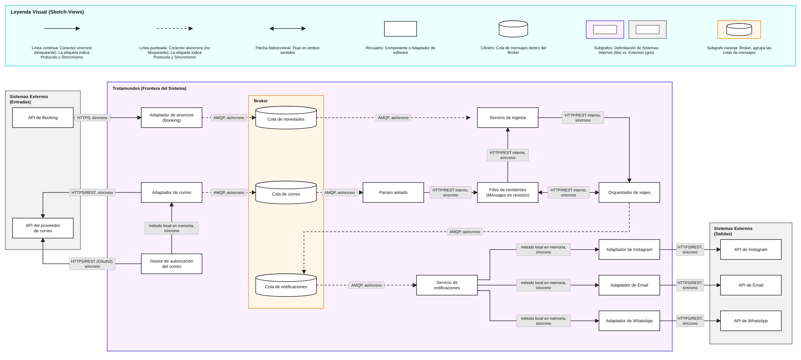
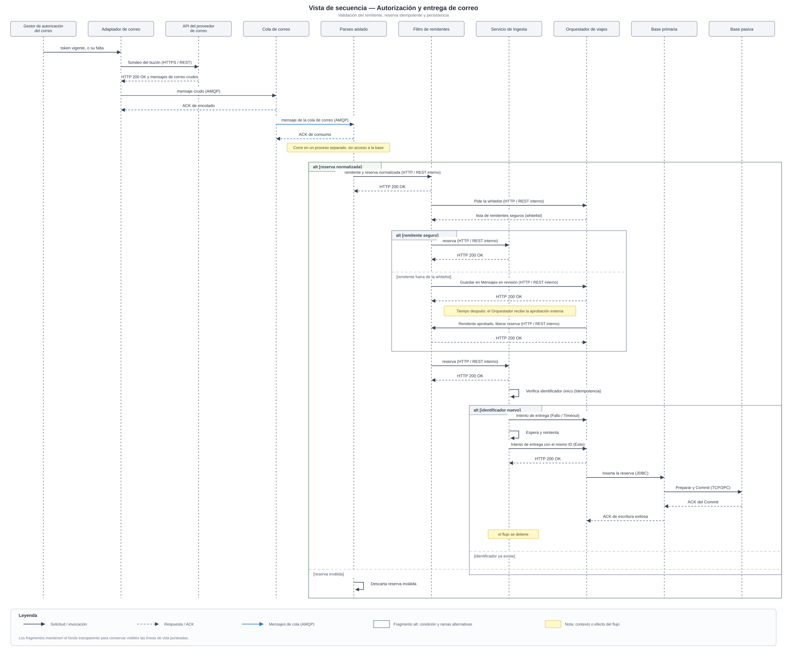

# Trotamundos — iteración 3

| Campo                       | Valor                                                                                                                                                               |
| --------------------------- | ------------------------------------------------------------------------------------------------------------------------------------------------------------------- |
| **Ronda**                   | 1                                                                                                                                                                   |
| **Arranque**                | Refinamiento. Se retoma el Core de las iteraciones 1 y 2 y se extiende con la ingesta de información externa.                                                       |
| **Qué toma esta iteración** | La entrada de información externa al modelo de viaje: novedades de proveedores, conectores nuevos, un medio de transporte nuevo, el canal de Instagram y el correo. |

El paso 1 de la ronda está en [README.md](README.md). El cierre de la iteración anterior está en [ITERACION_2.md](ITERACION_2.md).

## Paso 2. Establecer el goal

| Id           | En el goal o afuera                                                                                                                                                                       |
| ------------ | ----------------------------------------------------------------------------------------------------------------------------------------------------------------------------------------- |
| `QA-PER-01`  | En el goal. Actualización de una API externa (Booking). La app refleja las novedades en la sección "Novedades" en 5 minutos como máximo desde que el listener detecta la actualización.   |
| `QA-INT-01`  | En el goal. Integrar la API propietaria de una cadena hotelera nueva en menos de 2 semanas de esfuerzo, con la modificación en un único módulo de frontera y 0 impacto en la lógica core. |
| `QA-EVO-01`  | En el goal. Integrar un medio de transporte que el panel todavía no agrupa en el viaje, en un plazo de 3 meses de esfuerzo de desarrollo.                                                 |
| `QA-INT-02`  | En el goal. Incorporar Instagram como canal de envío de propuestas e itinerarios, en menos de 1 semana, con 1 componente nuevo y 0 modificaciones en los consumidores existentes.         |
| `QA-SEG-03*` | En el goal. El titular autoriza la lectura de su correo. El sistema accede solo con esa autorización y agrega las reservas a su itinerario.                                               |
| `REF-02`     | En el goal. Sondear y escanear el correo del usuario y agregar al itinerario las reservas de los mensajes de viaje.                                                                       |
| `REF-03`     | En el goal. Filtrar y armar whitelists de remitentes seguros para los correos de viaje.                                                                                                   |
| `QA-ESC-01`  | Afuera. Sigue parcial desde la iteración 1 y queda para la iteración 4, junto con el registro, el acceso y los datos de usuario.                                                          |
| `QA-SEG-01`  | Afuera. Ráfaga de recuperación de contraseña. Queda para la iteración 4.                                                                                                                  |
| `QA-SEG-02`  | Afuera. Registrar una actividad en el itinerario compartido. Queda para la iteración 4, sobre el modelo de reservas que fija esta iteración.                                              |
| `QA-PER-04*` | Afuera. Consulta de tendencias, destinos y cancelaciones. Queda para la iteración 4.                                                                                                      |
| `REF-04`     | Afuera. Agregar, actualizar o eliminar una reserva a mano. Queda para la iteración 4.                                                                                                     |
| `REF-05`     | Afuera. Resolver un problema con la agencia de viajes preferida. Queda para la iteración 4.                                                                                               |
| `REF-06`     | Afuera. Consultas analíticas de tendencias, destinos y cancelaciones. Queda para la iteración 4.                                                                                          |
| `QA-USA-01`  | Afuera. El viajero consulta su viaje en el móvil, con una capacidad nativa como el GPS. Queda para la iteración 4.                                                                        |

**Drivers ya resueltos:** `REF-01`, `CON-01`, `CON-02` (iteración 1) y `QA-PER-02`, `QA-PER-03`, `QA-DIS-01` (iteración 2).

**Goal.** El objetivo de esta iteración es definir cómo entra al modelo de viaje la información que viene de afuera de Trotamundos y cómo se extiende el Core sin tocarlo. Las novedades de las APIs de los proveedores se reflejan en la sección "Novedades" en 5 minutos como máximo desde que el listener detecta la actualización (`QA-PER-01`). Un conector nuevo, como el de una cadena hotelera, se integra en menos de 2 semanas y en un único módulo de frontera (`QA-INT-01`). Un medio de transporte nuevo queda agrupado en el viaje junto con las reservas existentes en un plazo de 3 meses (`QA-EVO-01`). Instagram se suma como canal de propuestas e itinerarios en menos de 1 semana, en un componente nuevo y sin modificar a los consumidores (`QA-INT-02`). Con la autorización del titular (`QA-SEG-03`*), el sistema sondea su correo, aplica las whitelists de remitentes (`REF-03`) y agrega las reservas de los mensajes de viaje a su itinerario (`REF-02`).

## Paso 3. Elegir los elementos a refinar

| Elemento                                                                  | Por qué este                                                                                                                                                                                                                                                                                                                                                                           | Movimiento |
| ------------------------------------------------------------------------- | -------------------------------------------------------------------------------------------------------------------------------------------------------------------------------------------------------------------------------------------------------------------------------------------------------------------------------------------------------------------------------------- | ---------- |
| Adaptador de aerolíneas, Adaptador de hoteles y Adaptador de arrendadoras | Son la Capa Anti-Corrupción de cada API y el lugar donde se suma un conector nuevo sin tocar el Core (`QA-INT-01`). Hoy solo hacen llamadas síncronas desde el Orquestador de viajes: no escuchan actualizaciones del proveedor (`QA-PER-01`). La iteración define cómo se agrega un adaptador y cómo reciben novedades.                                                               | Refinar    |
| Orquestador de viajes                                                     | Agrupa las reservas por viaje (`REF-01`) y es quien recibe lo que entra de afuera. Hoy el modelo de reserva no distingue tipos de medio de transporte, y esa distinción es lo que mide `QA-EVO-01`. La iteración lo refina, sin dividirlo, para exponer el modelo de reservas y el punto donde las novedades y las reservas del correo se incorporan al viaje (`QA-PER-01`, `REF-02`). | Refinar    |
| Capa de integración (elementos nuevos)                                    | La vista de componentes de la iteración 1 no tiene un módulo asíncrono de ingesta, un adaptador de correo, un adaptador del proveedor de anuncios (Booking) ni un servicio de notificaciones. Son los elementos que cubren `QA-PER-01`, `REF-02`, `REF-03`, `QA-SEG-03*` y `QA-INT-02`, y se instancian en el paso 5 dentro del refinamiento de los adaptadores y del orquestador.     | Instanciar |

Se refinan esos elementos de [vistas/C&C_VIEW_IT1.svg](vistas/C&C_VIEW_IT1.svg). Cliente web, Cliente móvil, Caché de borde (CDN), API Gateway y Balanceador de Carga encaminan y no cambian. Módulo de registro y Base primaria y Base pasiva quedan para `QA-ESC-01` y los datos de usuario de la iteración 4. API Proveedor 2 (SOAP), API de hoteles, API de arrendadoras y el correo están fuera de la frontera de Trotamundos.

## Paso 4. Elegir los conceptos de diseño

En esta iteración evaluamos las tácticas para el goal: la información externa entra y sale de forma asíncrona (`QA-PER-01`, `REF-02`, `QA-INT-02`), el Core se extiende sin modificarse (`QA-INT-01`, `QA-EVO-01`) y el acceso al correo exige la autorización del titular (`QA-SEG-03*`, `REF-03`). El Orquestador de viajes conserva la cotización y la gestión de viajes. La ingesta y las notificaciones quedan en piezas propias.

| Alternativa                                                                                                   | Tipo                        | Beneficia                                                                                                                                                                | Perjudica                                                                                                                                  | Queda |
| ------------------------------------------------------------------------------------------------------------- | --------------------------- | ------------------------------------------------------------------------------------------------------------------------------------------------------------------------ | ------------------------------------------------------------------------------------------------------------------------------------------ | ----- |
| Use an intermediary (broker con colas de novedades, correo y notificaciones)                                  | Táctica (interoperabilidad) | La ingesta y el envío no bloquean al Orquestador de viajes. Absorbe el pico de las 8 am sin tocar los 800 ms de `QA-PER-02` (`QA-PER-01`, `REF-02`, `QA-INT-02`).        | Suma un componente y latencia. La consistencia queda eventual. Si es único, es un SPOF y hay que hacerlo redundante.                       | Sí    |
| Bound queue sizes                                                                                             | Táctica (performance)       | Evita que una cola crezca sin límite en un pico (`QA-PER-01`, `QA-INT-02`).                                                                                              | Si se desborda se retrasan o se pierden mensajes, lo que choca con los 5 min y con el 100% de `QA-SEG-03*`.                                | Sí    |
| Retry (reabierta, con identificador único por mensaje)                                                        | Táctica (disponibilidad)    | Cubre fallos transitorios de un proveedor o de un canal. No hay cota de 800 ms en la ruta asíncrona (`QA-PER-01`, `REF-02`, `QA-INT-02`).                                | Puede duplicar reservas si no hay idempotencia. Cada reintento pasa por el commit en dos fases de la iteración 2.                          | Sí    |
| Abstract common services (interfaz común de proveedor y de canal)                                             | Táctica (interoperabilidad) | Un hotel o un canal nuevo es una implementación más, en un único módulo (`QA-INT-01`, `QA-INT-02`).                                                                      | Puede quedarse corta ante particularidades de un proveedor. Se solapa en parte con los contratos de los adaptadores de la iteración 1.     | Sí    |
| Polymorphism (+ Configuration-time binding) en el modelo de reservas                                          | Táctica (modificabilidad)   | Un medio de transporte nuevo se suma sin tocar la agrupación por viaje (`QA-EVO-01`).                                                                                    | Indirección en runtime y diseño previo. Con una medida de 3 meses hay riesgo de sobrediseñar.                                              | Sí    |
| Split module / Redistribute responsibilities (partir el Orquestador en dos servicios)                         | Táctica (modificabilidad)   | Separaría cotización y gestión de viajes.                                                                                                                                | Ningún driver de esta iteración la exige: la ingesta ya queda aparte y el polimorfismo cubre `QA-EVO-01`. Suma un servicio y una interfaz. | No    |
| Acceso controlado al correo (Authorize / Authenticate actors + Limit exposure + Encrypt data + Revoke access) | Táctica (seguridad)         | El correo se lee solo con la autorización del titular, con permisos mínimos, tokens y datos cifrados, y el titular puede retirar el acceso cuando quiera (`QA-SEG-03*`). | Fricción en el alta, costo de procesamiento y de manejo de claves, y hay que definir qué pasa con lo ya incorporado al revocar.            | Sí    |
| Validate input + Separate entities (parseo aislado)                                                           | Táctica (seguridad)         | El contenido de un mail es entrada no confiable. Queda aislado y las whitelists filtran remitentes (`REF-02`, `REF-03`).                                                 | Un componente más. La whitelist puede dejar fuera una reserva legítima.                                                                    | Sí    |
| Prioritize events / Priorización de recursos                                                                  | Táctica (performance)       | Atiende primero lo importante si ingesta y cotización compiten.                                                                                                          | Requiere políticas. Con la ingesta en piezas propias el conflicto se evita por separación.                                                 | No    |
| Configure behavior                                                                                            | Táctica (interoperabilidad) | Parametriza un conector por proveedor o versión.                                                                                                                         | Más configuración y casos de prueba. Cada proveedor ya es un adaptador propio.                                                             | No    |
| Interpret parameters / Shared repositories (tipos de reserva como dato)                                       | Táctica (modificabilidad)   | Un tipo nuevo se agrega por configuración.                                                                                                                               | Se pierde validación estática y control por tipo. Polymorphism alcanza.                                                                    | No    |
| Heartbeat                                                                                                     | Táctica (disponibilidad)    | El componente vigilado emite latidos.                                                                                                                                    | La API es externa y no puede emitirlos.                                                                                                    | No    |
| Service Discovery                                                                                             | Táctica (interoperabilidad) | Localiza endpoints dinámicamente.                                                                                                                                        | Agrega infraestructura. El problema acá es cambiar conectores, no ubicarlos.                                                               | No    |
| Adhere to standards                                                                                           | Táctica (interoperabilidad) | Reduce la distancia entre componentes.                                                                                                                                   | Casi no aplica: las APIs de los proveedores son propietarias.                                                                              | No    |
| Increase resources                                                                                            | Táctica (performance)       | Respuesta rápida ante un pico.                                                                                                                                           | Como respuesta principal cuesta dinero y no ataca la causa. Como complemento sigue siendo necesario: hay que dimensionar los consumidores.                                                                                                         | No, como principal |

**Tácticas que quedan:** Use an intermediary, Bound queue sizes, Retry, Abstract common services, Polymorphism, Acceso controlado al correo (Authorize / Authenticate actors + Limit exposure + Encrypt data + Revoke access) y Validate input + Separate entities.

**Tácticas reutilizadas de las iteraciones 1 y 2:**

- Capa Anti-Corrupción / Adaptadores, para los conectores nuevos y el adaptador de correo.
- Ping/Echo, para los adaptadores nuevos.
- Múltiples copias de datos (caché). No se instancia en esta iteración: las novedades se sirven desde el Orquestador de viajes y la base. Servirlas desde la caché queda como evolución, con el costo de frescura contra los 5 minutos de `QA-PER-01`.
- Graceful degradation. Sigue vigente tal como la fijó la iteración 2 para la cotización. Esta iteración no la extiende a la ruta asíncrona: ahí el fallo transitorio lo cubre Retry ([ADR-IT3-003](ADRs/ITERACION_3/ADR-IT3-003.md)).
- Redundant spare y Reconfiguration, para el broker.
- Transactions, como restricción de las escrituras.

**Justificación de la selección:**

- **Use an intermediary + Bound queue sizes + Retry.** Forman una cadena de tácticas. La cola desacopla y absorbe el pico (`QA-PER-01`), pero hay que limitarla para que no crezca sin límite, y eso arriesga la entrega. Retry compensa esas pérdidas, y obliga a identificar cada mensaje para no duplicar.
- **Reapertura de Retry.** La iteración 2 la rechazó porque bloqueaba contra los 800 ms de `QA-PER-02`. Acá la ruta es asíncrona y no tiene un usuario esperando, así que esa razón no aplica.
- **Rechazo de Prioritize events.** Con la ingesta en piezas propias, el conflicto con las cotizaciones se reduce por separación de despliegue, pero no desaparece: el Servicio de ingesta entrega al Orquestador de viajes, que comparte nodos con la cotización y es el único punto de escritura. Por eso el aislamiento se completa con un límite de tasa de entrega de la ingesta al Orquestador ([ADR-IT3-010](ADRs/ITERACION_3/ADR-IT3-010.md)), y no con políticas de prioridad. Se reabre si se llegaran a compartir nodos o si ese límite no alcanzara.
- **Rechazo de Split module.** Partir el Orquestador en dos servicios incorpora una complejidad adicional, ya que de momento se centraliza el procesamiento de la informacion. Podra reconsiderarse en el caso de que   el Orquestador se vuelva un cuello de botella.
- **Abstract common services + Polymorphism.** Mantienen el Core cerrado a la modificación: el conector, el canal o el tipo nuevo no cambian la lógica de agrupación (`QA-INT-01`, `QA-EVO-01`, `QA-INT-02`).
- **Seguridad del correo.** Las cuatro tácticas de acceso (Authorize / Authenticate actors, Limit exposure, Encrypt data, Revoke access) se toman como una sola decisión, "Acceso controlado al correo": se lee solo con la autorización del titular, con permisos mínimos, tokens y datos cifrados, y el titular puede retirar el acceso cuando quiera.
- **Tensión de** `QA-SEG-03`* **con la whitelist.** Un mensaje de un remitente fuera de la whitelist no se descarta: queda en una cola de revisión del titular ("Mensajes en revisión"). El titular puede aprobar al remitente (lo suma a la whitelist, `REF-03`) y entonces la reserva entra al itinerario. Lo que sí se descarta es el contenido que no pasa la validación del parseo aislado. Así la medida del 100% se cumple para los usuarios autorizados cuyos remitentes son seguros o fueron aprobados, y no se pierde una reserva legítima sin que el titular lo sepa.
- **Frecuencia del sondeo (Manage sampling rate).** Deja de ser una decisión aparte: es un parámetro del adaptador de correo (`REF-02`). Se fija en el paso 5, con el equilibrio entre frescura y consumo.
- **Rechazo de Heartbeat.** Se mantiene el motivo de la iteración 2: la API del proveedor es externa y no está a nuestro alcance modificarla para que emita latidos.

Prototipo throwaway: ninguno por ahora.

## Paso 5. Instanciar, asignar y definir interfaces

Cinco decisiones de diseño fijan este paso:

- **Booking avisa (push).** El proveedor de anuncios notifica a un listener de Trotamundos. Los 5 minutos de `QA-PER-01` corren desde que el listener detecta la actualización.
- **Un solo broker con colas separadas** (novedades, correo, notificaciones). Se hace redundante con Redundant spare y Reconfiguration, para que no sea un punto único de falla.
- **La ingesta es un servicio propio.** No comparte nodos con la cotización, y por eso se mantiene el rechazo de *Prioritize events*.
- `IProveedor` **es la interfaz común.** Reúne ping/eco, traducción al modelo interno y recepción de novedades. Los contratos específicos, como `ICotizadorHotel`, la extienden. Un hotel nuevo implementa ambas en un único módulo.
- **El Orquestador de viajes no se divide.** Sigue siendo un solo componente, el de las iteraciones 1 y 2. Esta iteración no lo parte: le agrega un modelo de reservas por dentro y le conecta piezas nuevas alrededor. Si más adelante se vuelve un cuello de botella, la división queda como evolución (paso 7).

Los drivers no fijan en números el tamaño de cada cola, la frecuencia del sondeo del correo ni la cantidad de reintentos. El tamaño de cada cola ([ADR-IT3-002](ADRs/ITERACION_3/ADR-IT3-002.md)) y el límite de reintentos con su backoff ([ADR-IT3-003](ADRs/ITERACION_3/ADR-IT3-003.md)) quedan declarados en esos ADRs como parámetros abiertos, a dimensionar con pruebas de carga: ninguno de los dos fija todavía un valor. La frecuencia del sondeo del correo sí se fija acá, porque el paso 4 la bajó a parámetro del Adaptador de correo: 15 minutos por buzón, configurable por despliegue. Es el equilibrio entre frescura y consumo: `REF-02` no pide una cota de frescura, y bajar el intervalo multiplica las consultas contra el proveedor de correo por cada buzón autorizado.

### Qué se agrega y dónde va

El sistema de las iteraciones 1 y 2 queda como está: clientes, Caché de borde, API Gateway, Balanceador de Carga, Orquestador de viajes con sus tres adaptadores, Módulo de registro y las dos bases. Esta iteración agrega lo siguiente.

| Elemento                                                      | ¿Nuevo o existente?                                                                              | Dónde va                                                                                         | Para qué driver                    |
| ------------------------------------------------------------- | ------------------------------------------------------------------------------------------------ | ------------------------------------------------------------------------------------------------ | ---------------------------------- |
| Modelo de reservas (`Reserva` y sus tipos, Registro de tipos) | Nuevo, dentro del Orquestador de viajes                                                          | Tier 2. Es un módulo interno del Orquestador. Reemplaza la agrupación sin tipos de hoy           | `QA-EVO-01`                        |
| `IProveedor`                                                  | Nuevo                                                                                            | Tier 2. Contrato que implementan los adaptadores                                                 | `QA-INT-01`                        |
| Adaptadores de aerolíneas, hoteles y arrendadoras             | Existentes. Ahora implementan `IProveedor`. Un hotel nuevo es otro módulo igual                  | Tier 2, desplegados con el Orquestador: este los invoca en memoria durante la cotización         | `QA-INT-01`                        |
| Adaptador de anuncios (Booking)                               | Nuevo                                                                                            | Tier 2, en nodos propios, junto a la ingesta. Recibe el aviso externo y solo habla con el broker | `QA-PER-01`                        |
| Broker con tres colas                                         | Nuevo                                                                                            | Entre los adaptadores y el Orquestador: es la pieza asíncrona del tier 2                         | `QA-PER-01`, `REF-02`, `QA-INT-02` |
| Servicio de ingesta                                           | Nuevo                                                                                            | Tier 2, con nodos propios. Lee del broker y le entrega al Orquestador                            | `QA-PER-01`, `REF-02`              |
| Adaptador de correo                                           | Existente en la iteración 1, ahora activo                                                        | Tier 2, en nodos propios, junto a la ingesta. Solo habla con el broker                           | `REF-02`, `CON-02`                 |
| Gestor de autorización del correo                             | Nuevo                                                                                            | Tier 2, en los nodos de entrada, junto al Adaptador de correo. Guarda los tokens cifrados en la base                                                    | `QA-SEG-03*`                       |
| Parseo aislado                                                | Nuevo                                                                                            | Tier 2, en los nodos de entrada, en un proceso separado, sin token y sin acceso a la base                                            | `REF-02`, `QA-SEG-03*`             |
| Filtro de remitentes (whitelist) y Mensajes en revisión       | Nuevo                                                                                            | Tier 2, entre el Parseo y la ingesta. Sus datos los guarda el Orquestador en la base             | `REF-03`                           |
| `ICanal`, Servicio de notificaciones, Adaptador de Instagram  | Nuevos. Los canales de Email y WhatsApp ya existen                                               | Tier 2, a la salida del broker                                                                   | `QA-INT-02`                        |
| Sección "Novedades" y pantalla de Mensajes en revisión        | Nuevas, en los clientes                                                                          | Tier 1, Cliente web y Cliente móvil                                                              | `QA-PER-01`, `REF-03`              |
| Base primaria y Base pasiva                                   | Existentes. Guardan además reservas tipadas, novedades, whitelist, mensajes en revisión y tokens | Tier 3                                                                                           | `REF-01`, `REF-03`                 |

El Orquestador de viajes es el dueño de lo que se guarda: viajes, reservas, novedades, whitelist y mensajes en revisión. Escribe en la base con Transactions, como en la iteración 2. El Servicio de ingesta nunca escribe en la base: le entrega al Orquestador.

### Orquestador de viajes (existente, con cambios)

| Elemento              | Responsabilidad                                                                                                                                                                                                                                                                                                                                                                                                         | Interfaz                                                                                                                                                                                                                                                            |
| --------------------- | ----------------------------------------------------------------------------------------------------------------------------------------------------------------------------------------------------------------------------------------------------------------------------------------------------------------------------------------------------------------------------------------------------------------------- | ------------------------------------------------------------------------------------------------------------------------------------------------------------------------------------------------------------------------------------------------------------------- |
| Orquestador de viajes | Mantiene lo de las iteraciones 1 y 2: la cotización con Scatter-Gather, la cota de 800 ms y la agrupación por viaje (`REF-01`). Suma: es dueño del modelo de reservas, recibe lo que entrega la ingesta, guarda las novedades, la whitelist y los mensajes en revisión, y publica en la cola de notificaciones los envíos de propuestas. La cotización no usa el broker ni la ingesta, así que no cambia (`QA-PER-02`). | Las de las iteraciones 1 y 2. Nuevas: desde el Servicio de ingesta, reserva o novedad con identificador. Desde el Balanceador, por HTTP: novedades, mensajes en revisión y aprobación de remitentes. Hacia el broker: pedidos de envío a la cola de notificaciones. |

### Modelo de reservas (módulo interno del Orquestador)

| Elemento                                                                                                          | Responsabilidad                                                                                                                                                                                                                    | Interfaz                                                                                                              |
| ----------------------------------------------------------------------------------------------------------------- | ---------------------------------------------------------------------------------------------------------------------------------------------------------------------------------------------------------------------------------- | --------------------------------------------------------------------------------------------------------------------- |
| `Reserva` (abstracta) y sus tipos: `ReservaVuelo`, `ReservaHotel`, `ReservaAuto`, `ReservaTren`, `ReservaAutobus` | Polymorphism: la agrupación por viaje trabaja contra `Reserva` y no conoce los tipos concretos. Cada tipo implementa su validación, su resumen y su fecha de término. Un medio de transporte nuevo es una clase más (`QA-EVO-01`). | Interna: `Reserva` expone identificador, viaje, fechas, estado y resumen. Es lo único que ve la agrupación por viaje. |
| Registro de tipos de reserva                                                                                      | Configuration-time binding: los tipos disponibles se cargan por configuración al desplegar. Alta de un tipo nuevo sin tocar la agrupación.                                                                                         | Interna: la agrupación consulta qué tipos existen.                                                                    |

### Capa de integración de proveedores

Hay dos tipos de adaptador y se despliegan distinto:

- **Adaptadores de cotización** (aerolíneas, hoteles y arrendadoras). Los invoca el Orquestador, en memoria y en paralelo, mientras el usuario espera los 800 ms (`QA-PER-02`). Se despliegan con el Orquestador, como en la iteración 1. Separarlos sumaría una llamada de red por cada cotización.
- **Adaptadores de entrada** (Booking y correo). No los invoca el Orquestador: reciben o buscan datos por su cuenta y los dejan en el broker. Se despliegan en nodos propios, junto a la ingesta, para que el pico de las 8 am de `QA-PER-01` no compita con las cotizaciones. Su único contacto con el resto del sistema es el broker.

| Elemento                                          | Responsabilidad                                                                                                                                                                                                     | Interfaz                                                                                                                                                                        |
| ------------------------------------------------- | ------------------------------------------------------------------------------------------------------------------------------------------------------------------------------------------------------------------- | ------------------------------------------------------------------------------------------------------------------------------------------------------------------------------- |
| `IProveedor`                                      | Abstract common services: contrato común de los adaptadores de proveedor. Ping/eco, traducción al modelo interno y recepción de novedades (`QA-INT-01`).                                                            | Interna: `ping()`, `traducir(mensaje)`, `recibirNovedad(mensaje)`. Los contratos específicos la extienden (`ICotizadorHotel`, `IProveedorInventario`, `IProveedorArrendadora`). |
| Adaptadores de aerolíneas, hoteles y arrendadoras | Siguen siendo la ACL de cada API (iteración 1). Ahora implementan `IProveedor`. Un adaptador nuevo, como el de una cadena hotelera, se agrega como un módulo más. Es el único módulo que se modifica (`QA-INT-01`). | Los de la iteración 2, más `IProveedor`.                                                                                                                                        |
| Adaptador de anuncios (Booking)                   | ACL del proveedor de anuncios. Es el listener: recibe el aviso de Booking, lo traduce al modelo interno y lo deja en la cola de novedades. Usa Ping/Echo contra Booking.                                            | Externa: HTTPS desde Booking, el aviso de actualización. Interna: `IProveedor`. Hacia el broker: el mensaje con identificador único, en la cola de novedades.                   |

### Broker y colas

| Elemento | Responsabilidad                                                                                                                                                                                                                                                                                                                                                                                                                               | Interfaz                                                                                                                                                                                                                     |
| -------- | --------------------------------------------------------------------------------------------------------------------------------------------------------------------------------------------------------------------------------------------------------------------------------------------------------------------------------------------------------------------------------------------------------------------------------------------- | ---------------------------------------------------------------------------------------------------------------------------------------------------------------------------------------------------------------------------- |
| Broker   | Use an intermediary: desacopla quien produce de quien consume y absorbe el pico de las 8 am. Tiene tres colas: novedades, correo y notificaciones. Bound queue sizes: cada cola tiene un tamaño máximo. Si se llena, la respuesta depende del productor: el Adaptador de correo, que sondea, aplica contrapresión y no publica hasta el sondeo siguiente, sin pérdida; el Adaptador de anuncios, que recibe un aviso push, responde una indisponibilidad a Booking y delega en él la reentrega; el Orquestador de viajes reintenta el pedido de envío. En los tres casos el aviso va a operaciones, y el mensaje que agota sus reintentos termina en una cola de mensajes muertos ([ADR-IT3-002](ADRs/ITERACION_3/ADR-IT3-002.md)). Es redundante (Redundant spare, Reconfiguration): si cae el nodo principal, el de respaldo toma las colas (`QA-PER-01`, `REF-02`, `QA-INT-02`). | Productores: Adaptador de anuncios (cola de novedades), Adaptador de correo (cola de correo), Orquestador de viajes (cola de notificaciones). Consumidores: Servicio de ingesta, Parseo aislado, Servicio de notificaciones. |

### Ingesta

| Elemento            | Responsabilidad                                                                                                                                                                                                                                                                                           | Interfaz                                                                                                                                                               |
| ------------------- | --------------------------------------------------------------------------------------------------------------------------------------------------------------------------------------------------------------------------------------------------------------------------------------------------------- | ---------------------------------------------------------------------------------------------------------------------------------------------------------------------- |
| Servicio de ingesta | Servicio propio, con sus nodos. Toma mensajes de la cola de novedades y las reservas ya validadas que llegan del Filtro de remitentes. Descarta los duplicados por identificador único. Reintenta si falla la entrega (Retry con idempotencia). Entrega al Orquestador de viajes con un límite de tasa, para que el pico no sature los nodos que atienden la cotización (`QA-PER-01`, `REF-02`, `QA-PER-02`). | Desde el broker: mensajes de novedades. Desde el Filtro de remitentes: reservas normalizadas. Hacia el Orquestador de viajes: reserva o novedad, con su identificador. |

### Correo: acceso, parseo y filtro

| Elemento                                                | Responsabilidad                                                                                                                                                                                                                                                             | Interfaz                                                                                                                                                                                                 |
| ------------------------------------------------------- | --------------------------------------------------------------------------------------------------------------------------------------------------------------------------------------------------------------------------------------------------------------------------- | -------------------------------------------------------------------------------------------------------------------------------------------------------------------------------------------------------- |
| Gestor de autorización del correo                       | Acceso controlado al correo. Registra el consentimiento del titular, guarda los tokens cifrados, pide permisos mínimos y revoca el acceso cuando el titular lo pide. Al revocar, la reserva ya incorporada al itinerario se conserva y no se lee más correo (`QA-SEG-03*`). | Desde el cliente, por el API Gateway: autorizar o revocar. Hacia el proveedor de correo: el flujo de autorización. Hacia el Adaptador de correo: el token vigente, o su falta.                           |
| Adaptador de correo                                     | ACL del correo (`CON-02`), ahora activo. Sondea el buzón del titular cada 15 minutos (Manage sampling rate, parámetro propio y configurable). Sin token no lee. Deja cada mensaje en la cola de correo y le asigna el identificador único con el que la ingesta descartará duplicados: el `Message-ID` del mensaje, o un hash de su contenido si falta ([ADR-IT3-003](ADRs/ITERACION_3/ADR-IT3-003.md)).                                                                      | Externa: API del correo. Interna: `IProveedor`. Hacia el broker: mensaje crudo, con su identificador, en la cola de correo.                                                                                                     |
| Parseo aislado                                          | Validate input + Separate entities: corre en un proceso separado, sin acceso a la base. Trata el mail como entrada no confiable. Extrae la reserva, la normaliza y descarta lo que no valida (`REF-02`).                                                                    | Desde el broker: mensaje de la cola de correo. Hacia el Filtro de remitentes: remitente y reserva normalizada, con el identificador del mensaje de origen.                                                                                           |
| Filtro de remitentes (whitelist) y Mensajes en revisión | Aplica la whitelist del titular (`REF-03`). Remitente seguro: la reserva pasa a la ingesta. Remitente fuera de la whitelist: el mensaje queda en Mensajes en revisión. Si el titular aprueba al remitente, se suma a la whitelist y el mensaje sigue a la ingesta.          | Desde el Parseo aislado: reserva y remitente. Hacia el Servicio de ingesta: reservas de remitentes seguros o aprobados. Desde y hacia el Orquestador de viajes: la whitelist y los mensajes en revisión. |

### Notificaciones y canales

| Elemento                                          | Responsabilidad                                                                                                                                                                                | Interfaz                                                                  |
| ------------------------------------------------- | ---------------------------------------------------------------------------------------------------------------------------------------------------------------------------------------------- | ------------------------------------------------------------------------- |
| `ICanal`                                          | Abstract common services: contrato común de los canales de envío (`QA-INT-02`).                                                                                                                | Interna: `enviar(destinatario, propuesta)`.                               |
| Servicio de notificaciones                        | Consume la cola de notificaciones y entrega cada mensaje por el canal pedido. Procesa los envíos de forma asíncrona, sin bloquear al Orquestador de viajes. Reintenta con identificador único. | Desde el broker: pedidos de envío. Hacia cada implementación de `ICanal`. |
| Adaptador de Instagram, y los de Email y WhatsApp | Implementaciones de `ICanal`. Instagram es el único componente nuevo (`QA-INT-02`). Los de Email y WhatsApp no cambian.                                                                        | Interna: `ICanal`. Externa: API de cada canal.                            |

### Clientes

La sección "Novedades" aparece en Cliente web y Cliente móvil. Pide las novedades por el API Gateway al Orquestador de viajes (`QA-PER-01`). La pantalla de Mensajes en revisión se agrega en los mismos clientes (`REF-03`).

### Relaciones permitidas

- Booking → Adaptador de anuncios → cola de novedades → Servicio de ingesta → Orquestador de viajes → base, por JDBC.
- Adaptador de correo → cola de correo → Parseo aislado → Filtro de remitentes → Servicio de ingesta.
- Gestor de autorización del correo → Adaptador de correo, para el token, por llamada en memoria: ambos se despliegan en los mismos nodos de entrada.
- Orquestador de viajes → cola de notificaciones → Servicio de notificaciones → implementaciones de `ICanal`.
- Cliente web y Cliente móvil → API Gateway → Balanceador de Carga → Orquestador de viajes.
- La cotización no usa el broker ni la ingesta.
- El Parseo aislado no accede a la base ni al token.
- Los nodos de entrada solo hablan con el broker, con dos excepciones explícitas: el Servicio de ingesta entrega al Orquestador de viajes, y el Gestor de autorización lee y escribe los tokens cifrados en la base ([ADR-IT3-010](ADRs/ITERACION_3/ADR-IT3-010.md)).
- La ingesta no escribe en la base: entrega al Orquestador de viajes.

### Secuencia

**Novedad de Booking** (`QA-PER-01`). Booking avisa una actualización. El Adaptador de anuncios, que hace de listener, la detecta, la traduce al modelo interno y la deja en la cola de novedades con un identificador único. El Servicio de ingesta la toma, verifica que no esté repetida y se la entrega al Orquestador de viajes. Este la escribe en la base por el commit en dos fases. El cliente la ve en "Novedades" dentro de los 5 minutos que corren desde la detección. Si la entrega falla, la ingesta reintenta con el mismo identificador y no duplica. Si la cola de novedades está llena, el Adaptador de anuncios responde una indisponibilidad y la reentrega queda a cargo de Booking: el listener no puede reencolar por su cuenta un aviso que ya consumió.

**Reserva desde el correo** (`REF-02`, `REF-03`, `QA-SEG-03`*). El titular autoriza la lectura. El Gestor guarda el consentimiento y el token cifrado. El Adaptador de correo sondea el buzón con la frecuencia configurada y deja cada mensaje en la cola de correo. El Parseo aislado lo valida y extrae la reserva. El Filtro de remitentes aplica la whitelist. Si el remitente es seguro, la reserva pasa a la ingesta y entra al itinerario. Si no lo es, queda en Mensajes en revisión hasta que el titular aprueba al remitente. Si el titular revoca el acceso, el Adaptador deja de leer y lo ya incorporado se conserva.

**Hotel nuevo** (`QA-INT-01`). El equipo implementa `IProveedor` y el contrato de cotización para la cadena nueva, en un único módulo adaptador. Lo despliega y lo registra por configuración. El Orquestador de viajes no se modifica.

**Medio de transporte nuevo** (`QA-EVO-01`). El equipo agrega una clase que extiende `Reserva` y la registra en el Registro de tipos de reserva. La agrupación por viaje no cambia.

**Propuesta por Instagram** (`QA-INT-02`). El Orquestador de viajes deja un pedido de envío en la cola de notificaciones. El Servicio de notificaciones lo toma y lo entrega al Adaptador de Instagram por `ICanal`. Los canales de Email y WhatsApp siguen sin cambios.

## Paso 6. Bosquejar y registrar la decisión

### Componentes y conectores — Subsistema asíncrono de ingesta y notificaciones

Estructura:

**Epígrafe.** Vista de componentes y conectores. Expone el subsistema asíncrono de ingesta y notificaciones dentro de Trotamundos (`QA-PER-01`, `REF-02`, `QA-INT-02`): Adaptador de anuncios (Booking), Adaptador de correo, Gestor de autorización del correo, Broker, Parseo aislado, Filtro de remitentes (Mensajes en revisión), Servicio de ingesta, Orquestador de viajes, Servicio de notificaciones y los adaptadores de Instagram, Email y WhatsApp.  
API de Booking y API del proveedor de correo quedan en Sistemas externos (Entradas). API de Instagram, API de Email y API de WhatsApp quedan en Sistemas externos (Salidas). El subgrafo naranja es el Broker y agrupa las colas de novedades, correo y notificaciones.  
La línea continua es el conector síncrono. La línea punteada es el conector asíncrono. API de Booking avisa al Adaptador de anuncios por HTTPS síncrono. El adaptador publica en la Cola de novedades por AMQP asíncrono. El Servicio de ingesta consume esa cola por AMQP asíncrono y entrega la novedad al Orquestador de viajes por HTTP/REST interno síncrono.  
El Gestor de autorización del correo autoriza contra la API del proveedor de correo por HTTPS/REST (OAuth2) síncrono y pasa el token al Adaptador de correo por llamada a método local en memoria, síncrono. El adaptador sondea esa API por HTTPS/REST síncrono y publica el mensaje en la Cola de correo por AMQP asíncrono. El Parseo aislado lo consume por AMQP asíncrono y lo entrega al Filtro de remitentes por HTTP/REST interno síncrono. El filtro sigue hacia el Servicio de ingesta por HTTP/REST interno síncrono. Con el Orquestador de viajes cruza la whitelist y los mensajes en revisión en los dos sentidos, por HTTP/REST interno síncrono.  
El Orquestador de viajes publica el pedido en la Cola de notificaciones por AMQP asíncrono. El Servicio de notificaciones lo consume por AMQP asíncrono y llama en memoria, de forma síncrona, a los adaptadores de Instagram, Email y WhatsApp (`ICanal`). Cada adaptador llama a su API por HTTPS/REST síncrono.  
Sirve para ver, en una sola estructura, que la ingesta de las 8 am (`QA-PER-01`) y el sondeo del correo (`REF-02`) entran por el Broker y quedan fuera de las cotizaciones síncronas de 800 ms (`QA-PER-02`), y que Instagram (`QA-INT-02`) se agrega como adaptador de `ICanal` al lado de Email y WhatsApp.

### Secuencia — Ingesta de correo

Estructura:

**Epígrafe.** Vista de secuencia. Expone la ingesta de una reserva desde el correo (`REF-02`, `REF-03`, `QA-SEG-03*`): Gestor de autorización del correo, Adaptador de correo, API del proveedor de correo, Cola de correo, Parseo aislado, Filtro de remitentes, Servicio de ingesta, Orquestador de viajes, Base primaria y Base pasiva.  
La API del proveedor de correo es el sistema externo. El recorrido arranca con el token en el Gestor; el titular no tiene línea de vida.  
La línea continua es la solicitud. La línea punteada gris es la respuesta o el ACK. La línea azul es el mensaje de la cola, por AMQP, y su ACK vuelve en azul punteado. El recuadro es un fragmento alt. La nota marca un contexto o un efecto del flujo.  
El Gestor entrega al Adaptador de correo el token vigente, o su falta. El adaptador sondea el buzón en la API del proveedor de correo por HTTPS/REST y recibe HTTP 200 OK con los mensajes de correo crudos. Publica el mensaje crudo en la Cola de correo por AMQP y recibe el ACK de encolado. La cola se lo entrega al Parseo aislado por AMQP y recibe el ACK de consumo. La nota del Parseo aislado dice que corre en un proceso separado, sin acceso a la base.  
Si la reserva normaliza, el Parseo aislado manda remitente y reserva al Filtro de remitentes por HTTP/REST interno y recibe HTTP 200 OK. El filtro pide la whitelist al Orquestador de viajes y recibe la lista de remitentes seguros. Si el remitente es seguro, la reserva sigue al Servicio de ingesta por HTTP/REST interno. Si está fuera de la whitelist, el filtro pide guardar el mensaje en Mensajes en revisión; tiempo después el Orquestador, ya con la aprobación externa, avisa que el remitente fue aprobado y el filtro libera la reserva hacia la ingesta.  
La ingesta verifica el identificador único. Si ya existe, el flujo se detiene. Si es nuevo, el primer intento de entrega al Orquestador falla por timeout; la ingesta espera, reintenta con el mismo identificador y recibe HTTP 200 OK. El Orquestador inserta la reserva en Base primaria por JDBC. Base primaria prepara y cierra el commit con Base pasiva por TCP/2PC, recibe el ACK del commit y devuelve al Orquestador el ACK de escritura exitosa. Si la reserva no valida, el Parseo aislado la descarta en una auto-llamada y el flujo no sigue.  
Sirve para ver, en un solo recorrido, el correo tratado como entrada no confiable y leído con el token (`REF-02`, `QA-SEG-03*`), la rama de la whitelist con Mensajes en revisión (`REF-03`) y la escritura atómica de la reserva en las dos bases.

### Catálogo

Decisiones de diseño registradas en [ADRs/ITERACION_3](ADRs/ITERACION_3/).

| ID | Decisión | Estado |
| --- | --- | --- |
| ADR-IT3-001 | [Broker con tres colas](ADRs/ITERACION_3/ADR-IT3-001.md) | aceptado |
| ADR-IT3-002 | [Bound queue sizes](ADRs/ITERACION_3/ADR-IT3-002.md) | aceptado |
| ADR-IT3-003 | [Retry con identificador único](ADRs/ITERACION_3/ADR-IT3-003.md) | aceptado |
| ADR-IT3-004 | [Abstract common services (`IProveedor` e `ICanal`)](ADRs/ITERACION_3/ADR-IT3-004.md) | aceptado |
| ADR-IT3-005 | [Polymorphism y Configuration-time binding en el modelo de reservas](ADRs/ITERACION_3/ADR-IT3-005.md) | aceptado |
| ADR-IT3-006 | [Acceso controlado al correo](ADRs/ITERACION_3/ADR-IT3-006.md) | aceptado |
| ADR-IT3-007 | [Parseo aislado](ADRs/ITERACION_3/ADR-IT3-007.md) | aceptado |
| ADR-IT3-008 | [Whitelist con Mensajes en revisión](ADRs/ITERACION_3/ADR-IT3-008.md) | aceptado |
| ADR-IT3-009 | [Novedades de Booking por aviso (push)](ADRs/ITERACION_3/ADR-IT3-009.md) | aceptado |
| ADR-IT3-010 | [Ingesta y adaptadores de entrada en nodos propios](ADRs/ITERACION_3/ADR-IT3-010.md) | aceptado |
| ADR-IT3-011 | [Split module / Redistribute responsibilities](ADRs/ITERACION_3/ADR-IT3-011.md) | rechazado |
| ADR-IT3-012 | [Configure behavior](ADRs/ITERACION_3/ADR-IT3-012.md) | rechazado |
| ADR-IT3-013 | [Interpret parameters / Shared repositories](ADRs/ITERACION_3/ADR-IT3-013.md) | rechazado |
| ADR-IT3-014 | [Adhere to standards](ADRs/ITERACION_3/ADR-IT3-014.md) | rechazado |
| ADR-IT3-015 | [Increase resources](ADRs/ITERACION_3/ADR-IT3-015.md) | rechazado |

## Paso 7. Analizar y revisar el purpose

| Id del goal | Estado     | Una oración                                                                                                                                                                                                                                                                                |
| ----------- | ---------- | ------------------------------------------------------------------------------------------------------------------------------------------------------------------------------------------------------------------------------------------------------------------------------------------ |
| `QA-PER-01` | Completely | El Adaptador de anuncios recibe el aviso de Booking, lo publica en la cola de novedades del Broker ([ADR-IT3-001](ADRs/ITERACION_3/ADR-IT3-001.md), [ADR-IT3-002](ADRs/ITERACION_3/ADR-IT3-002.md)) y el Servicio de ingesta lo entrega con Retry idempotente ([ADR-IT3-003](ADRs/ITERACION_3/ADR-IT3-003.md)) al Orquestador para reflejarlo en "Novedades" dentro de los 5 minutos. La medida corre desde la detección del listener y vale en operación normal: `ADR-IT3-002` y `ADR-IT3-003` registran que una cola desbordada o un backoff largo pueden consumir ese presupuesto. |
| `QA-INT-01` | Completely | El contrato común `IProveedor` ([ADR-IT3-004](ADRs/ITERACION_3/ADR-IT3-004.md)) junto con la ACL ([ADR-007](ADRs/ITERACION_1/ADR-007.md)) acotan la integración de una cadena hotelera nueva a un único módulo de frontera, con 0 impacto en la lógica del Orquestador.                           |
| `QA-EVO-01` | Completely | La jerarquía polimórfica de `Reserva` y el Registro de tipos con Configuration-time binding ([ADR-IT3-005](ADRs/ITERACION_3/ADR-IT3-005.md)) permiten incorporar un nuevo medio de transporte sin modificar la agrupación por viaje.                                                                |
| `QA-INT-02` | Completely | El contrato `ICanal` ([ADR-IT3-004](ADRs/ITERACION_3/ADR-IT3-004.md)) y la cola de notificaciones del Broker ([ADR-IT3-001](ADRs/ITERACION_3/ADR-IT3-001.md)) permiten sumar el Adaptador de Instagram como un único componente nuevo sin tocar al Orquestador ni degradar a Email y WhatsApp.             |
| `QA-SEG-03*`| Completely | El Gestor de autorización aplica Acceso controlado al correo ([ADR-IT3-006](ADRs/ITERACION_3/ADR-IT3-006.md)) y el flujo de Mensajes en revisión ([ADR-IT3-008](ADRs/ITERACION_3/ADR-IT3-008.md)) evita descartar en silencio una reserva legítima de un remitente que todavía no está en la whitelist. La medida es condicional, tal como la fija el ADR: el 100 % se cumple para los titulares autorizados cuyos remitentes son seguros o fueron aprobados, y una reserva que espera aprobación no está en el itinerario hasta que el titular actúa. Fuera de esa medida quedan el contenido que no pasa la validación del parseo ([ADR-IT3-007](ADRs/ITERACION_3/ADR-IT3-007.md)) y el mensaje que agota sus reintentos, que termina en la cola de mensajes muertos ([ADR-IT3-002](ADRs/ITERACION_3/ADR-IT3-002.md)). |
| `REF-02`    | Completely | El Adaptador de correo sondea el buzón autorizado, publica en la cola de correo y el Parseo aislado ([ADR-IT3-007](ADRs/ITERACION_3/ADR-IT3-007.md)) extrae y normaliza las reservas antes de pasarlas a la ingesta.                                                                               |
| `REF-03`    | Completely | El Filtro de remitentes valida contra la whitelist del titular y retiene los remitentes desconocidos en Mensajes en revisión hasta su aprobación ([ADR-IT3-008](ADRs/ITERACION_3/ADR-IT3-008.md)).                                                                                                 |

| Pregunta                    | Respuesta                                                                                                                                                                                                                                                                                                                                                                                                                                                                                                                                                                                              |
| --------------------------- | ------------------------------------------------------------------------------------------------------------------------------------------------------------------------------------------------------------------------------------------------------------------------------------------------------------------------------------------------------------------------------------------------------------------------------------------------------------------------------------------------------------------------------------------------------------------------------------------------------ |
| ¿Se cumplió el goal?        | Sí. La entrada de novedades y correos y la salida de notificaciones quedaron desacopladas mediante el Broker y el Servicio de ingesta en nodos propios, y el Core quedó extensible mediante `IProveedor`, `ICanal` y el polimorfismo de `Reserva`. Quedan abiertos, declarados como parámetros en sus ADRs y a dimensionar con pruebas de carga, el tamaño máximo de cada cola ([ADR-IT3-002](ADRs/ITERACION_3/ADR-IT3-002.md)) y el límite de reintentos con su backoff ([ADR-IT3-003](ADRs/ITERACION_3/ADR-IT3-003.md)). La frecuencia de sondeo del correo quedó fijada en el paso 5 en 15 minutos por buzón, configurable. La medida de `QA-SEG-03*` se cumple con la condición que registra [ADR-IT3-008](ADRs/ITERACION_3/ADR-IT3-008.md).                                                                                                                                                                                         |
| Purpose de la ronda         | Arquitectura greenfield del panel de viajes en web y móvil, guiada por los escenarios de [LISTADO_DRIVERS.md](LISTADO_DRIVERS.md) ([README.md](README.md), paso 1).                                                                                                                                                                                                                                                                                                                                                                                                                                    |
| ¿Hace falta otra iteración? | Sí.                                                                                                                                                                                                                                                                                                                                                                                                                                                                                                                                                                                                    |
| Entra en la siguiente       | 1) Escalado de escrituras y distribución geográfica entre 3 continentes para el registro masivo de 100.000 usuarios diarios, que sigue parcial desde la iteración 1 (`QA-ESC-01`). 2) Defensa ante ráfagas maliciosas en el endpoint de recuperación de contraseña/correo (`QA-SEG-01`) y control de acceso por rol para registrar actividades en itinerarios compartidos sobre el modelo de reservas de esta iteración (`QA-SEG-02`). 3) Separación de las consultas analíticas pesadas de tendencias, destinos y cancelaciones en menos de 10 segundos sin impactar al Core transaccional (`REF-06`, `QA-PER-04*`). 4) Gestión manual de reservas en el panel (`REF-04`) e integración con la agencia de viajes preferida para resolución de problemas (`REF-05`). 5) Uso de capacidades nativas como el GPS en la app móvil (`QA-USA-01`) y verificación del diseño interno móvil pendiente de `QA-PER-03`. |
