# Trotamundos — iteración 5

| Campo | Valor |
| --- | --- |
| **Ronda** | 1 |
| **Arranque** | Refinamiento. Se retoman los bloques B y D que la iteración 4 dejó abiertos: el contrato `Reserva` ya expone `lugar` ([ADR-IT4-009](ADRs/ITERACION_4/ADR-IT4-009.md)) y conserva las cancelaciones por baja lógica ([ADR-IT4-008](ADRs/ITERACION_4/ADR-IT4-008.md)), pero todavía no hay decisión sobre el camino de lectura analítico ni sobre la conducta del Cliente móvil. |
| **Qué toma esta iteración** | Los dos bloques pendientes de la primera entrega: (B) el camino de lectura analítico aislado de la Base de viajes para el equipo de datos (`QA-PER-04*`, `REF-06`) y (D) el aprovechamiento del GPS nativo del dispositivo sobre `Reserva.lugar` en el Cliente móvil (`QA-USA-01`). |

El paso 1 de la ronda está en [README.md](README.md). El cierre de la iteración anterior está en [ITERACION_4.md](ITERACION_4.md).

## Paso 2. Establecer el goal

| Id | En el goal o afuera |
| --- | --- |
| `QA-PER-04*` | En el goal (bloque B). Sigue parcial desde la iteración 4: el contrato `Reserva` ya expone el destino (`lugar`) y la baja lógica conserva las cancelaciones, pero falta el camino de lectura aislado de la Base de viajes y el mecanismo para procesar y generar el informe en menos de 10 segundos en promedio bajo carga de pico. |
| `REF-06` | En el goal (bloque B). Contraparte funcional de `QA-PER-04*`: consultas analíticas pesadas de tendencias, destinos y cancelaciones para su monetización por el equipo de datos. |
| `QA-USA-01` | En el goal (bloque D). Sigue parcial desde la iteración 4: `Reserva` ya incluye `lugar` con coordenadas opcionales, pero falta definir cómo el Cliente móvil aprovecha el GPS nativo al consultar el viaje sin afectar el arranque de 1,4 s (`QA-PER-03`) y cómo degrada cuando faltan coordenadas o permiso. |
| `REF-07` | Afuera. El requerimiento funcional avanzado de la segunda entrega (Asistente virtual / Chatbot) se aborda en la [Iteración 6](ITERACION_6.md). |

**Drivers ya resueltos:** `REF-01`, `CON-01`, `CON-02` (iteración 1); `QA-PER-02`, `QA-PER-03`, `QA-DIS-01` (iteración 2); `QA-PER-01`, `QA-INT-01`, `QA-INT-02`, `QA-EVO-01`, `QA-SEG-03*`, `REF-02`, `REF-03` (iteración 3); `QA-ESC-01`, `QA-SEG-01`, `QA-SEG-02`, `REF-04`, `REF-05` (iteración 4).

**Goal.** Cerrar los tres drivers de la primera entrega que la iteración 4 dejó preparados en el modelo de datos pero pendientes de decisión arquitectónica:
1. **Camino analítico desacoplado (`QA-PER-04*`, `REF-06`):** permitir que el equipo de datos obtenga tendencias, destinos y cancelaciones en menos de 10 segundos en promedio bajo una operación de 2 millones de usuarios activos semanales, 15 millones de cuentas y picos de domingo a lunes, de jueves a viernes o de disrupciones climáticas, sin competir por la Base de viajes ni por los nodos del Orquestador.
2. **Experiencia móvil con GPS nativo (`QA-USA-01`):** aprovechar el GPS del dispositivo móvil sobre `Reserva.lugar` cuando el viajero consulta su viaje, manteniendo el primer despliegue de login en menos de 1,4 segundos (`QA-PER-03`) y degradando limpiamente cuando faltan coordenadas o permisos.

Con esta iteración quedan en `Completely` los veintiún drivers iniciales de [LISTADO_DRIVERS.md](LISTADO_DRIVERS.md).

## Paso 3. Elegir los elementos a refinar

| Bloque | Elemento | Por qué este | Movimiento |
| --- | --- | --- | --- |
| B | Orquestador de viajes | Es el único componente que escribe viajes, reservas y bajas lógicas en la Base de viajes ([ADR-IT4-008](ADRs/ITERACION_4/ADR-IT4-008.md)). Para alimentar la analítica sin que el equipo de datos lea la Base de viajes, el Orquestador debe publicar los eventos de cambio de reserva/viaje hacia el camino analítico (`REF-06`). | Refinar |
| B | Broker (iteraciones 3 y 4) | Hoy tiene cuatro colas (novedades, correo, notificaciones, casos de ayuda). Sumar una quinta cola acotada para eventos analíticos desacopla la escritura transaccional del procesamiento analítico (`QA-PER-04*`, `REF-06`). | Refinar |
| B | Proyector analítico | No existe. Es el consumidor asíncrono que toma los eventos de la quinta cola, los deduplica y mantiene actualizadas las proyecciones analíticas sin tocar el Core (`QA-PER-04*`, `REF-06`). | Instanciar |
| B | Base analítica y Servicio de consultas analíticas | No existen. Son el almacén de lectura separado de la Base de viajes y el servicio con cota de 10 s que atiende al equipo de datos (`QA-PER-04*`, `REF-06`). | Instanciar |
| D | Cliente móvil | Ya carga el login desde la Caché de borde en < 1,4 s (`QA-PER-03`) y recibe las reservas con `lugar` ([ADR-IT4-009](ADRs/ITERACION_4/ADR-IT4-009.md)). Se refina para invocar el GPS nativo del dispositivo en la vista del viaje y calcular cercanía y ruta localmente (`QA-USA-01`). | Refinar |

## Paso 4. Elegir los conceptos de diseño

### B.1 Cómo se aísla la consulta analítica pesada de la Base de viajes (`QA-PER-04*`, `REF-06`, `QA-PER-02`, `QA-DIS-01`)

| Alternativa | Tipo | Beneficia | Perjudica | Queda |
| --- | --- | --- | --- | --- |
| Quinta cola acotada en el Broker (eventos analíticos anonimizados), consumida con Retry idempotente por un Proyector analítico en nodos propios que escribe en una Base analítica separada de solo lectura para el Servicio de consultas analíticas | Tácticas (performance + modificabilidad: CQRS / Read model + Use an intermediary) | Aísla por completo la Base de viajes y los nodos del Orquestador de las consultas pesadas del equipo de datos, incluso en pleno pico de disrupción climática. Reutiliza el Broker redundante, Bound queue sizes y Retry de la iteración 3 (`QA-PER-04*`, `REF-06`, `QA-PER-02`). | Consistencia eventual entre la operación del viajero y el informe analítico. Suma una quinta cola, el Proyector analítico y la Base analítica. | Sí |
| Ejecutar las consultas analíticas directamente sobre la Base de viajes primaria o sobre su Base pasiva | — | Sin base nueva ni proyección asíncrona. | En la primaria compite con los 800 ms de `QA-PER-02` y el 2PC; en la pasiva retrasa el acuerdo del commit en dos fases y degrada el respaldo caliente de `QA-DIS-01`. | No |
| Extracción nocturna por lotes (ETL diario) desde la Base de viajes | Táctica (performance) | Desacopla las consultas diurnas. | Deja al equipo de datos sin datos del día durante una disrupción de viajes y concentra una lectura masiva sobre la Base de viajes cuando corre el lote. | No |

### B.2 Cómo se garantiza la cota de 10 segundos sobre 15 millones de cuentas (`QA-PER-04*`, `REF-06`)

| Alternativa | Tipo | Beneficia | Perjudica | Queda |
| --- | --- | --- | --- | --- |
| Preagregación incremental en el Proyector analítico (por destino `Reserva.lugar.destino`, ventana temporal, tipo de reserva y estado/cancelación) más cota de ejecución de 10 s (*Bound execution times*) en el Servicio de consultas analíticas | Táctica (performance: precomputación + Bound execution times) | El tiempo de lectura del informe depende de los destinos y períodos consultados y no de los millones de reservas históricas, cumpliendo holgadamente los 10 s (`QA-PER-04*`). | Más trabajo por evento al proyectar y necesidad de reprocesar los eventos de la Base analítica si se agrega una dimensión nueva en el futuro. | Sí |
| Guardar solo eventos crudos en la Base analítica y agregar todo en cada consulta del equipo de datos | — | Escritura más simple en el Proyector. | El tiempo de consulta crece con el historial acumulado y supera los 10 s bajo volumen real. | No |
| Un único reporte estático precalculado sin filtros | Táctica (performance) | Respuesta instantánea. | No permite consultar tendencias por destino o ventana a demanda (`REF-06`). | No |

### D.1 Cómo aprovecha el Cliente móvil el GPS sobre `Reserva.lugar` (`QA-USA-01`, `QA-PER-03`)

| Alternativa | Tipo | Beneficia | Perjudica | Queda |
| --- | --- | --- | --- | --- |
| Lectura diferida del GPS nativo en el Cliente móvil al abrir la vista del viaje (nunca en el login), cálculo local en el dispositivo de distancia y acceso a ruta nativa contra `Reserva.lugar`, destacando la reserva activa más próxima, y degradación a vista cronológica sin distancia cuando faltan coordenadas o permiso | Tácticas (usabilidad + performance) | Aprovecha el GPS nativo sin tocar el FCP de 1,4 s del login (`QA-PER-03`), no suma peticiones al Core, funciona con red móvil inestable una vez cargado el viaje y preserva la privacidad de la ubicación en tiempo real (`QA-USA-01`). | Depende de que el usuario otorgue permiso de ubicación y de que la reserva tenga coordenadas en `lugar`. | Sí |
| Enviar periódicamente la posición GPS del móvil al Orquestador para calcular distancias en el servidor | — | Permite lógica centralizada de ubicación en el backend. | Consume batería y datos en red 3G (`QA-PER-03`), suma carga continua al API Gateway para 2 millones de usuarios activos semanales y almacena ubicación sensible sin que ningún driver lo pida. | No |
| Exigir permiso de GPS obligatorio al iniciar la aplicación | — | Garantiza tener coordenadas desde el arranque. | Interrumpe y demora el FCP de 1,4 s del login (`QA-PER-03`) y bloquea al viajero que no quiere compartir ubicación. | No |

**Tácticas que quedan:** Use an intermediary (quinta cola acotada de eventos analíticos), modelo de lectura separado (Proyector analítico y Base analítica), Retry con identificador único de evento, precomputación incremental de agregados, Bound execution times en el Servicio de consultas analíticas, y cálculo local en el dispositivo con carga diferida y Graceful degradation en el Cliente móvil.

**Tácticas reutilizadas de las iteraciones 1 a 4:**

- N-Tier ([ADR-001](ADRs/ITERACION_1/ADR-001.md)): la Base analítica y el Servicio de consultas analíticas se ubican en los tiers 3 y 2 ya existentes. La analítica es un camino de lectura nuevo, no un cambio de estilo.
- API Gateway como único punto de entrada ([ADR-008](ADRs/ITERACION_1/ADR-008.md)): el equipo de datos consulta el informe por el mismo borde que los viajeros, con la misma validación de firma del token ([ADR-IT4-004](ADRs/ITERACION_4/ADR-IT4-004.md)).
- Broker con colas acotadas, Bound queue sizes y Retry con identificador único ([ADR-IT3-001](ADRs/ITERACION_3/ADR-IT3-001.md), [ADR-IT3-002](ADRs/ITERACION_3/ADR-IT3-002.md), [ADR-IT3-003](ADRs/ITERACION_3/ADR-IT3-003.md)): la quinta cola reutiliza íntegra la política de la iteración 3, igual que hizo la cuarta cola de casos de ayuda ([ADR-IT4-010](ADRs/ITERACION_4/ADR-IT4-010.md)).
- Separación por despliegue en nodos propios ([ADR-IT3-010](ADRs/ITERACION_3/ADR-IT3-010.md)): el Proyector analítico y el Servicio de consultas analíticas corren fuera de los nodos del Orquestador, como la ingesta y como el registro ([ADR-IT4-002](ADRs/ITERACION_4/ADR-IT4-002.md)).
- Bound execution times y Graceful degradation ([ADR-IT2-001](ADRs/ITERACION_2/ADR-IT2-001.md), [ADR-IT2-002](ADRs/ITERACION_2/ADR-IT2-002.md)): la cota de 10 s del informe analítico y la degradación de la vista móvil cuando faltan coordenadas o permiso de ubicación.
- Transactions y Redundant spare ([ADR-IT2-004](ADRs/ITERACION_2/ADR-IT2-004.md), [ADR-IT2-005](ADRs/ITERACION_2/ADR-IT2-005.md)): el Orquestador publica el evento analítico recién después de confirmar su commit en dos fases, y ni la primaria ni la pasiva atienden consultas analíticas.
- Múltiples copias de datos (caché de borde, [ADR-005](ADRs/ITERACION_1/ADR-005.md)): sigue sirviendo el login del móvil en menos de 1,4 s (`QA-PER-03`), ahora con la condición explícita de no inicializar el GPS en ese arranque.
- Modelo polimórfico de `Reserva` con `lugar` y baja lógica ([ADR-IT4-008](ADRs/ITERACION_4/ADR-IT4-008.md), [ADR-IT4-009](ADRs/ITERACION_4/ADR-IT4-009.md)): es la fuente del destino y de las cancelaciones que proyecta la analítica y de las coordenadas que usa el móvil.

**Justificación de la selección:**

- **El aislamiento es físico, no de configuración.** `QA-PER-04*` convive con `QA-PER-02` y `QA-DIS-01` en el mismo pico (una disrupción climática dispara a la vez las operaciones del viajero y las consultas del equipo de datos). Por eso no alcanza con limitar la consulta: la analítica necesita su propia base y sus propios nodos ([ADR-IT5-001](ADRs/ITERACION_5/ADR-IT5-001.md)), y se rechaza explícitamente leer de la primaria o de la pasiva ([ADR-IT5-004](ADRs/ITERACION_5/ADR-IT5-004.md)).
- **Separar la base y acotar el tiempo son dos decisiones, no una.** Una Base analítica propia evita el daño colateral sobre el Core, pero no fija el tiempo del informe: con eventos crudos y 15 millones de cuentas, el escaneo crece con el histórico. La cota de 10 s se sostiene por la preagregación incremental ([ADR-IT5-002](ADRs/ITERACION_5/ADR-IT5-002.md)), que es viable porque `REF-06` fija de antemano las dimensiones del informe (tendencias, destinos y cancelaciones).
- **El evento sale anonimizado.** Ningún driver de la analítica pide datos personales del viajero, así que el evento lleva tipo de reserva, `lugar.destino`, fechas, `origen` y estado, y no correos ni credenciales. Es una restricción de diseño, no una decisión diferida al detalle.
- **La consistencia eventual es aceptable acá y no lo era en la iteración 2.** `QA-DIS-01` priorizó consistencia sobre latencia para las escrituras del viajero, con commit en dos fases. El informe analítico no es una escritura del viajero: `QA-PER-04*` mide el tiempo de procesamiento y generación del informe, no la instantaneidad del último dato, así que la cola asíncrona no incumple ningún escenario.
- **El GPS se difiere para no reabrir un driver cerrado.** `QA-PER-03` quedó `Completely` en la iteración 2 y mide la primera pintura del login. Pedir el permiso o inicializar el receptor GPS en el arranque pondría un diálogo del sistema operativo y una espera en frío dentro de esa medida, así que la lectura se corre a la vista del viaje ([ADR-IT5-003](ADRs/ITERACION_5/ADR-IT5-003.md)).
- **Rechazo del seguimiento en servidor.** El estímulo de `QA-USA-01` es que el viajero *consulta* su viaje en el móvil. Con las coordenadas de la reserva ya en el teléfono, enviar la posición al backend sumaría tráfico, batería y un rastro de ubicación que ningún driver pide ([ADR-IT5-005](ADRs/ITERACION_5/ADR-IT5-005.md)).
- **La degradación del móvil es parte de la decisión.** `lugar.coordenadas` es opcional por diseño ([ADR-IT4-009](ADRs/ITERACION_4/ADR-IT4-009.md)) y el permiso de ubicación es del usuario, así que la vista sin distancia ni ruta no es un caso de error sino el camino alternativo esperado.

Prototipo throwaway: ninguno por ahora.

## Paso 5. Instanciar, asignar y definir interfaces

Cuatro decisiones fijan este paso:

- **El Broker pasa de cuatro a cinco colas acotadas** con la `cola de eventos analíticos`. Reutiliza la misma política de tamaño máximo, Retry idempotente y cola de mensajes muertos de la iteración 3 ([ADR-IT3-002](ADRs/ITERACION_3/ADR-IT3-002.md), [ADR-IT3-003](ADRs/ITERACION_3/ADR-IT3-003.md)).
- **La analítica tiene su propio camino de escritura y su propia base.** El Orquestador de viajes solo publica el evento anonimizado tras confirmar su transacción; el Proyector analítico (en nodos propios junto a la ingesta) actualiza las series preagregadas en la Base analítica, y el Servicio de consultas analíticas responde al equipo de datos con una cota de 10 segundos. Ni el Proyector ni el Servicio de consultas analíticas tocan la Base de viajes.
- **El GPS se lee y se procesa localmente en el Cliente móvil, después del login.** Durante la apertura de la app (`QA-PER-03`), el móvil solo pide y renderiza el login desde la Caché de borde. Recién al consultar un viaje activo pide la posición al GPS del sistema operativo y la cruza en memoria con `Reserva.lugar`.
- **Degradación explícita en el móvil:** sin permiso de GPS o sin coordenadas en `Reserva.lugar`, la tarjeta de la reserva muestra el nombre y destino textuales del lugar sin distancia ni botón de ruta, manteniendo el orden cronológico del itinerario.

### Qué se agrega y dónde va

| Elemento | ¿Nuevo o existente? | Dónde va | Para qué driver |
| --- | --- | --- | --- |
| Orquestador de viajes (emisión de eventos analíticos) | Existente, refinado | Tier 2, Core | `REF-06`, `QA-PER-04*` |
| Cola de eventos analíticos (quinta cola del Broker) | Nueva, dentro del Broker existente | Tier 2, Broker | `QA-PER-04*`, `REF-06` |
| Proyector analítico | Nuevo | Tier 2, en nodos propios junto a la ingesta | `QA-PER-04*`, `REF-06` |
| Base analítica | Nueva | Tier 3, separada de la Base de viajes y de las Bases de cuentas | `QA-PER-04*`, `REF-06` |
| Servicio de consultas analíticas | Nuevo | Tier 2, en nodos propios sobre la Base analítica | `QA-PER-04*`, `REF-06` |
| Cliente móvil con módulo local de proximidad GPS | Existente, refinado | Tier 1 | `QA-USA-01`, `QA-PER-03` |

### Analítica de viajes (`QA-PER-04*`, `REF-06`)

| Elemento | Responsabilidad | Interfaz |
| --- | --- | --- |
| Orquestador de viajes (refinado) | Tras confirmar en la Base de viajes un alta, modificación, baja lógica (cancelación) o archivado de reserva/viaje, publica en la cola de eventos analíticos un evento con identificador único, tipo de evento, tipo de reserva, `lugar.destino`, fechas, `origen` y estado, sin datos personales de la cuenta. | Hacia el Broker: publicación asíncrona en la cola de eventos analíticos. |
| Cola de eventos analíticos (quinta cola del Broker) | Absorbe los picos de eventos durante domingos-lunes, jueves-viernes y disrupciones climáticas. Acotada (`Bound queue sizes`): si se llena, el Orquestador no bloquea la operación del viajero, registra el desborde a operaciones y un barrido de reconciliación reencola lo pendiente. | Productor: Orquestador de viajes. Consumidor: Proyector analítico. |
| Proyector analítico | Corre en nodos propios junto a la ingesta. Consume la cola de eventos analíticos con Retry e idempotencia por identificador de evento. Guarda el evento y actualiza de forma incremental las tablas preagregadas de tendencias por fecha, destinos (`lugar.destino`) y tasa de cancelaciones en la Base analítica. | Desde el Broker: eventos analíticos. Hacia la Base analítica, por conector SQL/JDBC: escritura idempotente de eventos y agregados. |
| Base analítica | Almacena los hechos analíticos anonimizados y las vistas/tablas preagregadas por destino, ventana temporal, tipo de reserva y estado. Físicamente separada de la Base de viajes y de las Bases de cuentas. | Desde el Proyector analítico: escrituras de proyección. Desde el Servicio de consultas analíticas: lecturas de agregados. |
| Servicio de consultas analíticas | Atiende las consultas del equipo de datos pasando por el API Gateway. Lee las proyecciones preagregadas de la Base analítica aplicando una cota de ejecución de 10 segundos (*Bound execution times*) y devuelve el informe de tendencias, destinos y cancelaciones. | Desde el API Gateway: `consultarInformeAnalitico(rangoFechas, destino, tipoReserva)`. Hacia la Base analítica: lectura acotada en 10 s. |

### Experiencia móvil con GPS (`QA-USA-01`, `QA-PER-03`)

| Elemento | Responsabilidad | Interfaz |
| --- | --- | --- |
| Cliente móvil (refinado) | 1) En el arranque pide únicamente los recursos estáticos del login a la Caché de borde para cumplir el FCP < 1,4 s (`QA-PER-03`), sin inicializar el GPS. 2) Cuando el viajero autenticado abre su viaje activo, solicita la posición actual a la API nativa de geolocalización del dispositivo. 3) Con coordenadas del dispositivo y coordenadas en `Reserva.lugar`, calcula localmente en memoria la distancia a cada reserva, destaca la reserva activa más próxima y ofrece abrir la ruta en el mapa nativo del sistema operativo. 4) Si el usuario deniega el permiso de GPS o una reserva tiene `lugar` sin coordenadas, muestra el itinerario cronológico con el nombre y destino textuales sin distancia ni ruta. | Hacia la API nativa del SO móvil: `obtenerPosicionActual()`. Hacia el API Gateway: las mismas llamadas HTTPS REST de las iteraciones 1 y 4 (el GPS no viaja al servidor). |

### Relaciones permitidas

- Orquestador de viajes → cola de eventos analíticos (en el Broker).
- Cola de eventos analíticos → Proyector analítico → Base analítica.
- Equipo de datos → API Gateway → Servicio de consultas analíticas → Base analítica.
- El Servicio de consultas analíticas y el Proyector analítico **nunca** leen ni escriben en la Base de viajes ni en las Bases de cuentas.
- El Cliente móvil invoca la API nativa de GPS en el propio dispositivo y **no** envía coordenadas de seguimiento continuo al API Gateway ni al Orquestador.

### Secuencia

**Consulta analítica bajo pico de operación** (`QA-PER-04*`, `REF-06`). Durante la operación normal o un pico de disrupción, cada reserva creada, modificada o dada de baja lógicamente en el Orquestador genera un evento anonimizado con su `lugar.destino` y su estado en la cola de eventos analíticos. El Proyector analítico lo consume en nodos propios, descarta duplicados por identificador de evento y actualiza los contadores preagregados de destinos, tendencias y cancelaciones en la Base analítica. Cuando el equipo de datos solicita un informe al Servicio de consultas analíticas a través del API Gateway, el servicio abre una cota de 10 segundos, lee directamente las tablas preagregadas de la Base analítica y devuelve el informe antes de los 10 segundos en promedio, sin haber tocado ni un nodo del Orquestador ni la Base de viajes.

**Consulta del viaje en el móvil usando GPS** (`QA-USA-01`, `QA-PER-03`). El viajero abre la aplicación móvil en el aeropuerto: el cliente carga el login desde la Caché de borde en menos de 1,4 s sin pedir el GPS. Una vez iniciada la sesión, el viajero abre su viaje activo. El Cliente móvil recibe del Orquestador el itinerario cuyas reservas incluyen `lugar` (nombre, destino y coordenadas cuando se conocen), pide la posición actual al GPS nativo del dispositivo y calcula en memoria la distancia a cada reserva. La reserva activa más cercana se destaca al tope con su distancia y el acceso directo para abrir la navegación nativa. Las reservas manuales o de proveedores que no traen coordenadas se muestran en su orden cronológico con nombre y destino, sin distancia ni ruta.

## Paso 6. Bosquejar y registrar la decisión

### Componentes y conectores — Camino analítico desacoplado y Cliente móvil con GPS

Estructura:



```mermaid
flowchart LR
    subgraph Dispositivo["Dispositivo Móvil (Tier 1)"]
        GPS["GPS / Mapa nativo del SO"]
        CM["Cliente móvil (Cálculo local de proximidad)"]
        GPS -->|"Posición local en memoria (síncrono)"| CM
    end

    ED["Equipo de datos"]

    subgraph Sistema["Trotamundos — Iteración 5"]
        GW["API Gateway"]
        ORQ["Orquestador de viajes"]
        BVP[("Base de viajes primaria/pasiva")]
        BRK[["Broker (5ta cola: eventos analíticos)"]]
        PA["Proyector analítico (nodos propios)"]
        BA[("Base analítica (agregados por destino/fecha/cancelación)")]
        SCA["Servicio de consultas analíticas (cota 10 s)"]
    end

    CM -->|"HTTPS REST: consultar viaje (sin enviar GPS)"| GW
    GW -->|"HTTP (síncrono)"| ORQ
    ORQ -->|"JDBC 2PC (síncrono)"| BVP
    ORQ -.->|"Evento analítico anonimizado (asíncrono)"| BRK
    BRK -.->|"Consume con Retry idempotente (asíncrono)"| PA
    PA -->|"JDBC: actualiza agregados (síncrono)"| BA

    ED -->|"HTTPS REST: consultar informe (síncrono)"| GW
    GW -->|"HTTP (síncrono)"| SCA
    SCA -->|"JDBC: lee preagregados con cota 10 s (síncrono)"| BA

    subgraph Leyenda["Leyenda"]
        L1["Recuadro: Componente de ejecución"]
        L2[("Cilindro: Base de datos")]
        L3[["Doble borde: Broker de colas acotadas"]]
        L4["Flecha continua: Conector síncrono"]
        L5["Flecha punteada: Conector asíncrono por cola"]
    end
```

Leyenda:

- Recuadro: Componente de ejecución.
- Cilindro: Base de datos.
- Doble borde: Broker de colas acotadas.
- Flecha continua: Conector síncrono.
- Flecha punteada: Conector asíncrono por cola.
- Frontera: `Trotamundos — Iteración 5` encierra los servicios de backend y sus bases; el dispositivo móvil con su GPS nativo y el Equipo de datos interactúan desde el exterior.

### Secuencia — Proyección asíncrona y consulta analítica en menos de 10 s (`QA-PER-04*`, `REF-06`)

Estructura:

```mermaid
sequenceDiagram
    participant ORQ as Orquestador de viajes
    participant BVP as Base de viajes (primaria/pasiva)
    participant BRK as Broker (Cola eventos analíticos)
    participant PA as Proyector analítico
    participant BA as Base analítica
    participant ED as Equipo de datos
    participant GW as API Gateway
    participant SCA as Servicio de consultas analíticas

    Note over ORQ: Leyenda: línea continua = llamada síncrona; línea punteada = mensaje asíncrono o retorno. Equipo de datos es actor externo.
    ORQ->>BVP: 1. Confirma alta, edición o baja lógica de Reserva (con lugar.destino) [JDBC 2PC]
    BVP-->>ORQ: 2. Commit confirmado
    ORQ--)BRK: 3. Publica evento analítico anonimizado (idEvento, tipo, destino, fechas, estado)
    BRK--)PA: 4. Entrega evento analítico (con Retry idempotente)
    PA->>BA: 5. Registra idEvento y actualiza preagregados (tendencias, destinos, cancelaciones) [JDBC]
    BA-->>PA: 6. Confirmación

    ED->>GW: 7. GET informe de tendencias, destinos y cancelaciones [HTTPS REST]
    GW->>SCA: 8. Encamina consulta autenticada [HTTP]
    Note over SCA: 9. Abre cota de ejecución de 10 s (Bound execution times)
    SCA->>BA: 10. Lee vistas preagregadas sin tocar Base de viajes [JDBC]
    BA-->>SCA: 11. Series preagregadas
    SCA-->>GW: 12. Informe generado (< 10 s en promedio)
    GW-->>ED: 13. Informe de tendencias, destinos y cancelaciones
```

### Catálogo

Decisiones de diseño registradas en [ADRs/ITERACION_5](ADRs/ITERACION_5/), justificadas en [Justificación_ADRs_iteración_5.md](ADRs/ITERACION_5/Justificación_ADRs_iteración_5.md).

| ID | Decisión | Estado |
| --- | --- | --- |
| ADR-IT5-001 | [Desacoplamiento del camino analítico con quinta cola del Broker, Proyector analítico en nodos propios y Base analítica separada](ADRs/ITERACION_5/ADR-IT5-001.md) | aceptado |
| ADR-IT5-002 | [Preagregación incremental por destino, tendencia y cancelación con cota de 10 s en el Servicio de consultas analíticas](ADRs/ITERACION_5/ADR-IT5-002.md) | aceptado |
| ADR-IT5-003 | [Cálculo local de proximidad y ruta con GPS nativo en el Cliente móvil sobre `Reserva.lugar`, con carga diferida y degradación sin coordenadas](ADRs/ITERACION_5/ADR-IT5-003.md) | aceptado |
| ADR-IT5-004 | [Ejecución de consultas analíticas directamente sobre la Base de viajes (primaria o pasiva)](ADRs/ITERACION_5/ADR-IT5-004.md) | rechazado |
| ADR-IT5-005 | [Seguimiento continuo de la posición GPS del viajero en el servidor](ADRs/ITERACION_5/ADR-IT5-005.md) | rechazado |

## Paso 7. Analizar y revisar el purpose

| Id del goal | Estado | Una oración |
| --- | --- | --- |
| `QA-PER-04*` | Completely | Las consultas del equipo de datos corren sobre una Base analítica separada alimentada por la quinta cola del Broker y el Proyector analítico en nodos propios ([ADR-IT5-001](ADRs/ITERACION_5/ADR-IT5-001.md)), y leen vistas preagregadas por destino, tendencia y cancelación con una cota de 10 segundos ([ADR-IT5-002](ADRs/ITERACION_5/ADR-IT5-002.md)), sin tocar la Base de viajes. |
| `REF-06` | Completely | Los destinos de `Reserva.lugar` ([ADR-IT4-009](ADRs/ITERACION_4/ADR-IT4-009.md)) y las cancelaciones por baja lógica ([ADR-IT4-008](ADRs/ITERACION_4/ADR-IT4-008.md)) se proyectan de forma anonimizada y quedan disponibles para las consultas analíticas del equipo de datos ([ADR-IT5-001](ADRs/ITERACION_5/ADR-IT5-001.md), [ADR-IT5-002](ADRs/ITERACION_5/ADR-IT5-002.md)). |
| `QA-USA-01` | Completely | El Cliente móvil lee el GPS nativo recién en la vista del viaje —sin penalizar los 1,4 s del login—, calcula en el dispositivo la distancia y ruta hacia `Reserva.lugar` destacando la reserva activa más próxima, y degrada a la vista cronológica cuando faltan coordenadas o permiso ([ADR-IT5-003](ADRs/ITERACION_5/ADR-IT5-003.md)). |

### Justificación del estado

| Id | Qué estaba abierto al cierre de la iteración 4 | Cómo lo cierra la iteración 5 |
| --- | --- | --- |
| `QA-PER-04*` | Aislar la consulta pesada de la Base de viajes durante picos de domingo a lunes, jueves a viernes o disrupciones climáticas. | Quinta cola del Broker, Proyector analítico en nodos propios y Base analítica separada ([ADR-IT5-001](ADRs/ITERACION_5/ADR-IT5-001.md)), rechazando explícitamente consultar tanto la primaria como la pasiva de viajes ([ADR-IT5-004](ADRs/ITERACION_5/ADR-IT5-004.md)). |
| `QA-PER-04*` | Procesar y generar el informe antes de los 10 segundos en promedio con 15 millones de cuentas y 2 millones de usuarios activos semanales. | El Proyector mantiene tablas preagregadas incrementales por destino, ventana temporal y estado, y el Servicio de consultas analíticas aplica una cota de 10 s sobre esas proyecciones ([ADR-IT5-002](ADRs/ITERACION_5/ADR-IT5-002.md)). |
| `REF-06` | Camino de recopilación y consulta de tendencias, destinos y cancelaciones para el equipo de datos. | El Orquestador emite eventos anonimizados en cada alta, modificación o baja lógica de `Reserva`, y el Servicio de consultas analíticas expone el informe sobre la Base analítica ([ADR-IT5-001](ADRs/ITERACION_5/ADR-IT5-001.md), [ADR-IT5-002](ADRs/ITERACION_5/ADR-IT5-002.md)). |
| `QA-USA-01` | Conducta del Cliente móvil para aprovechar el GPS sobre `Reserva.lugar` sin degradar `QA-PER-03`. | Carga diferida del GPS tras el login, cálculo en memoria en el dispositivo de cercanía y ruta nativa, y degradación limpia cuando faltan coordenadas o permiso ([ADR-IT5-003](ADRs/ITERACION_5/ADR-IT5-003.md)), rechazando el tracking continuo en servidor ([ADR-IT5-005](ADRs/ITERACION_5/ADR-IT5-005.md)). |

### Trade-offs aceptados

| Driver | Qué se sacrifica | A cambio de |
| --- | --- | --- |
| `QA-PER-04*`, `REF-06` | El informe analítico tiene consistencia eventual respecto de las últimas reservas o cancelaciones en vuelo ([ADR-IT5-001](ADRs/ITERACION_5/ADR-IT5-001.md)). | Que una consulta analítica pesada en pleno pico no compita jamás con los 800 ms de `QA-PER-02` ni con el commit en dos fases de `QA-DIS-01`. |
| `QA-PER-04*`, `REF-06` | Mayor trabajo al proyectar cada evento y necesidad de reprocesar eventos si se suma una dimensión analítica nueva ([ADR-IT5-002](ADRs/ITERACION_5/ADR-IT5-002.md)). | Que el informe responda en menos de 10 segundos sin escanear millones de filas en el momento de la consulta. |
| `QA-USA-01` | Sin alertas geocercadas iniciadas por el servidor en segundo plano ([ADR-IT5-003](ADRs/ITERACION_5/ADR-IT5-003.md), [ADR-IT5-005](ADRs/ITERACION_5/ADR-IT5-005.md)). | Preservar los 1,4 s en red 3G (`QA-PER-03`), el consumo de batería del móvil y la privacidad de ubicación del viajero. |

### Riesgos residuales

| Riesgo | Registrado en | Por qué no cambia el estado |
| --- | --- | --- |
| Si la cola de eventos analíticos se llena durante una disrupción extrema, el informe demora más en reflejar los últimos minutos hasta que corre la reconciliación. | [ADR-IT5-001](ADRs/ITERACION_5/ADR-IT5-001.md) | `QA-PER-04*` mide el tiempo de procesamiento y generación del informe (< 10 s), que sigue acotado sobre las vistas preagregadas. |
| La satisfacción de > 3,5 estrellas en tiendas de `QA-USA-01` depende de factores de producto más allá de la arquitectura. | [ADR-IT5-003](ADRs/ITERACION_5/ADR-IT5-003.md) | El estímulo y la respuesta arquitectónica del escenario (aprovechar el GPS nativo al consultar el viaje en el móvil) quedan completamente instanciados y verificables. |

### Cierre

| Pregunta | Respuesta |
| --- | --- |
| ¿Se cumplió el goal? | Sí. `QA-PER-04*`, `REF-06` y `QA-USA-01` pasan de `Partially` a `Completely`. |
| Purpose de la ronda | Con esta iteración quedan cubiertos en `Completely` los 21 drivers iniciales de la primera parte. |
| ¿Hace falta otra iteración? | Sí: la **[Iteración 6](ITERACION_6.md)** incorpora el requerimiento funcional avanzado obligatorio de la segunda entrega (`REF-07` — Asistente virtual / Chatbot, Opción B del enunciado). |

### Estado de los drivers al cierre de esta iteración

| Estado | Drivers |
| --- | --- |
| `Completely` | `REF-01`, `REF-02`, `REF-03`, `REF-04`, `REF-05`, `REF-06`, `CON-01`, `CON-02`, `QA-PER-01`, `QA-PER-02`, `QA-PER-03`, `QA-PER-04*`, `QA-DIS-01`, `QA-ESC-01`, `QA-INT-01`, `QA-INT-02`, `QA-SEG-01`, `QA-SEG-02`, `QA-SEG-03*`, `QA-EVO-01`, `QA-USA-01` |
| `Partially` | — |
| `Not Yet` | `REF-07` *(se resuelve en la [Iteración 6](ITERACION_6.md))* |
