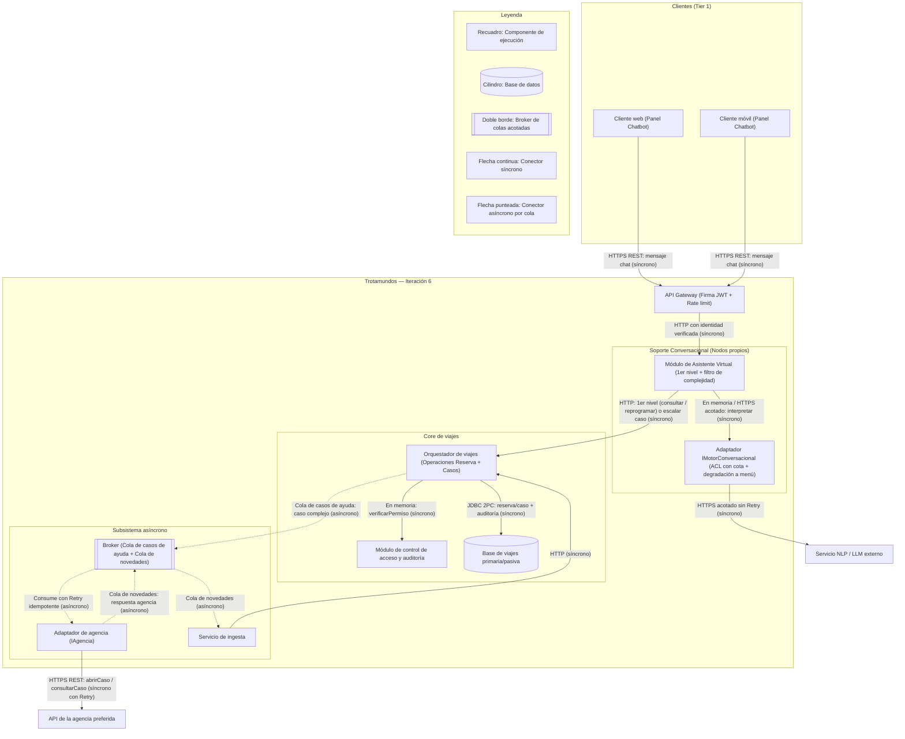

# Trotamundos — iteración 6

| Campo | Valor |
| --- | --- |
| **Ronda** | 1 |
| **Arranque** | Extensión. Se retoma la arquitectura cerrada en las iteraciones 1 a 5 —Core N-Tier, Broker con cinco colas acotadas, identidad particionada, control de acceso y auditoría, `IAgencia` y camino analítico— y se incorpora el requerimiento funcional avanzado obligatorio de la segunda entrega sin reabrir ningún driver ya cerrado. |
| **Qué toma esta iteración** | El único driver que quedaba en `Not Yet`: `REF-07` — Asistente virtual / Chatbot (Opción B del enunciado), como primer nivel de soporte interactivo con delegación de los casos complejos a la agencia de viajes preferida del usuario. |

El paso 1 de la ronda está en [README.md](README.md). El cierre de la iteración anterior está en [ITERACION_5.md](ITERACION_5.md).

## Paso 2. Establecer el goal

| Id | En el goal o afuera |
| --- | --- |
| `REF-07` | En el goal. Requerimiento funcional avanzado obligatorio de la segunda entrega (Opción B — Asistente virtual / Chatbot): implementar un bot conversacional integrado que actúe como primer nivel de soporte interactivo para gestionar reprogramaciones, consultas de estado y problemas menores, delegando a la agencia de viajes preferida del usuario únicamente aquellos casos complejos. |

**Drivers ya resueltos (`Completely` al cierre de la iteración 5):** `REF-01`, `REF-02`, `REF-03`, `REF-04`, `REF-05`, `REF-06`, `CON-01`, `CON-02`, `QA-PER-01`, `QA-PER-02`, `QA-PER-03`, `QA-PER-04*`, `QA-DIS-01`, `QA-ESC-01`, `QA-INT-01`, `QA-INT-02`, `QA-SEG-01`, `QA-SEG-02`, `QA-SEG-03*`, `QA-EVO-01`, `QA-USA-01`.

**Goal.** Incorporar a la arquitectura el requerimiento funcional avanzado elegido para la segunda entrega (`REF-07` — Asistente virtual / Chatbot), apoyándose en las capacidades ya diseñadas en la iteración 4 —la gestión manual idempotente con control de acceso (`REF-04`, `QA-SEG-02`) y la integración asíncrona con la agencia preferida detrás de `IAgencia` (`REF-05`)— sin degradar los 800 ms de la cotización (`QA-PER-02`) ni la disponibilidad global (`QA-DIS-01`).

## Paso 3. Elegir los elementos a refinar

| Elemento | Por qué este | Movimiento |
| --- | --- | --- |
| Módulo de Asistente Virtual y contrato `IMotorConversacional` | No existen. Son el componente conversacional de primer nivel y la abstracción (ACL) del clasificador/motor de lenguaje natural que interpreta la intención del viajero (`REF-07`). | Instanciar |
| API Gateway | Único punto de entrada para web y móvil (`CON-01`, [ADR-008](ADRs/ITERACION_1/ADR-008.md)). Debe validar la firma del token de sesión, aplicar limitación de tasa y encaminar los mensajes del chat al Módulo de Asistente Virtual (`REF-07`, `QA-SEG-01`). | Refinar |
| Orquestador de viajes | Es el dueño de los viajes, las reservas (`REF-01`, `REF-04`), el control de acceso y auditoría (`QA-SEG-02`) y la apertura de casos hacia la cola de casos de ayuda (`REF-05`). El Asistente Virtual debe apoyarse en él para resolver el primer nivel o escalar a la agencia sin abrir accesos paralelos a la Base de viajes (`REF-07`). | Refinar |
| Cliente web y Cliente móvil | Ambos deben exponer el panel conversacional integrado del Asistente Virtual (`REF-07`, `CON-01`). | Refinar |

La cola de casos de ayuda del Broker y el Adaptador de agencia (`IAgencia`) de la iteración 4 ([ADR-IT4-010](ADRs/ITERACION_4/ADR-IT4-010.md)) no necesitan cambios estructurales: reciben los casos complejos escalados por el Asistente igual que recibían los reportes manuales.

## Paso 4. Elegir los conceptos de diseño

### 4.1 Dónde se despliega el Módulo de Asistente Virtual (`REF-07`, `QA-PER-02`, `CON-01`)

| Alternativa | Tipo | Beneficia | Perjudica | Queda |
| --- | --- | --- | --- | --- |
| Desplegar el Módulo de Asistente Virtual en nodos propios sin estado, detrás del API Gateway, separado de los nodos del Orquestador de viajes | Táctica (performance / escalabilidad: separación por despliegue) | Las sesiones de chat y la clasificación de intenciones durante una disrupción climática no compiten por CPU ni hilos con la cotización de 800 ms (`QA-PER-02`). Sirve por igual a web y móvil (`CON-01`). | Un grupo más de nodos para operar y un salto HTTP interno hacia el Orquestador cuando el bot ejecuta una acción. | Sí |
| Ejecutar el Asistente Virtual dentro de los nodos del Orquestador de viajes | — | Sin salto de red entre el bot y el Orquestador. | El pico de soporte conversacional durante una disrupción comparte nodos con la cotización de 800 ms (`QA-PER-02`). | No |
| Ejecutar la lógica del bot en cada cliente (web y móvil) | — | Sin nodos nuevos en el backend. | Duplica la lógica en dos clientes (`CON-01`) y expone reglas y credenciales del motor conversacional en el borde. | No |

### 4.2 Cómo ejecuta el Asistente las consultas y reprogramaciones de primer nivel (`REF-07`, `REF-04`, `QA-SEG-02`)

| Alternativa | Tipo | Beneficia | Perjudica | Queda |
| --- | --- | --- | --- | --- |
| El Asistente Virtual invoca las operaciones existentes del Orquestador de viajes (consulta de estado, `agregarReserva`, `actualizarReserva(id)`, `eliminarReserva(id)`) propagando la identidad verificada del actor y una clave de operación del turno, con confirmación explícita previa del viajero para escrituras | Tácticas (seguridad + modificabilidad) | Reutiliza el único camino de validación polimórfica, clave de idempotencia, Módulo de control de acceso (`verificarPermiso`), auditoría transaccional y emisión de eventos analíticos (`REF-04`, `QA-SEG-02`, `REF-06`). Nadie puede usar el bot para saltear permisos en un itinerario compartido. | Suma una llamada interna al Orquestador y exige un paso de confirmación en el diálogo antes de modificar o dar de baja una reserva. | Sí |
| Conectar el Módulo de Asistente Virtual por JDBC directo a la Base de viajes | — | Menos saltos internos. | Rompe la propiedad exclusiva del Orquestador sobre la Base de viajes, duplica la validación polimórfica de `Reserva` y permite eludir el control de acceso y la auditoría de `QA-SEG-02`. | No |

### 4.3 Cómo se separan los problemas menores de los casos complejos y cómo se delega a la agencia (`REF-07`, `REF-05`)

| Alternativa | Tipo | Beneficia | Perjudica | Queda |
| --- | --- | --- | --- | --- |
| Clasificación en dos niveles: 1) Primer nivel (consultas de estado/novedades y reprogramaciones o bajas sobre reservas editables) resuelto contra el Orquestador; 2) Caso complejo (reembolsos, disputas, tramos con penalidad, proveedor caído o pedido explícito del viajero) delegado invocando la apertura de caso en el Orquestador con el resumen del diálogo, que sale por la cola de casos de ayuda hacia `IAgencia` | Táctica (interoperabilidad: Use an intermediary + ACL) | Cumple `REF-07` reutilizando sin cambios la cola de casos de ayuda y el Adaptador de agencia (`IAgencia`) de `ADR-IT4-010`. Filtra el ruido antes de llegar a la agencia y envía el contexto estructurado cuando escala. | Requiere ofrecer siempre una opción explícita ("derivar a mi agencia") por si el viajero quiere escalar manualmente. | Sí |
| Llamada síncrona directa del Asistente Virtual a la API de la agencia preferida | — | Respuesta inmediata si la agencia contesta rápido. | Viola el rechazo de llamada síncrona a terceros ([ADR-IT4-014](ADRs/ITERACION_4/ADR-IT4-014.md)) y pierde el reclamo si la agencia está caída. | No |

### 4.4 Cómo se protege el soporte si el motor de lenguaje natural se demora o falla (`REF-07`, `QA-DIS-01`)

| Alternativa | Tipo | Beneficia | Perjudica | Queda |
| --- | --- | --- | --- | --- |
| Encapsular el clasificador/LLM detrás del contrato `IMotorConversacional` (ACL) con cota de espera (*Bound execution times*) y degradación elegante (*Graceful degradation*) a un menú guiado de opciones de primer nivel y escalamiento | Tácticas (interoperabilidad + disponibilidad) | Si el motor de NLP/LLM falla o supera la cota, el viajero sigue pudiendo consultar estado, reprogramar o derivar a su agencia mediante opciones guiadas (`REF-07`, `QA-DIS-01`). Permite además intercambiar el motor sin tocar el Asistente. | En modo degradado se reemplaza el texto libre por opciones estructuradas. | Sí |
| Acoplar el Asistente a un proveedor de LLM sin degradación | — | Menos código en el módulo. | La caída del proveedor externo deja al viajero sin primer nivel y sin forma de escalar desde el asistente. | No |

**Tácticas que quedan:** Separación por despliegue del Módulo de Asistente Virtual en nodos propios sin estado, reutilización de las operaciones autorizadas e idempotentes del Orquestador de viajes, clasificación en dos niveles con delegación asíncrona por la cola de casos de ayuda hacia `IAgencia`, y Capa Anti-Corrupción (`IMotorConversacional`) con Bound execution times y Graceful degradation a menú guiado.

**Tácticas reutilizadas de las iteraciones 1 a 5:**

- N-Tier ([ADR-001](ADRs/ITERACION_1/ADR-001.md)): el Asistente Virtual es un componente más del tier de negocio; no cambia el estilo del Core.
- API Gateway como único punto de entrada ([ADR-008](ADRs/ITERACION_1/ADR-008.md)), con validación de firma del token ([ADR-IT4-004](ADRs/ITERACION_4/ADR-IT4-004.md)) y limitación de tasa ([ADR-IT4-005](ADRs/ITERACION_4/ADR-IT4-005.md)): el chat entra por el mismo borde que el resto del panel y sirve por igual a web y móvil (`CON-01`).
- Capa Anti-Corrupción / Adaptadores ([ADR-007](ADRs/ITERACION_1/ADR-007.md)) y Abstract common services ([ADR-IT3-004](ADRs/ITERACION_3/ADR-IT3-004.md)): el motor de lenguaje natural se trata como cualquier otro tercero, detrás de `IMotorConversacional`.
- Bound execution times y Graceful degradation ([ADR-IT2-001](ADRs/ITERACION_2/ADR-IT2-001.md), [ADR-IT2-002](ADRs/ITERACION_2/ADR-IT2-002.md)): cota de espera al motor conversacional y degradación a opciones guiadas, con el mismo criterio que la cotización.
- Separación por despliegue en nodos propios ([ADR-IT3-010](ADRs/ITERACION_3/ADR-IT3-010.md), [ADR-IT4-002](ADRs/ITERACION_4/ADR-IT4-002.md)): el soporte conversacional no comparte nodos con la cotización de 800 ms.
- Broker con colas acotadas y Retry con identificador único ([ADR-IT3-001](ADRs/ITERACION_3/ADR-IT3-001.md) a [ADR-IT3-003](ADRs/ITERACION_3/ADR-IT3-003.md)) y `IAgencia` sobre la cola de casos de ayuda ([ADR-IT4-010](ADRs/ITERACION_4/ADR-IT4-010.md)): el escalamiento del bot usa el canal asíncrono que ya existía para `REF-05`.
- Autorización por itinerario con auditoría en la misma transacción ([ADR-IT4-007](ADRs/ITERACION_4/ADR-IT4-007.md)) y operaciones manuales idempotentes con `origen` y baja lógica ([ADR-IT4-008](ADRs/ITERACION_4/ADR-IT4-008.md)): son el camino único de escritura que el bot invoca.
- Camino analítico por la quinta cola ([ADR-IT5-001](ADRs/ITERACION_5/ADR-IT5-001.md)): toda reprogramación hecha por el bot emite su evento analítico sin trabajo adicional, porque la emite el Orquestador.

**Justificación de la selección:**

- **El Asistente no es un dueño de datos, es un traductor de intenciones.** `REF-07` pide un primer nivel de soporte, no un segundo camino de escritura. Por eso la decisión central es que el bot invoque las operaciones del Orquestador propagando la identidad del actor y una clave de operación ([ADR-IT6-002](ADRs/ITERACION_6/ADR-IT6-002.md)) en lugar de tocar la Base de viajes ([ADR-IT6-005](ADRs/ITERACION_6/ADR-IT6-005.md)).
- **`QA-SEG-02` se cumple por construcción, no por una regla nueva en el bot.** Si el Asistente reutiliza `verificarPermiso` y la auditoría transaccional de la iteración 4, un participante sin permiso recibe la misma denegación y el mismo asiento de auditoría que desde la grilla manual. Duplicar esa lógica en el chat habría abierto una vía para saltearla.
- **La frontera entre primer nivel y caso complejo es una decisión de diseño, no de producto.** `REF-07` habla de problemas menores y de casos complejos sin enumerarlos, así que la iteración fija el criterio explícito ([ADR-IT6-003](ADRs/ITERACION_6/ADR-IT6-003.md)): lo que se resuelve con las operaciones ya existentes sobre el itinerario es primer nivel; lo que involucra dinero, penalidades de proveedor o un tercero que no responde se delega.
- **El escalamiento pasa por el Orquestador y no directo al Broker.** El Orquestador es el dueño del estado del caso y quien valida el permiso sobre ese itinerario, así que encolar desde el Asistente habría dejado casos sin estado persistido ni autorización.
- **La idempotencia del chat es obligatoria.** Un mensaje reenviado o un reintento de red en una conversación es más probable que en un formulario, así que cada turno conversacional lleva su clave de operación sobre las operaciones idempotentes de [ADR-IT4-008](ADRs/ITERACION_4/ADR-IT4-008.md).
- **Confirmación explícita antes de escribir.** El riesgo propio del lenguaje natural es la mala interpretación, no la falta de permisos. Por eso toda modificación o baja lógica disparada por el chat exige una confirmación en el diálogo ([ADR-IT6-002](ADRs/ITERACION_6/ADR-IT6-002.md)).
- **El motor de lenguaje es reemplazable y prescindible.** `QA-DIS-01` no admite que el soporte quede fuera de línea porque un tercero de NLP se demore, y el prototipo necesita poder correr con un clasificador determinístico. Las dos cosas se resuelven con el mismo contrato y la misma degradación ([ADR-IT6-004](ADRs/ITERACION_6/ADR-IT6-004.md)).
- **Rechazo de Retry contra el motor conversacional.** Se mantiene el motivo de la iteración 2 ([ADR-IT2-006](ADRs/ITERACION_2/ADR-IT2-006.md)): hay un usuario esperando en una conversación interactiva, así que la cota vence hacia el menú guiado en lugar de reintentar.

Prototipo throwaway: ninguno por ahora.

## Paso 5. Instanciar, asignar y definir interfaces

Cuatro decisiones fijan este paso:

- **El Módulo de Asistente Virtual corre en nodos propios sin estado**, detrás del API Gateway. No comparte nodos con la cotización ni accede de forma directa a ninguna base de datos.
- **El primer nivel reusa las operaciones del Orquestador de viajes.** Consultar el estado de un viaje/reserva o aplicar una reprogramación menor por chat ejecuta exactamente los mismos métodos, permisos (`verificarPermiso`), clave de idempotencia y auditoría transaccional de la iteración 4.
- **Los casos complejos se delegan por la ruta asíncrona de `REF-05`.** Cuando el Asistente detecta un caso complejo o el viajero pide hablar con su agencia, registra el caso en el Orquestador adjuntando el resumen estructurado del diálogo; el Orquestador lo publica en la cola de casos de ayuda y el Adaptador de agencia (`IAgencia`) lo entrega con Retry.
- **La interpretación de lenguaje natural se aísla detrás de `IMotorConversacional` con cota de espera y degradación a opciones guiadas.**

### Qué se agrega y dónde va

| Elemento | ¿Nuevo o existente? | Dónde va | Para qué driver |
| --- | --- | --- | --- |
| Módulo de Asistente Virtual | Nuevo | Tier 2, en nodos propios sin estado | `REF-07`, `QA-PER-02` |
| `IMotorConversacional` y su adaptador | Nuevo | Tier 2, invocado por el Módulo de Asistente Virtual | `REF-07`, `QA-DIS-01` |
| Orquestador de viajes (recepción de acciones de primer nivel y escalamiento con resumen) | Existente, refinado | Tier 2, Core | `REF-07`, `REF-04`, `REF-05`, `QA-SEG-02` |
| Panel del Asistente Virtual en Cliente web y Cliente móvil | Nuevo en ambos clientes | Tier 1 | `REF-07`, `CON-01` |

### Asistente Virtual y escalamiento (`REF-07`, `REF-04`, `REF-05`, `QA-SEG-02`)

| Elemento | Responsabilidad | Interfaz |
| --- | --- | --- |
| Módulo de Asistente Virtual | Recibe el mensaje del viajero desde el API Gateway con su identidad verificada. Invoca `IMotorConversacional.interpretar` dentro de una cota de tiempo; si vence la cota, degrada a opciones guiadas. Si la intención es de **primer nivel** (consulta de estado/novedades, reprogramación simple o baja de reserva editable tras confirmación del usuario), invoca al Orquestador propagando la identidad del actor y una clave de operación. Si es un **caso complejo** (reembolso, disputa, cambio con penalidad o solicitud de escalar), invoca la apertura de caso en el Orquestador adjuntando la reserva afectada y el resumen de la conversación. | Desde el API Gateway: `procesarMensajeChat(cuenta, idViaje, mensaje, claveOperacion)`. Hacia `IMotorConversacional`: `interpretar(mensaje, contextoViaje)`. Hacia el Orquestador de viajes: consulta de viaje y novedades, `agregarReserva`, `actualizarReserva`, `eliminarReserva` o `abrirCasoAyuda(idReserva, resumenChat)`. |
| `IMotorConversacional` | Contrato interno (ACL) que abstrae el clasificador de intenciones o motor de lenguaje natural. Traduce el texto del viajero en una intención tipada (`CONSULTAR_ESTADO`, `REPROGRAMAR_RESERVA`, `CANCELAR_RESERVA`, `ESCALAR_AGENCIA`) y sus parámetros extraídos. | Interna: `interpretar(mensaje, contextoViaje)` con cota de tiempo (*Bound execution times*). |
| Orquestador de viajes, Cola de casos de ayuda y Adaptador de agencia (`IAgencia`) | Mantienen todas sus responsabilidades de la iteración 4. En las acciones de primer nivel del Asistente, el Orquestador aplica `verificarPermiso`, valida el subtipo de `Reserva`, escribe en la Base de viajes con 2PC y auditoría, y emite el evento analítico. En los casos complejos escalados por el Asistente, guarda el caso con el resumen del diálogo y lo publica en la cola de casos de ayuda para que el Adaptador de agencia lo entregue por `IAgencia.abrirCaso`. | Las de las iteraciones 4 y 5. |

### Relaciones permitidas

- Cliente web y Cliente móvil → API Gateway → Módulo de Asistente Virtual.
- Módulo de Asistente Virtual → `IMotorConversacional` (con cota de tiempo y sin Retry).
- Módulo de Asistente Virtual → Orquestador de viajes (con la identidad verificada del viajero y clave de operación).
- Orquestador de viajes → Módulo de control de acceso → Base de viajes (para validar y auditar las acciones de primer nivel del bot).
- Orquestador de viajes → cola de casos de ayuda → Adaptador de agencia (`IAgencia`) → API de la agencia preferida (para los casos complejos delegados por el bot).
- El Módulo de Asistente Virtual **nunca** se conecta a la Base de viajes, ni a las Bases de cuentas, ni a la Base analítica, ni llama de forma directa a la API de la agencia.

### Secuencia

**Consulta o reprogramación menor resuelta en primer nivel** (`REF-07`, `REF-04`, `QA-SEG-02`). El viajero escribe en el chat que necesita cambiar la fecha de una reserva o consultar su estado. El API Gateway valida la firma del token y entrega el turno al Módulo de Asistente Virtual. El Asistente consulta el contexto del viaje en el Orquestador e invoca a `IMotorConversacional` dentro de su cota. Identificada la reprogramación simple y confirmada por el viajero en el chat, el Asistente llama a `actualizarReserva(id)` en el Orquestador con la identidad del viajero y la clave de operación del turno. El Orquestador verifica el permiso en el Módulo de control de acceso, valida la reserva, escribe el cambio y el asiento de auditoría en la misma transacción 2PC en la Base de viajes, publica el evento analítico y devuelve la confirmación al Asistente, que responde al viajero sin haber involucrado a la agencia.

**Caso complejo delegado a la agencia de viajes preferida** (`REF-07`, `REF-05`). El viajero plantea un problema complejo (por ejemplo una cancelación de vuelo con reclamo de reembolso y conexión perdida, o pide derivar a su agencia). El Módulo de Asistente Virtual clasifica el caso como complejo, resume los datos del reclamo y la reserva involucrada e invoca la apertura de caso en el Orquestador de viajes. El Orquestador persiste el caso como "en trámite", publica el pedido con identificador único en la cola de casos de ayuda del Broker y el Asistente informa en el acto al viajero que su agencia preferida ya recibió el caso. El Adaptador de agencia consume la cola y ejecuta `IAgencia.abrirCaso` con Retry idempotente; cuando la agencia responde, la actualización ingresa por la cola de novedades y el Servicio de ingesta hacia "Novedades".

## Paso 6. Bosquejar y registrar la decisión

### Componentes y conectores — Asistente Virtual de primer nivel y delegación a la agencia preferida

Estructura:



Leyenda:

- Recuadro: Componente de ejecución.
- Cilindro: Base de datos.
- Doble borde: Broker de colas acotadas.
- Flecha continua: Conector síncrono.
- Flecha punteada: Conector asíncrono por cola.
- Frontera: `Trotamundos — Iteración 6` encierra el sistema; los clientes, el servicio NLP/LLM externo y la API de la agencia preferida quedan fuera de la frontera.

### Secuencia — Resolución de primer nivel vs. delegación de caso complejo a la agencia (`REF-07`, `REF-04`, `REF-05`, `QA-SEG-02`)

Estructura:

```mermaid
sequenceDiagram
    participant V as Viajero (Web / Móvil)
    participant GW as API Gateway
    participant MAV as Módulo Asistente Virtual
    participant IMC as IMotorConversacional
    participant ORQ as Orquestador de viajes
    participant MCA as Módulo control de acceso
    participant BVP as Base de viajes (2PC)
    participant BRK as Broker (Cola casos ayuda)
    participant AAG as Adaptador de agencia (IAgencia)
    participant AG as API Agencia Preferida

    Note over V: Leyenda: línea continua = llamada síncrona; línea punteada = mensaje asíncrono o retorno. Viajero y API Agencia Preferida son externos.
    V->>GW: 1. Envía consulta o pedido en el chat [HTTPS REST]
    GW->>MAV: 2. Encamina mensaje con identidad verificada [HTTP]
    MAV->>IMC: 3. interpretar(mensaje, contexto) [con cota de espera]
    IMC-->>MAV: 4. Intención clasificada (o menú guiado si venció la cota)

    alt Caso de Primer Nivel (consulta de estado o reprogramación menor confirmada)
        MAV->>ORQ: 5a. actualizarReserva(id, datos, claveOperacion) con identidad del viajero [HTTP]
        ORQ->>MCA: 6a. verificarPermiso(cuenta, itinerario, MODIFICAR)
        ORQ->>BVP: 7a. Persiste cambio + asiento de auditoría en la misma transacción [JDBC 2PC]
        BVP-->>ORQ: 8a. Confirmación
        ORQ-->>MAV: 9a. Reserva reprogramada (o denegado 401 si no tiene rol)
        MAV-->>V: 10a. Confirmación inmediata en el chat (sin tocar la agencia)
    else Caso Complejo (reembolso, disputa, proveedor caído o solicitud de escalar)
        MAV->>ORQ: 5b. abrirCasoAyuda(idReserva, resumenConversacion) [HTTP]
        ORQ->>BVP: 6b. Registra caso "en trámite" + auditoría [JDBC 2PC]
        ORQ--)BRK: 7b. Publica caso complejo con id único en cola de casos de ayuda
        ORQ-->>MAV: 8b. Caso registrado "en trámite"
        MAV-->>V: 9b. Informa que el caso fue delegado a su agencia preferida
        BRK--)AAG: 10b. Consume caso de ayuda
        AAG->>AG: 11b. abrirCaso(casoConResumen) con Retry idempotente [HTTPS REST]
        AG-->>AAG: 12b. Acuse de agencia (las actualizaciones vuelven por cola de novedades)
    end
```

### Catálogo

Decisiones de diseño registradas en [ADRs/ITERACION_6](ADRs/ITERACION_6/), justificadas en [Justificación_ADRs_iteración_6.md](ADRs/ITERACION_6/Justificación_ADRs_iteración_6.md).

| ID | Decisión | Estado |
| --- | --- | --- |
| ADR-IT6-001 | [Módulo de Asistente Virtual en nodos propios, desacoplado de los nodos de cotización](ADRs/ITERACION_6/ADR-IT6-001.md) | aceptado |
| ADR-IT6-002 | [Resolución de primer nivel reutilizando las operaciones autorizadas e idempotentes del Orquestador de viajes](ADRs/ITERACION_6/ADR-IT6-002.md) | aceptado |
| ADR-IT6-003 | [Escalamiento de casos complejos del Asistente Virtual a la agencia preferida mediante la cola de casos de ayuda e `IAgencia`](ADRs/ITERACION_6/ADR-IT6-003.md) | aceptado |
| ADR-IT6-004 | [Contrato `IMotorConversacional` (ACL) con cota de espera y degradación a menú guiado](ADRs/ITERACION_6/ADR-IT6-004.md) | aceptado |
| ADR-IT6-005 | [Acceso directo del Asistente Virtual a la Base de viajes o a la API de la agencia](ADRs/ITERACION_6/ADR-IT6-005.md) | rechazado |

## Paso 7. Analizar y revisar el purpose

| Id del goal | Estado | Una oración |
| --- | --- | --- |
| `REF-07` | Completely | El Módulo de Asistente Virtual corre en nodos propios detrás del API Gateway ([ADR-IT6-001](ADRs/ITERACION_6/ADR-IT6-001.md)), interpreta intenciones detrás de `IMotorConversacional` con cota de tiempo y degradación a menú guiado ([ADR-IT6-004](ADRs/ITERACION_6/ADR-IT6-004.md)), resuelve en primer nivel las consultas de estado y reprogramaciones menores a través de las operaciones autorizadas e idempotentes del Orquestador ([ADR-IT6-002](ADRs/ITERACION_6/ADR-IT6-002.md)) y delega únicamente los casos complejos a la agencia preferida por la cola de casos de ayuda e `IAgencia` ([ADR-IT6-003](ADRs/ITERACION_6/ADR-IT6-003.md)). |

### Justificación del estado

| Id | Qué estaba abierto al cierre de la iteración 5 | Cómo lo cierra la iteración 6 |
| --- | --- | --- |
| `REF-07` | Dónde se despliega el bot conversacional sin degradar los 800 ms de la cotización (`QA-PER-02`) ni la disponibilidad global (`QA-DIS-01`). | Módulo de Asistente Virtual en nodos propios sin estado detrás del API Gateway, separado de los nodos del Orquestador ([ADR-IT6-001](ADRs/ITERACION_6/ADR-IT6-001.md)). |
| `REF-07` | Cómo resuelve el primer nivel (consultas de estado, reprogramaciones y problemas menores) sin abrir un segundo camino de acceso a los datos ni saltear permisos (`REF-04`, `QA-SEG-02`). | El bot traduce la intención en llamadas a las operaciones idempotentes y autorizadas del Orquestador, con identidad del actor, clave de operación, `verificarPermiso` y auditoría en la misma transacción ([ADR-IT6-002](ADRs/ITERACION_6/ADR-IT6-002.md)), rechazando el acceso directo a la Base de viajes y a la API de la agencia ([ADR-IT6-005](ADRs/ITERACION_6/ADR-IT6-005.md)). |
| `REF-07` | Qué es un caso complejo y por dónde se delega a la agencia de viajes preferida (`REF-05`). | Clasificación explícita en dos niveles y delegación asíncrona por la cola de casos de ayuda hacia `IAgencia`, con el resumen del diálogo y la reserva afectada ([ADR-IT6-003](ADRs/ITERACION_6/ADR-IT6-003.md)). |
| `REF-07` | Qué pasa con el soporte si el motor de lenguaje natural se demora o falla (`QA-DIS-01`). | Contrato `IMotorConversacional` (ACL) con cota de espera y degradación a menú guiado de primer nivel, sin Retry bloqueante ([ADR-IT6-004](ADRs/ITERACION_6/ADR-IT6-004.md)). |

### Trade-offs aceptados

| Driver | Qué se sacrifica | A cambio de |
| --- | --- | --- |
| `REF-07`, `QA-PER-02` | Un salto HTTP interno del Asistente al Orquestador y un grupo más de nodos para operar ([ADR-IT6-001](ADRs/ITERACION_6/ADR-IT6-001.md)). | Que una tormenta de chats durante una disrupción climática no consuma nodos de la cotización de 800 ms. |
| `REF-07`, `QA-SEG-02` | El Asistente debe pedir confirmación antes de ejecutar una escritura y depende del Orquestador ([ADR-IT6-002](ADRs/ITERACION_6/ADR-IT6-002.md), [ADR-IT6-005](ADRs/ITERACION_6/ADR-IT6-005.md)). | Un único punto de autorización, auditoría transaccional y validación polimórfica de `Reserva`, sin riesgo de saltear permisos por chat. |
| `REF-07`, `QA-DIS-01` | Cuando el motor de lenguaje natural tarda o cae, el chat pasa de texto libre a menú guiado ([ADR-IT6-004](ADRs/ITERACION_6/ADR-IT6-004.md)). | Que el viajero nunca pierda el soporte de primer nivel ni la derivación a su agencia preferida. |

### Riesgos residuales

| Riesgo | Registrado en | Por qué no cambia el estado |
| --- | --- | --- |
| Que el clasificador interprete como simple un caso que el viajero quería enviar a la agencia. | [ADR-IT6-003](ADRs/ITERACION_6/ADR-IT6-003.md) | La interfaz ofrece siempre la acción explícita "derivar a mi agencia" para escalar en un paso. |

### Cierre

| Pregunta | Respuesta |
| --- | --- |
| ¿Se cumplió el goal? | Sí. `REF-07` queda en `Completely` y los 21 drivers anteriores conservan su estado `Completely`. |
| Purpose de la ronda | Con esta sexta iteración quedan completos el diseño de la primera parte y el requerimiento avanzado obligatorio de la segunda entrega, listos para las especificaciones contractuales (`specs/`) y los planes de implementación (`planes/`). |
| ¿Hace falta otra iteración? | No. Los 22 drivers de [LISTADO_DRIVERS.md](LISTADO_DRIVERS.md) están en `Completely`. |

### Estado de los veintidós drivers al cierre de la Iteración 6

| Estado | Drivers |
| --- | --- |
| `Completely` | `REF-01`, `REF-02`, `REF-03`, `REF-04`, `REF-05`, `REF-06`, `REF-07`, `CON-01`, `CON-02`, `QA-PER-01`, `QA-PER-02`, `QA-PER-03`, `QA-PER-04*`, `QA-DIS-01`, `QA-ESC-01`, `QA-INT-01`, `QA-INT-02`, `QA-SEG-01`, `QA-SEG-02`, `QA-SEG-03*`, `QA-EVO-01`, `QA-USA-01` |
| `Partially` | — |
| `Not Yet` | — |
