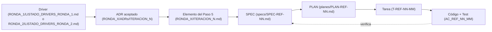

# Políticas de Especificaciones (Specs) y Planes — Trotamundos

Este documento define las reglas, plantillas y convenciones para elaborar las **especificaciones contractuales (`specs/`)** y los **planes de implementación (`planes/`)** del prototipo arquitectónico de **Trotamundos**, manteniendo trazabilidad completa hacia el proceso ADD ([ITERACION_1.md](RONDA_1/ITERACION_1.md) a [ITERACION_5.md](RONDA_1/ITERACION_5.md)), los ADRs (`RONDA_1/ADRs/` y `RONDA_2/ADRs/`) y los listados cerrados de drivers ([RONDA_1/LISTADO_DRIVERS_RONDA_1.md](RONDA_1/LISTADO_DRIVERS_RONDA_1.md) y [RONDA_2/LISTADO_DRIVERS_RONDA_2.md](RONDA_2/LISTADO_DRIVERS_RONDA_2.md)).

---

## 1. Principio Rector: Cadena de Trazabilidad

Cada línea de código y cada prueba automatizada del prototipo debe poder rastrearse sin saltos hasta el escenario de atributo de calidad, requerimiento funcional o restricción que la originó:



1. **Nada entra al código sin Spec aprobada y Plan aprobado.**
2. **La Spec no toma decisiones arquitectónicas:** transcribe y formaliza contractualmente lo que ya decidieron el Paso 5 y los ADRs `aceptado`. Enumera los elementos del Paso 5 que realizan su requerimiento funcional y copia, en «Conceptos de diseño aceptados», la restricción del ADR `aceptado`. Si al redactar una Spec aparece una elección de arquitectura no cubierta por un ADR, la Spec se frena y se registra primero el ADR con `skill-adrs`.
3. **Respeto estricto a `RONDA_1/LISTADO_DRIVERS_RONDA_1.md`:** según la regla `.cursor/rules/listado-drivers-cerrado.mdc`, ninguna Spec ni Plan puede inventar o citar un driver que no exista en `RONDA_1/LISTADO_DRIVERS_RONDA_1.md` o en `RONDA_2/LISTADO_DRIVERS_RONDA_2.md`.

---

## 2. Diferencia entre una Spec y un Plan

| Aspecto | **SPEC (`specs/SPEC-REF-<NN>.md`)** | **PLAN (`planes/PLAN-REF-<NN>.md`)** |
| :--- | :--- | :--- |
| **Pregunta que responde** | *¿Qué hace este elemento y cuál es su contrato exacto?* | *¿Cómo lo construimos en el prototipo y en qué orden?* |
| **Fuentes permitidas** | Paso 5 y Paso 7 de `RONDA_X/ITERACION_N.md`, ADRs en estado `aceptado`, `RONDA_1/LISTADO_DRIVERS_RONDA_1.md` o `RONDA_2/LISTADO_DRIVERS_RONDA_2.md`. | La Spec ya `aprobada` y el stack definido en [planes/PLAN_MAESTRO.md](planes/PLAN_MAESTRO.md). |
| **Nivel de abstracción** | Contractual: operaciones, entradas, salidas, errores, cotas, invariantes y criterios de aceptación. | Implementación: archivos a crear, clases/funciones, mocks, tareas chicas y nombres de tests. |
| **Cuándo cambia** | Solo si se modifica o agrega un ADR o se ajusta el alcance del prototipo. | Puede ajustarse libremente durante la implementación mientras siga cumpliendo el 100 % de los `AC` de su Spec. |
| **Confirmación** | Requiere respuesta explícita **`OK SPEC`** del usuario. | Requiere respuesta explícita **`OK PLAN`** del usuario. |

---

## 3. Estructura de Directorios y Nomenclatura

Las especificaciones y los planes viven en carpetas separadas en la raíz del repositorio:

```text
trotamundos-v1/
├── POLITICAS_SPECS_Y_PLANES.md       # Este documento
├── TRAZABILIDAD.md                   # Matriz global Driver -> ADR -> SPEC -> AC -> Test
├── specs/
│   ├── SPEC_TEMPLATE.md              # Plantilla obligatoria de Spec
│   └── SPEC-REF-<NN>.md              # Una spec por requerimiento funcional REF-01 a REF-07
├── planes/
│   ├── PLAN_TEMPLATE.md              # Plantilla obligatoria de Plan
│   ├── PLAN_MAESTRO.md               # Hoja de ruta de los 5 slices del prototipo y stack
│   └── PLAN-REF-<NN>.md              # Un plan por cada SPEC aprobada (mismo sufijo)
└── .cursor/skills/
    ├── skill-specs/SKILL.md          # Skill interactiva para redactar specs
    └── skill-plan/SKILL.md           # Skill interactiva para redactar planes
```

### 3.1. Códigos de `<REF>`

La unidad de una spec es un requerimiento funcional, `REF-01` a `REF-07`. No hay una spec por elemento del Paso 5 y el archivo no lleva título de ronda. Dentro de la spec se agrupan los drivers de calidad y las restricciones que la iteración ata a esa funcionalidad, y se transcriben los conceptos de diseño cuyo ADR está `aceptado`. Esos conceptos guían cómo se implementa el requerimiento. La spec enumera los elementos del Paso 5 que lo realizan y no elige arquitectura nueva.

| Código | Requerimiento | Spec |
| :--- | :--- | :--- |
| `REF-01` | Ciclo de vida del viaje | `SPEC-REF-01` |
| `REF-02` | Procesamiento de correo | `SPEC-REF-02` |
| `REF-03` | Filtros y whitelists | `SPEC-REF-03` |
| `REF-04` | Gestión manual | `SPEC-REF-04` |
| `REF-05` | Resolución de problemas | `SPEC-REF-05` |
| `REF-06` | Analítica de datos | `SPEC-REF-06` |
| `REF-07` | Asistente virtual (Chatbot) | `SPEC-REF-07` |

Registro y autenticación, cotización, caché de borde, novedades de Booking (`QA-PER-01`), notificaciones (`QA-INT-02`) y el cliente con GPS (`QA-USA-01`) no tienen spec en esta tanda.

### 3.2. Identificadores Estables

- **Especificación:** `SPEC-REF-<NN>` (ej. `SPEC-REF-01`). `<NN>` es el mismo número del rótulo `REF-<NN>`.
- **Criterio de aceptación:** `AC-REF-<NN>-<MM>` (ej. `AC-REF-01-01`).
- **Plan:** `PLAN-REF-<NN>` (mismo sufijo que la Spec que implementa).
- **Tarea:** `T-REF-<NN>-<MM>` (ej. `T-REF-01-01`).
- Un identificador **nunca se reutiliza** si una spec o tarea se descarta.

---

## 4. Reglas para Redactar una Spec (`skill-specs`)

1. **No inferir lo no especificado:** igual que en `skill-adrs` y `skill-sketch`, ningún campo cuyo dato no esté en el Paso 5, en un ADR `aceptado` o dicho por el usuario en el chat se inventa. Se deja `[sin especificar]` y se pregunta ofreciendo posibles datos con su fuente.
2. **Nombres exactos del Paso 5:** los componentes, contratos y métodos conservan los nombres exactos de las iteraciones (`IProveedor`, `ICotizadorHotel`, `ICanal.enviar`, `IAgencia.abrirCaso`, `verificarPermiso`, `agregarReserva`, `actualizarReserva`, `eliminarReserva`, `Reserva.lugar`, etc.).
3. **Relaciones permitidas explícitas:** toda Spec enumera con qué elementos puede hablar y con cuáles tiene prohibido comunicarse según la sección *Relaciones permitidas* de las iteraciones 1 a 4 (por ejemplo: el Orquestador de viajes no lee ni escribe en ninguna Base de cuentas; el Servicio de ingesta no escribe directo en la Base de viajes; el Parseo aislado no accede a la base ni al token).
4. **Criterios de aceptación (`AC-*`) medibles:** redactados con *Dado / Cuando / Entonces*, indicando qué driver o ADR verifican y cómo se prueban.
5. **Parámetros abiertos como valores de prototipo:** aquellos números que los ADRs dejaron abiertos como parámetros de configuración (ej. tamaño máximo de cada cola en `ADR-IT3-002`, cantidad de reintentos y backoff en `ADR-IT3-003`, ventana y cupo del rate limit en `ADR-IT4-005`, vida corta del token en `ADR-IT4-004`, cota de cada adaptador en `ADR-IT2-003`) se fijan en la tabla *Parámetros Configurables (Valores de Prototipo)* para poder correr los tests.
6. **Simplificaciones permitidas y prohibidas:**
   - *Permitido:* simular las 3 regiones geográficas con 3 instancias/bases separadas en el mismo entorno local; simular las APIs externas (`CON-02`) con mocks locales a los que se les puede inyectar latencia o caída; usar el conector SQL del lenguaje elegido en lugar de `JDBC` nominal manteniendo transacciones y el coordinador de commit en dos fases (2PC).
   - *Prohibido:* cualquier simplificación que viole una frontera o táctica de un ADR aceptado (ej. unificar la Base de cuentas con la Base de viajes, hacer llamadas síncronas donde el ADR fijó una cola del Broker, o saltear el control de acceso/auditoría).

---

## 5. Reglas para Redactar un Plan (`skill-plan`)

1. **Precondición:** solo se redacta `PLAN-REF-<NN>` cuando `SPEC-REF-<NN>` está en estado `aprobada`.
2. **Alineación con los 5 Incrementos (Vertical Slices):** cada plan se ubica dentro de uno de los 5 slices definidos en [planes/PLAN_MAESTRO.md](planes/PLAN_MAESTRO.md).
3. **Mapeo 1 a 1 entre paquetes de código y elementos del Paso 5:** la tabla *Estructura de Código* del plan debe mostrar qué carpeta/archivo representa a cada componente del Paso 5 y qué imports tiene prohibidos para hacer cumplir la arquitectura en el código.
4. **Cobertura total de `AC`:**
   - Toda tarea `T-REF-<NN>-<MM>` cubre al menos un `AC-REF-<NN>-<KK>`.
   - Todo `AC` de la Spec figura en la *Matriz de Cobertura* asociado a una tarea y al nombre exacto de su test automatizado.
5. **Inyección de fallos para demostrar tácticas:** cuando la Spec involucra una táctica de disponibilidad, performance o seguridad (ej. timeout de 800 ms, caída de nodo, caída de Base primaria, cola llena, ráfaga de 50 requests), el plan debe incluir el mecanismo de prueba que provoca el estímulo y verifica la respuesta arquitectónica.

---

## 6. Convenciones de Trazabilidad en el Código del Prototipo

- **Encabezado de archivo fuente:**
  ```python
  # SPEC: SPEC-REF-<NN>
  # ELEMENTO PASO 5: <Nombre del elemento> (ITERACION_<N>)
  # ADRs: ADR-..., ADR-IT...
  # DRIVERS: QA-..., REF-...
  ```
- **Nombre de los tests automatizados:**
  `test_AC_REF_<NN>_<MM>_<descripcion_corta>` (ej. `test_AC_REF_04_02_sin_permiso_presenta_pagina_error_401`).
- **Mensajes de commit:**
  `[T-REF-<NN>-<MM>] <descripción corta> (SPEC-REF-<NN>)`.
