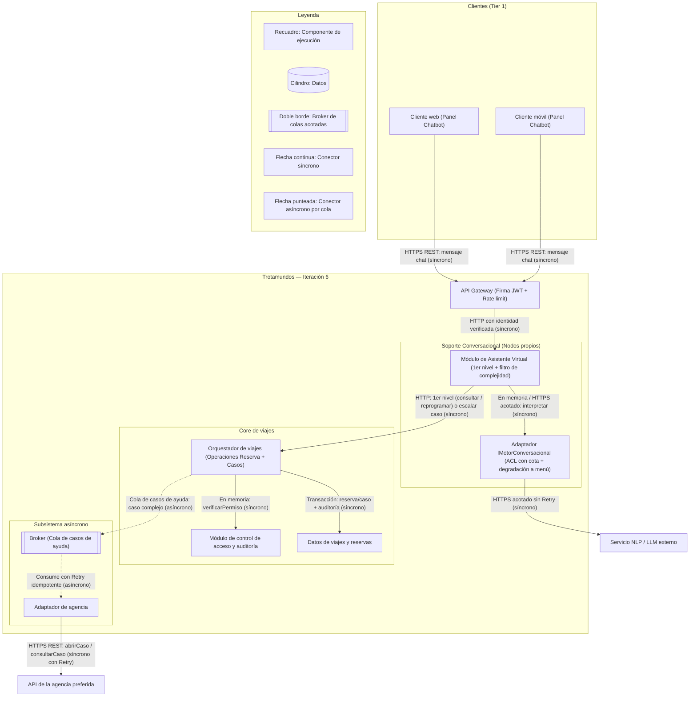

# Trotamundos — iteración 1

| Campo | Valor |
| --- | --- |
| **Ronda** | 2 |
| **Arranque** | Extensión. Se retoma la arquitectura cerrada de la Ronda 1 sin reabrir ninguno de sus drivers y se incorpora el requerimiento funcional avanzado obligatorio de la segunda entrega. |
| **Qué toma esta iteración** | `REF-07` — Asistente virtual / Chatbot, como primer nivel de soporte interactivo con delegación de los casos complejos a la agencia de viajes preferida del usuario, junto con `QA-DIS-02` (número de contacto de la agencia de viajes preferida si ningún proveedor de modelo de IA está disponible). `QA-PER-05` (respuesta al viajero en como máximo 35 segundos) se selecciona en esta iteración pero no llega a resolverse por completo. `QA-SEG-04` queda para la siguiente iteración. |

El cierre de la iteración anterior está en [RONDA_1/ITERACION_5.md](../RONDA_1/ITERACION_5.md).

## Paso 1. Revisar las entradas

**Purpose de la ronda.** Extender la arquitectura cerrada de la Ronda 1 con el asistente virtual, en web y móvil, sin reabrir los drivers de esa ronda.

Los drivers de esta ronda son `REF-07`, `QA-PER-05`, `QA-DIS-02` y `QA-SEG-04`. El texto está en [LISTADO_DRIVERS_RONDA_2.md](LISTADO_DRIVERS_RONDA_2.md). No entra otro.

**Criterio sobre los escenarios.** `QA-PER-05`, `QA-DIS-02` y `QA-SEG-04` se fijaron para el asistente y operan como drivers de esta ronda. Los drivers de la Ronda 1 permanecen en `Completely` y no son entrada de esta revisión.

### Entradas

| Clase | Ids vigentes | Hueco o supuesto de esta ronda |
| --- | --- | --- |
| Design purpose | Ronda 2, extensión sobre la arquitectura cerrada | Incorporar el asistente virtual sin reabrir los drivers de la Ronda 1. |
| Escenarios de QA | `QA-PER-05`, `QA-DIS-02`, `QA-SEG-04` | El texto de cada escenario está en [LISTADO_DRIVERS_RONDA_2.md](LISTADO_DRIVERS_RONDA_2.md). |
| Requerimientos funcionales | `REF-07` | El texto está en [LISTADO_DRIVERS_RONDA_2.md](LISTADO_DRIVERS_RONDA_2.md). `REF-01` a `REF-06` quedan cerrados en la Ronda 1. |
| Restricciones | `CON-01`, `CON-02` | Siguen vigentes: las dos versiones, web y móvil, son necesarias, y la integración es por APIs. No se rediseñan. |

### Backlog al abrir la ronda

Letras del Utility Tree: (importancia de negocio, riesgo técnico). Estado inicial de los drivers de esta ronda: `Not Yet`.

| Id | Prioridad | Estado | Nota |
| --- | --- | --- | --- |
| `REF-07` | `(H, H)` | Completely | Requerimiento obligatorio de la segunda entrega. Se implementa el bot de primer nivel para reprogramaciones, consultas de estado y problemas menores, delegando lo complejo a la agencia preferida. |
| `QA-PER-05` | `(H, M)` | Partially | La medida es un máximo de 35 segundos. Se selecciona en esta iteración pero no llega a resolverse por completo: el encapsulado del motor permite verificar disponibilidad, pero tareas complejas como reprogramaciones pueden exceder esa cota. Queda para ITERACION_2. |
| `QA-DIS-02` | `(H, M)` | Completely | Cuando ningún proveedor de IA está disponible, el asistente muestra el número de contacto de la agencia de viajes preferida del usuario. Se implementa la degradación elegante para entregar ese número. |
| `QA-SEG-04` | `(H, H)` | Not Yet | Pide no obedecer una inyección de prompt y responder solo dentro del propósito de `REF-07`. Queda para ITERACION_2. |

Estados del Kanban: `Not Yet`, `Partially`, `Completely`, `Discarded`.

El paso 2 elige un goal entre estos ids. Esta revisión no lo elige.

## Paso 2. Establecer el goal

| Id | En el goal o afuera |
| --- | --- |
| `REF-07` | En el goal. Requerimiento funcional avanzado obligatorio de la segunda entrega (Asistente virtual / Chatbot): implementar un bot conversacional integrado que actúe como primer nivel de soporte interactivo para gestionar reprogramaciones, consultas de estado y problemas menores, delegando a la agencia de viajes preferida del usuario únicamente aquellos casos complejos. Queda resuelto por completo. |
| `QA-DIS-02` | En el goal. Si ningún proveedor de modelo de IA está disponible, el asistente muestra el número de contacto de la agencia de viajes preferida del usuario. Queda resuelto por completo. |
| `QA-PER-05` | En el goal. Con un proveedor de modelo de IA disponible, la respuesta del asistente al viajero llega en como máximo 35 segundos. Se selecciona en esta iteración pero no llega a resolverse por completo. Queda para ITERACION_2. |
| `QA-SEG-04` | Afuera. El asistente no obedece una inyección de prompt y no responde fuera del propósito de `REF-07`. Queda para ITERACION_2. |

**Goal.** Incorporar a la arquitectura el requerimiento funcional avanzado de la segunda entrega (`REF-07` — Asistente virtual / Chatbot), apoyándose en las capacidades ya diseñadas de la Ronda 1 —la gestión manual de reservas con control de acceso y la integración asíncrona con la agencia preferida— sin degradar los tiempos de respuesta ni la disponibilidad del sistema existente. `REF-07` y `QA-DIS-02` quedan resueltos por completo. `QA-PER-05` queda parcialmente resuelto y se retoma en ITERACION_2. `QA-SEG-04` queda para ITERACION_2.

## Paso 3. Elegir los elementos a refinar

| Elemento | Por qué este | Movimiento |
| --- | --- | --- |
| Módulo de Asistente Virtual y contrato `IMotorConversacional` | No existen. Son el componente conversacional de primer nivel y la abstracción (ACL) del clasificador/motor de lenguaje natural que interpreta la intención del viajero (`REF-07`). | Instanciar |
| API Gateway | Único punto de entrada para web y móvil. Debe validar la firma del token de sesión, aplicar limitación de tasa y encaminar los mensajes del chat al Módulo de Asistente Virtual. | Refinar |
| Orquestador de viajes | Es el dueño de los viajes y las reservas, del control de acceso y auditoría, y de la apertura de casos hacia la cola de casos de ayuda. El Asistente Virtual debe apoyarse en él para resolver el primer nivel o escalar a la agencia sin abrir accesos paralelos a los datos. | Refinar |
| Cliente web y Cliente móvil | Ambos deben exponer el panel conversacional integrado del Asistente Virtual. | Refinar |

La cola de casos de ayuda del Broker y el Adaptador de agencia no necesitan cambios estructurales: reciben los casos complejos escalados por el Asistente igual que recibían los reportes manuales.

## Paso 4. Elegir los conceptos de diseño

### 4.1 Dónde se despliega el Módulo de Asistente Virtual

| Alternativa | Tipo | Beneficia | Perjudica | Queda |
| --- | --- | --- | --- | --- |
| Desplegar el Módulo de Asistente Virtual en nodos propios sin estado, detrás del API Gateway, separado de los nodos del Orquestador de viajes | Tácticas (modificabilidad: Split module y Encapsulate; performance: separación por despliegue) | La responsabilidad conversacional no entra en el Orquestador ni en los clientes: cada módulo sigue cohesivo. El asistente usa las interfaces ya existentes, así que el cambio no se propaga a los módulos ni a las funcionalidades de la Ronda 1. Las sesiones de chat tampoco compiten por CPU ni hilos con la cotización. Sirve por igual a web y móvil. | Un grupo más de nodos para operar y un salto HTTP interno hacia el Orquestador cuando el bot ejecuta una acción. | Sí |
| Ejecutar el Asistente Virtual dentro de los nodos del Orquestador de viajes | — | Sin salto de red entre el bot y el Orquestador. | El pico de soporte conversacional comparte nodos con la cotización del sistema existente. | No |
| Ejecutar la lógica del bot en cada cliente CSR (web y móvil) | — | Sin nodos nuevos en el backend. | Duplica la lógica en dos clientes y expone reglas y credenciales del motor conversacional en el borde. | No |

### 4.2 Cómo ejecuta el Asistente las consultas y reprogramaciones de primer nivel

| Alternativa | Tipo | Beneficia | Perjudica | Queda |
| --- | --- | --- | --- | --- |
| El Asistente Virtual invoca las operaciones existentes del Orquestador de viajes (consulta de estado, agregar, actualizar y eliminar reserva) propagando la identidad verificada del actor y una clave de operación del turno, con confirmación explícita previa del viajero para escrituras | Tácticas (modificabilidad: Encapsulate; seguridad) | La interfaz del Orquestador permanece estable: el asistente no abre sus datos ni duplica sus reglas. Reutiliza el único camino de validación polimórfica, clave de idempotencia, control de acceso, auditoría transaccional y emisión de eventos. Nadie puede usar el bot para saltear permisos en un itinerario compartido. | Suma una llamada interna al Orquestador y exige un paso de confirmación en el diálogo antes de modificar o dar de baja una reserva. | Sí |
| Conectar el Módulo de Asistente Virtual por JDBC directo a los datos | — | Menos saltos internos. | Rompe la propiedad exclusiva del Orquestador sobre los datos, duplica la validación polimórfica y permite eludir el control de acceso y la auditoría. | No |

**Tácticas que quedan:** Split module y Encapsulate para incorporar el Módulo de Asistente Virtual sin bajar la cohesión de los módulos ya existentes ni propagar el cambio a sus funcionalidades; separación por despliegue de ese módulo en nodos propios sin estado; y Capa Anti-Corrupción (`IMotorConversacional`) con cota de espera y degradación a menú guiado.

**Tácticas reutilizadas de la Ronda 1:**

- N-Tier: el Asistente Virtual es un componente más del tier de negocio; no cambia el estilo del Core.
- API Gateway como único punto de entrada, con validación de firma del token y limitación de tasa: el chat entra por el mismo borde que el resto del panel y sirve por igual a web y móvil.
- Capa Anti-Corrupción / Adaptadores: el motor de lenguaje natural se trata como cualquier otro tercero, detrás de `IMotorConversacional`.
- Cota de espera y degradación elegante: cota de espera al motor conversacional y degradación a opciones guiadas.
- Separación por despliegue en nodos propios: el soporte conversacional no comparte nodos con la cotización del sistema existente.
- Broker con colas acotadas y Retry con identificador único, y el Adaptador de agencia sobre la cola de casos de ayuda: el escalamiento del bot usa el canal asíncrono que ya existía.
- Autorización por itinerario con auditoría en la misma transacción y operaciones manuales idempotentes: son el camino único de escritura que el bot invoca.
- Camino de lectura por la quinta cola del Broker: toda reprogramación hecha por el bot emite su evento de lectura sin trabajo adicional, porque lo emite el Orquestador.

**Justificación de la selección:**

- **El módulo se incorpora con Split module y Encapsulate.** Split module deja la conversación en un módulo propio: el Orquestador conserva viajes y reservas, y el asistente queda cohesivo en el diálogo. No reabre el Split module rechazado en la iteración 3, que partía el Orquestador en dos servicios. Encapsulate contiene el cambio detrás de interfaces estables: el API Gateway encamina, el Orquestador no modifica el contrato de sus operaciones y el motor de lenguaje queda detrás de `IMotorConversacional`. Un cambio del asistente o del motor no obliga a modificar los módulos ni las funcionalidades de la Ronda 1.
- **El Asistente no es un dueño de datos, es un traductor de intenciones.** `REF-07` pide un primer nivel de soporte, no un segundo camino de escritura. Por eso la decisión central es que el bot invoque las operaciones del Orquestador propagando la identidad del actor y una clave de operación en lugar de tocar los datos directamente.
- El control de acceso y la auditoría se cumplen por construcción, no por una regla nueva en el bot. Si el Asistente reutiliza el módulo de control de acceso y la auditoría transaccional de la Ronda 1, un participante sin permiso recibe la misma denegación y el mismo asiento de auditoría que desde la grilla manual. Duplicar esa lógica en el chat habría abierto una vía para saltearla.
- **La idempotencia del chat es obligatoria.** Un mensaje reenviado o un reintento de red en una conversación es más probable que en un formulario, así que cada turno conversacional lleva su clave de operación sobre las operaciones idempotentes de la Ronda 1.
- **Confirmación explícita antes de escribir.** El riesgo propio del lenguaje natural es la mala interpretación, no la falta de permisos. Por eso toda modificación o baja lógica disparada por el chat exige una confirmación en el diálogo.

Prototipo throwaway: ninguno por ahora.

## Paso 5. Instanciar, asignar y definir interfaces

Cuatro decisiones fijan este paso:

- **El Módulo de Asistente Virtual corre en nodos propios sin estado**, detrás del API Gateway. No comparte nodos con la cotización ni accede de forma directa a ninguna base de datos.
- **El primer nivel reusa las operaciones del Orquestador de viajes.** Consultar el estado de un viaje/reserva o aplicar una reprogramación menor por chat ejecuta exactamente los mismos métodos, permisos, clave de idempotencia y auditoría transaccional de la Ronda 1.
- **Los casos complejos se delegan por la ruta asíncrona del Adaptador de agencia.** Cuando el Asistente detecta un caso complejo o el viajero pide hablar con su agencia, registra el caso en el Orquestador adjuntando el resumen estructurado del diálogo; el Orquestador lo publica en la cola de casos de ayuda y el Adaptador de agencia lo entrega con Retry.
- **La interpretación de lenguaje natural se aísla detrás de `IMotorConversacional` con cota de espera y degradación a opciones guiadas.**

### Qué se agrega y dónde va

| Elemento | ¿Nuevo o existente? | Dónde va | Para qué driver |
| --- | --- | --- | --- |
| Módulo de Asistente Virtual | Nuevo | Tier 2, en nodos propios sin estado | `REF-07` |
| `IMotorConversacional` y su adaptador | Nuevo | Tier 2, invocado por el Módulo de Asistente Virtual | `REF-07` |
| Orquestador de viajes (recepción de acciones de primer nivel y escalamiento con resumen) | Existente, refinado | Tier 2, Core | `REF-07` |
| Panel del Asistente Virtual en Cliente web y Cliente móvil | Nuevo en ambos clientes | Tier 1 | `REF-07` |

### Asistente Virtual y escalamiento

| Elemento | Responsabilidad | Interfaz |
| --- | --- | --- |
| Módulo de Asistente Virtual | Recibe el mensaje del viajero desde el API Gateway con su identidad verificada. Invoca `IMotorConversacional.interpretar` dentro de una cota de tiempo; si vence la cota, degrada a opciones guiadas. Si la intención es de primer nivel (consulta de estado/novedades, reprogramación simple o baja de reserva editable tras confirmación del usuario), invoca al Orquestador propagando la identidad del actor y una clave de operación. Si es un caso complejo (reembolso, disputa, cambio con penalidad o solicitud de escalar), invoca la apertura de caso en el Orquestador adjuntando la reserva afectada y el resumen de la conversación. | Desde el API Gateway: mensaje de chat con identidad verificada. Hacia `IMotorConversacional`: interpretar mensaje. Hacia el Orquestador de viajes: operaciones de reserva y apertura de caso. |
| `IMotorConversacional` | Contrato interno (ACL) que abstrae el clasificador de intenciones o motor de lenguaje natural. Traduce el texto del viajero en una intención tipada y sus parámetros extraídos. | Interna: `interpretar(mensaje, contexto)` con cota de tiempo. |
| Orquestador de viajes, Cola de casos de ayuda y Adaptador de agencia | Mantienen todas sus responsabilidades de la Ronda 1. En las acciones de primer nivel del Asistente, el Orquestador aplica el control de acceso, valida la reserva, escribe con transacción y auditoría, y emite el evento de lectura. En los casos complejos escalados por el Asistente, guarda el caso con el resumen del diálogo y lo publica en la cola de casos de ayuda para que el Adaptador de agencia lo entregue. | Las interfaces de la Ronda 1. |

### Relaciones permitidas

- Cliente web y Cliente móvil → API Gateway → Módulo de Asistente Virtual.
- Módulo de Asistente Virtual → `IMotorConversacional` (con cota de tiempo y sin Retry).
- Módulo de Asistente Virtual → Orquestador de viajes (con la identidad verificada del viajero y clave de operación).
- Orquestador de viajes → control de acceso → datos (para validar y auditar las acciones de primer nivel del bot).
- Orquestador de viajes → cola de casos de ayuda → Adaptador de agencia → API de la agencia preferida (para los casos complejos delegados por el bot).
- El Módulo de Asistente Virtual nunca se conecta a ninguna base de datos, ni llama de forma directa a la API de la agencia.

### Secuencia

**Consulta o reprogramación menor resuelta en primer nivel.** El viajero escribe en el chat que necesita cambiar la fecha de una reserva o consultar su estado. El API Gateway valida la firma del token y entrega el turno al Módulo de Asistente Virtual. El Asistente consulta el contexto del viaje en el Orquestador e invoca a `IMotorConversacional` dentro de su cota. Identificada la reprogramación simple y confirmada por el viajero en el chat, el Asistente llama a actualizar reserva en el Orquestador con la identidad del viajero y la clave de operación del turno. El Orquestador verifica el permiso, valida la reserva, escribe el cambio y el asiento de auditoría en la misma transacción, y devuelve la confirmación al Asistente, que responde al viajero sin haber involucrado a la agencia.

**Caso complejo delegado a la agencia de viajes preferida.** El viajero plantea un problema complejo (por ejemplo una cancelación de vuelo con reclamo de reembolso y conexión perdida, o pide derivar a su agencia). El Módulo de Asistente Virtual clasifica el caso como complejo, resume los datos del reclamo y la reserva involucrada e invoca la apertura de caso en el Orquestador de viajes. El Orquestador persiste el caso, publica el pedido con identificador único en la cola de casos de ayuda del Broker y el Asistente informa al viajero que su agencia preferida ya recibió el caso. El Adaptador de agencia consume la cola y ejecuta la apertura de caso con Retry idempotente.

## Paso 6. Bosquejar y registrar la decisión

### Componentes y conectores — Asistente Virtual de primer nivel y delegación a la agencia preferida

Estructura:



Leyenda:

- Recuadro: Componente de ejecución.
- Cilindro: Datos.
- Doble borde: Broker de colas acotadas.
- Flecha continua: Conector síncrono.
- Flecha punteada: Conector asíncrono por cola.
- Frontera: `Trotamundos — Iteración 6` encierra el sistema; los clientes, el servicio NLP/LLM externo y la API de la agencia preferida quedan fuera de la frontera.

### Secuencia — Resolución de primer nivel vs. delegación de caso complejo a la agencia

Estructura:

```mermaid
sequenceDiagram
    participant V as Viajero (Web / Móvil)
    participant GW as API Gateway
    participant MAV as Módulo Asistente Virtual
    participant IMC as IMotorConversacional
    participant ORQ as Orquestador de viajes
    participant MCA as Módulo control de acceso
    participant DAT as Datos de viajes y reservas
    participant BRK as Broker (Cola casos ayuda)
    participant AAG as Adaptador de agencia
    participant AG as API Agencia Preferida

    Note over V: Leyenda: línea continua = llamada síncrona; línea punteada = mensaje asíncrono o retorno. Viajero y API Agencia Preferida son externos.
    V->>GW: 1. Envía consulta o pedido en el chat [HTTPS REST]
    GW->>MAV: 2. Encamina mensaje con identidad verificada [HTTP]
    MAV->>IMC: 3. interpretar(mensaje, contexto) [con cota de espera]
    IMC-->>MAV: 4. Intención clasificada (o menú guiado si venció la cota)

    alt Caso de Primer Nivel (consulta de estado o reprogramación menor confirmada)
        MAV->>ORQ: 5a. Actualizar reserva con identidad del viajero y clave de operación [HTTP]
        ORQ->>MCA: 6a. verificarPermiso(cuenta, itinerario, MODIFICAR)
        ORQ->>DAT: 7a. Persiste cambio + asiento de auditoría en la misma transacción
        DAT-->>ORQ: 8a. Confirmación
        ORQ-->>MAV: 9a. Reserva reprogramada (o denegado si no tiene rol)
        MAV-->>V: 10a. Confirmación inmediata en el chat (sin tocar la agencia)
    else Caso Complejo (reembolso, disputa, proveedor caído o solicitud de escalar)
        MAV->>ORQ: 5b. Abrir caso de ayuda con resumen de conversación [HTTP]
        ORQ->>DAT: 6b. Registra caso "en trámite" + auditoría en la misma transacción
        DAT-->>ORQ: 7b. Confirmación
        ORQ--)BRK: 8b. Publica caso complejo con id único en cola de casos de ayuda
        ORQ-->>MAV: 9b. Caso registrado "en trámite"
        MAV-->>V: 10b. Informa que el caso fue delegado a su agencia preferida
        BRK--)AAG: 11b. Consume caso de ayuda
        AAG->>AG: 12b. Abrir caso con Retry idempotente [HTTPS REST]
        AG-->>AAG: 13b. Acuse de agencia
    end
```

### Catálogo

Decisiones de diseño registradas en [ADRs/ITERACION_1](ADRs/ITERACION_1/), justificadas en [Justificación_ADRs_iteración_1.md](ADRs/ITERACION_1/Justificación_ADRs_iteración_1.md).

| ID | Decisión | Estado |
| --- | --- | --- |
| ADR-IT1-001 | Módulo de Asistente Virtual en nodos propios, desacoplado de los nodos de cotización | aceptado |
| ADR-IT1-002 | Resolución de primer nivel reutilizando las operaciones autorizadas e idempotentes del Orquestador de viajes | aceptado |
| ADR-IT1-003 | Escalamiento de casos complejos del Asistente Virtual a la agencia preferida mediante la cola de casos de ayuda y el Adaptador de agencia | aceptado |
| ADR-IT1-004 | Contrato `IMotorConversacional` (ACL) con cota de espera y degradación a menú guiado | aceptado |
| ADR-IT1-005 | Acceso directo del Asistente Virtual a los datos o a la API de la agencia | rechazado |

## Paso 7. Analizar y revisar el purpose

| Id del goal | Estado | Una oración |
| --- | --- | --- |
| `REF-07` | Completely | El Módulo de Asistente Virtual corre en nodos propios detrás del API Gateway ([ADR-IT1-001](ADRs/ITERACION_1/ADR-IT1-001.md)), interpreta intenciones detrás de `IMotorConversacional` con cota de tiempo y degradación a menú guiado ([ADR-IT1-004](ADRs/ITERACION_1/ADR-IT1-004.md)), resuelve en primer nivel las consultas de estado y reprogramaciones menores a través de las operaciones autorizadas e idempotentes del Orquestador ([ADR-IT1-002](ADRs/ITERACION_1/ADR-IT1-002.md)) y delega únicamente los casos complejos a la agencia preferida por la cola de casos de ayuda y el Adaptador de agencia ([ADR-IT1-003](ADRs/ITERACION_1/ADR-IT1-003.md)). |
| `QA-DIS-02` | Completely | Cuando ningún proveedor de IA está disponible, el asistente muestra el número de contacto de la agencia de viajes preferida del usuario mediante degradación elegante ([ADR-IT1-004](ADRs/ITERACION_1/ADR-IT1-004.md)). |
| `QA-PER-05` | Partially | La cota de 35 segundos para responder al viajero está prevista pero no se garantiza para tareas complejas como reprogramaciones, que pueden exceder esa cota. Queda para ITERACION_2. |
| `QA-SEG-04` | Not Yet | El rechazo de la inyección de prompt y el alcance acotado al propósito de `REF-07` quedan para ITERACION_2. |

### Justificación del estado

| Id | Qué estaba abierto al inicio de esta ronda | Cómo lo cierra la iteración 6 |
| --- | --- | --- |
| `REF-07` | Dónde se despliega el bot conversacional sin degradar los tiempos de respuesta ni la disponibilidad del sistema existente. | Módulo de Asistente Virtual en nodos propios sin estado detrás del API Gateway, separado de los nodos del Orquestador ([ADR-IT1-001](ADRs/ITERACION_1/ADR-IT1-001.md)). |
| `REF-07` | Cómo resuelve el primer nivel (consultas de estado, reprogramaciones y problemas menores) sin abrir un segundo camino de acceso a los datos ni saltear permisos. | El bot traduce la intención en llamadas a las operaciones idempotentes y autorizadas del Orquestador, con identidad del actor, clave de operación, control de acceso y auditoría en la misma transacción ([ADR-IT1-002](ADRs/ITERACION_1/ADR-IT1-002.md)), rechazando el acceso directo a los datos y a la API de la agencia ([ADR-IT1-005](ADRs/ITERACION_1/ADR-IT1-005.md)). |
| `REF-07` | Qué es un caso complejo y por dónde se delega a la agencia de viajes preferida. | Clasificación explícita en dos niveles y delegación asíncrona por la cola de casos de ayuda hacia el Adaptador de agencia, con el resumen del diálogo y la reserva afectada ([ADR-IT1-003](ADRs/ITERACION_1/ADR-IT1-003.md)). |
| `REF-07` | Qué pasa con el soporte si el motor de lenguaje natural se demora o falla. | Contrato `IMotorConversacional` (ACL) con cota de espera y degradación a menú guiado de primer nivel, sin Retry bloqueante ([ADR-IT1-004](ADRs/ITERACION_1/ADR-IT1-004.md)). |
| `QA-DIS-02` | Qué pasa cuando ningún proveedor de IA está disponible. | Degradación elegante: el asistente muestra el número de contacto de la agencia de viajes preferida sin dejar al usuario sin respuesta ([ADR-IT1-004](ADRs/ITERACION_1/ADR-IT1-004.md)). |
| `QA-PER-05` | Responder al viajero en como máximo 35 segundos. | Se prevé la cota pero no se garantiza para tareas complejas como reprogramaciones, que pueden excederla. Queda para ITERACION_2. |
| `QA-SEG-04` | No obedecer una inyección de prompt y responder solo dentro del propósito de `REF-07`. | Queda para ITERACION_2. |

### Trade-offs aceptados

| Driver | Qué se sacrifica | A cambio de |
| --- | --- | --- |
| `REF-07` | Un salto HTTP interno del Asistente al Orquestador y un grupo más de nodos para operar ([ADR-IT1-001](ADRs/ITERACION_1/ADR-IT1-001.md)). | Que una tormenta de chats no consuma nodos de la cotización del sistema existente. |
| `REF-07` | El Asistente debe pedir confirmación antes de ejecutar una escritura y depende del Orquestador ([ADR-IT1-002](ADRs/ITERACION_1/ADR-IT1-002.md), [ADR-IT1-005](ADR-IT1-005.md)). | Un único punto de autorización, auditoría transaccional y validación polimórfica de reservas, sin riesgo de saltear permisos por chat. |
| `REF-07` | Cuando el motor de lenguaje natural tarda o cae, el chat pasa de texto libre a menú guiado ([ADR-IT1-004](ADRs/ITERACION_1/ADR-IT1-004.md)). | Que el viajero nunca pierda el soporte de primer nivel ni la derivación a su agencia preferida. |

### Riesgos residuales

| Riesgo | Registrado en | Por qué no cambia el estado |
| --- | --- | --- |
| Que el clasificador interprete como simple un caso que el viajero quería enviar a la agencia. | [ADR-IT1-003](ADRs/ITERACION_1/ADR-IT1-003.md) | La interfaz ofrece siempre la acción explícita "derivar a mi agencia" para escalar en un paso. |

### Cierre

| Pregunta | Respuesta |
| --- | --- |
| ¿Se cumplió el goal? | Parcialmente. `REF-07` y `QA-DIS-02` quedan en `Completely`. `QA-PER-05` queda en `Partially` y `QA-SEG-04` en `Not Yet`. |
| Purpose de la ronda | Con esta iteración queda incorporado el requerimiento avanzado obligatorio de la segunda entrega (`REF-07` — Asistente virtual / Chatbot) sobre la arquitectura cerrada de la Ronda 1, junto con `QA-DIS-02`. `QA-PER-05` y `QA-SEG-04` se retoman en ITERACION_2. |
| ¿Hace falta otra iteración? | Sí. Falta la decisión de `QA-PER-05` y `QA-SEG-04`. |

### Estado de los drivers de esta ronda

| Estado | Drivers |
| --- | --- |
| `Completely` | `REF-07`, `QA-DIS-02` |
| `Partially` | `QA-PER-05` |
| `Not Yet` | `QA-SEG-04` |
